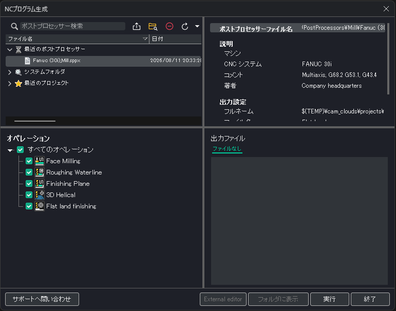
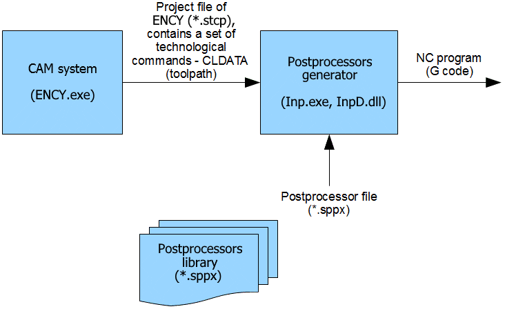

# Geração de código NC

A geração de programas NC é realizada por um pós-processador que transforma os comandos CLDATA de um caminho de ferramenta calculado no formato do sistema CNC selecionado. Os arquivos do pós-processador têm a extensão *.sppx. A saída do código CNC é realizada em um arquivo de texto padrão, de modo que pode ser facilmente transmitida do computador, onde o pacote de distribuição está instalado, para o controle CNC usando qualquer método padrão de cópia de arquivos e pastas.

Para gerar o código CNC, pressione o botão . O painel de geração do programa NC será exibido.

Aqui você pode selecionar o pós-processador necessário e executá-lo para obter um programa NC. Se a lista não contiver o pós-processador desejado, tente selecionar outra **Folder** com arquivos de pós-processador usando os controles apropriados na parte superior do painel. As informações gerais sobre o pós-processador selecionado são exibidas no canto inferior esquerdo do painel.

No campo `Arquivo de saída`, digite o nome e o caminho do arquivo para o qual o programa NC deve ser enviado.

Use o botão suspenso para ver a lista de arquivos de programas NC anteriores ou selecione a saída do programa NC para a mesma pasta do projeto ou para a pasta padrão. A pasta padrão é definida na [janela de configurações do sistema](90.md).

Para iniciar a geração do programa NC para o sistema CNC selecionado, pressione o botão **Executar**. Na versão completa do programa, o código NC é gravado no arquivo de saída e, se selecionado, na janela do pós-processador. Na versão de demonstração, a saída para um arquivo não será executada e somente as últimas cadeias de caracteres do programa NC serão exibidas na janela do pós-processador.

Observe que o pós-processador só cria código NC para as operações de usinagem calculadas que estão "ativadas" (ícone de status ,  ou  na [janela da lista de processos de usinagem](293.md)) e que também têm a propriedade `Gerar código NC` definida no momento em que o pós-processador é executado (a árvore de operações abaixo da lista do pós-processador).

> Note:
>
> Para gerar vários programas NC para diferentes operações, use a árvore de operações para ativar ou desativar a geração de código NC para operações e, em seguida, execute o pós-processador para criar os programas NC separados. Observe que a propriedade "Gerar código NC" é uma propriedade da operação. Ela será salva no projeto e nas configurações padrão de **User operations**.

Se algumas operações tiverem a propriedade `Gerar código NC` desativada, a indicação  ficará visível. O nó raiz  marca ou desmarca todas as operações habilitadas na árvore de tecnologia.

O sistema de pós-processamento é um módulo padrão separado e pode, se necessário, ser executado separadamente do sistema CAM.

. O nome do arquivo executável é - Inp.exe. Os [arquivos de ajuste do pós-processador para sistemas CNC](730.md) são criados e editados usando o `Gerador de pós-processadores` (INP.exe).

