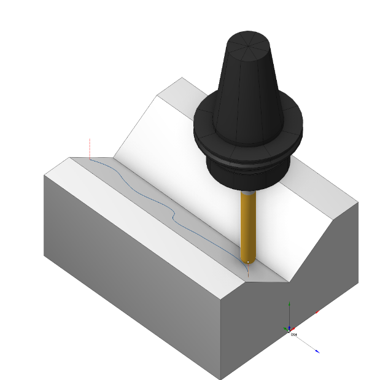

# 3D輪郭

## 適用分野：

このオペレーションは、任意の空間曲線に沿った加工を行うために設計されています。加工は、工具による一連の3Dパスによって行われます。各パスは、Z方向のステップ値に基づいてZ方向にオフセットして生成されます。各パスの数やZ方向のオフセット量は、加工深さおよびパラメータページで設定したステップ値によって決まります。

## セットアップ：

<strong>セットアップ</strong>タブでは、プロジェクトの主要なパラメータの設定を行います。これには、装置上の部品の位置決め、部品の座標系などが含まれます。[詳細を見る](1022.md)

## ジョブ割り当て:

<strong>カーブ</strong> 曲線に沿った加工順序を設定します<strong>。</strong>[詳細を見る](707.md)

<strong>タブを追加</strong> 輪郭に沿ってタブを追加します。[詳細を見る](102012.md)

<strong>プロパティ</strong> 要素のプロパティを表示します。残し代を追加することも可能です。また、リスト内の項目をダブルクリックすることでも、このメニューを表示できます。

<strong>削除</strong> リストから項目を削除します。

<strong>制限</strong> 加工してはならない領域を制限することができます。[詳細を見る](101231.md)

## 加工設定：

<strong>加工設定</strong>の主なパラメータは、<strong>2D輪郭の項目</strong>で説明されています。[詳細を見る](404.md)

## パラメータ:

このタブには、部品、ワーク、治具、およびその他の軌跡に影響を与える要素を制御するための主要なパラメータが含まれており、ツールパスを変更できます。 [詳細を見る](100112.md)

## リンク／リード

リンク／リードタブでは、早送り動作のパラメータを設定します。これには、工具交換位置からの工具アプローチ、切削パス開始点までの位置決め、最終切削後の退避、加工パス間の移動、および工具交換位置への復帰が含まれます。座標軸に沿った移動順序、移動軌跡、および移動量を設定することができます。

拡大

<strong>次の項目で構成されます。</strong>

<strong>アプローチ／リターン</strong> このパラメータグループは、工具交換位置から進入動作開始位置への工具の移動、および復帰の動作を制御します。[詳細を見る](https://confluence.encycam.com/pages/viewpage.action?pageId=131904799)

<strong>安全な動作</strong> 安全サーフェスのタイプとワークから安全サーフェスまでの距離を定義します。加工面またはツールパス間の移行を円滑にし、アプローチまたはリターンの最初の段階はこの面に向かって行われます。[詳細を見る](https://confluence.encycam.com/display/SC1/.Safe+Motions+v19)

<strong>高度なリンク設定</strong> このパラメータグループは、主に5軸加工において、回転軸の最適な動きを考慮した軌道形成方法を設定します。[詳細を見る](100118.md)

<strong>リンク</strong> 進入／退出リンクおよび加工動作間のリンクに関するルールを設定します。[詳細を見る](https://confluence.encycam.com/display/SC1/.Links+for+countouring+operations+v19)

<strong>リード</strong> 加工動作に対して、送り速度を使用して追加の進入および退避の動作を設定できます。

<strong>距離</strong> リンクのルールで使用される距離です。 [詳細を見る](https://confluence.encycam.com/display/SC1/.Distance+for+3D+operations+v19)

## 送り速度設定

このダイアログを使用して、主軸回転速度、早送り速度、およびツールパスの各領域の送り速度を設定できます。主軸回転速度は、毎分回転数または切削速度のいずれかで設定できます。設定値には下線が表示されます。もう一方の値は、工具径を考慮し、設定値に基づいて再計算されます 。[詳細を見る](100142.md)

## 変換：

オペレーション内で計算された工具軌跡に対して座標変換を行うためのパラメータグループです 。[詳細を見る](10168.md)

## パーツ：

パーツは、干渉をチェックする空間を定義する幾何要素のグループです 。[詳細を見る](330.md)

## ワーク：

加工のワークモデルでは、加工する素材を定義します 。[詳細を見る](738.md)

## 治具：

治具には通常、チャック、グリップ、クランプなどの固定補助具と、その他の種類の制限領域を指定します 。[詳細を見る](10283.md)
