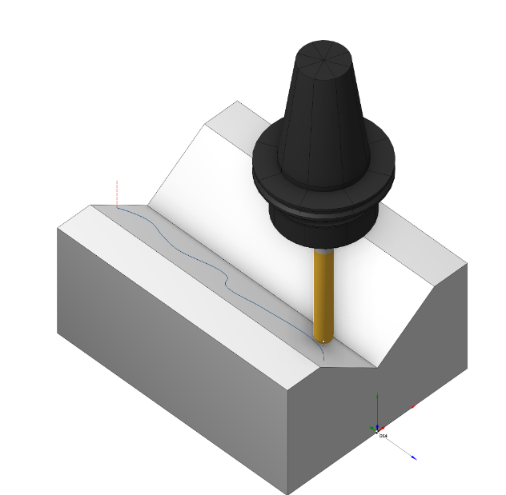

# Contornatura 3D

## Ambito di applicazione:

Questa operazione è destinata all'esecuzione di lavorazioni lungo qualsiasi curva spaziale. La lavorazione viene eseguita in una serie di passate 3D dell'utensile. Le passate vengono create con uno scostamento in Z l'una dall'altra in base al valore del passo Z. Il numero di passate e il loro scostamento in Z dipendono dai livelli di lavorazione e dal valore del passo inseriti nella pagina dei parametri.

### Configurazione:

La scheda <strong>Setup</strong> (configurazione) serve a impostare i parametri principali del progetto. Ciò può comprendere il posizionamento del pezzo sull'attrezzatura, il sistema di coordinate del pezzo e altro. [Dettagli](1022.md)

### Assegnazione del lavoro:

<strong>Curve.</strong> Imposta l'ordine di lavoro lungo la curva <strong>.</strong> [Dettagli](707.md)

<strong>Add tabs<strong>.</strong></strong> Aggiunge ponticelli (di tenuta) lungo il contorno.[Dettagli](102012.md)

<strong>Properties.</strong> Visualizza le proprietà di un elemento. È possibile aggiungere il sovrametallo. Questo menu può essere richiamato anche facendo doppio clic su una voce dell'elenco.

<strong>Delete.</strong> Rimuove una voce dall'elenco

<strong>Restrictions.</strong> Consente di limitare le zone che non devono essere lavorate. [Dettagli](101231.md)

### Strategia:

I parametri principali dell'operazione <strong>Strategy</strong> (strategia) sono descritti nella <strong>sezione Contornatura 2D</strong> (2D contour). [Dettagli](404.md)

### Parametri:

Questa scheda contiene i parametri principali per il controllo del pezzo, del grezzo, delle attrezzature e di altri elementi, che consentono di modificare il percorso utensile. [Dettagli](100112.md)

### Collegamenti/Attacchi:

Nella scheda Links/Leads si definiscono i parametri dei movimenti rapidi. Tali movimenti comprendono l'avvicinamento dell'utensile dalla posizione di cambio utensile, l'attacco all'inizio della corsa di lavoro, la retrazione dopo l'ultimo movimento di taglio, le transizioni tra le passate di lavoro e il ritorno al punto di cambio utensile. È possibile configurare la sequenza dei movimenti lungo le coordinate, la traiettoria di tali movimenti e l'entità degli spostamenti.

Fare clic qui per espandere..

<strong>Comprende:</strong>

<strong>Approach/Return.</strong> Questo gruppo di parametri gestisce i movimenti dell'utensile dalla posizione di cambio utensile all'inizio dei percorsi di attacco, e il ritorno. [Dettagli](100116.md).

<strong>Safe motions.</strong> Definisce il tipo di superficie di sicurezza (Safety Surface) e la distanza dal grezzo a tale superficie. Questa superficie agevola le transizioni tra le superfici lavorate o i percorsi utensile, e la prima fase di avvicinamento o di ritorno avviene verso di essa. [Dettagli](100117.md).

<strong>Advanced links settings.</strong> Questo gruppo di parametri specifica le caratteristiche della formazione del percorso utensile, principalmente per le operazioni a cinque assi, tenendo conto dei movimenti ottimali degli assi rotanti. [Dettagli](100118.md).

<strong>Links.</strong> Definisce le regole che governano i collegamenti di entrata/uscita e i collegamenti tra i movimenti di lavoro. [Dettagli](100132.md).

<strong>Leads.</strong> Consente di aggiungere ai movimenti di lavoro attacchi e uscite aggiuntivi utilizzando il relativo avanzamento. [Dettagli](101147.md)

<strong>Distances.</strong> Distanze utilizzate nelle regole dei collegamenti (Links). [Dettagli](100138.md)

### Avanzamenti/Velocità:

Con questa finestra di dialogo l'utente può definire la velocità di rotazione del mandrino, la velocità dei movimenti rapidi e i valori di avanzamento per le diverse zone del percorso utensile. La velocità di rotazione del mandrino può essere definita come giri al minuto oppure come velocità di taglio. Il valore determinante sarà sottolineato. Il secondo valore verrà ricalcolato rispetto al valore determinante, tenendo conto del diametro dell'utensile. [Dettagli](100142.md)

### Trasformazioni:

Insieme di parametri dell'operazione che consentono di eseguire la conversione delle coordinate per il percorso utensile calcolato all'interno dell'operazione. [Dettagli](10168.md)

### Pezzo:

Il pezzo è un gruppo di elementi geometrici che definisce lo spazio in cui verificare le intaccature. [Dettagli](330.md)

### Grezzo:

Il modello del grezzo di un'operazione definisce il materiale da lavorare. [Dettagli](738.md)

### Attrezzature:

Come attrezzature si specificano di norma i dispositivi di fissaggio quali autocentranti, griffe, staffe e simili, nonché le zone vietate di qualsiasi altra natura. [Dettagli](10283.md)
