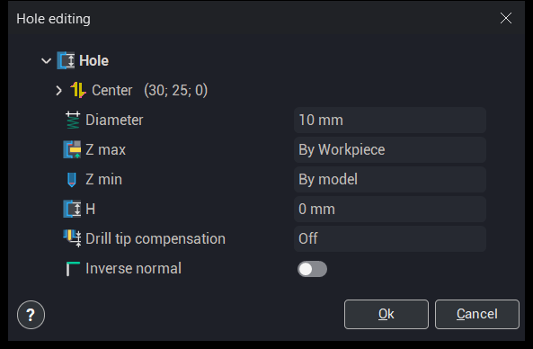
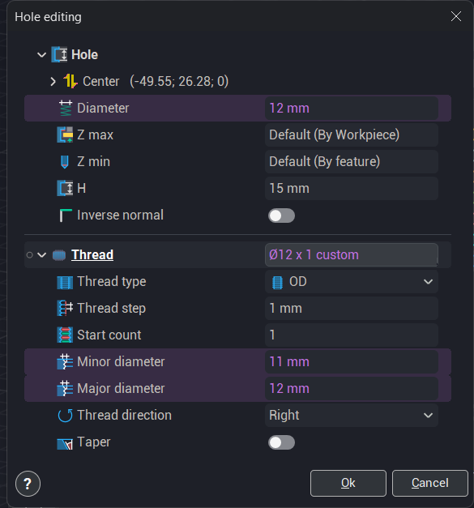
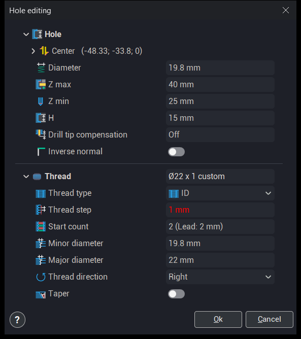
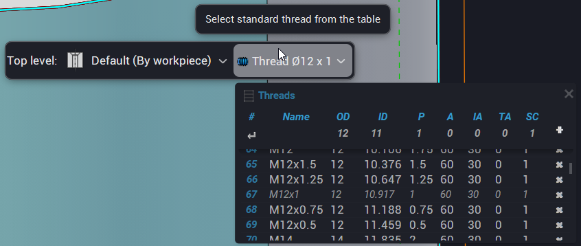

# 点要素を使った穴の定義

## 適用分野：

開いたウィンドウでは、新しい穴または既存の穴のパラメータを設定します。既存の穴を編集するには、リスト内の対象の穴をダブルクリックするか、<strong>プロパティ</strong>コマンドを使用します。<strong>Hole editing</strong>（穴の編集）ウィンドウが開きます。

### 穴の作成と編集

穴を作成するには、ユーザーはパラメータ（位置、直径、深さ）の値を設定し、**Ok**ボタンをクリックします。作成された穴は自動的にリストに追加されます。

穴のパラメータを変更すると、その変更内容がグラフィックウィンドウ上に表示されます。

### 穴のパラメータ

<strong>Hole editing</strong>（穴の編集）ウィンドウには、<strong>Hole creation</strong>（穴の作成）ウィンドウと同じパラメータが含まれています。[詳細](406.md)

<strong>中心</strong> 穴の中心の座標が、1行に<em>(X; Y; Z)</em>として表示されます。行を展開すると座標を編集できます。

<strong>Inverse normal</strong>（法線の反転） 穴の穴あけ方向を反転します。

### 複数の穴の編集

複数の穴を一度に編集するには、リストで穴を選択して<strong>プロパティ</strong>コマンドを使用します。ウィンドウには、<strong>ねじ</strong>グループを含む、選択したすべての穴のパラメータが表示されます。選択した穴でパラメータの値が異なる場合、そのパラメータは紫色で強調表示されます。ウィンドウで入力した値は、選択したすべての穴に適用されます。

### ねじ

<strong>ねじ</strong>グループは、オペレーションで<strong>ねじ切りフライス加工</strong>の穴加工タイプを使用する場合に表示されます。このグループでは、穴のねじを定義します。加工ストラテジはオペレーションのすべての穴に共通で、<strong>加工設定</strong>タブで設定します。[詳細](10100.md)

<strong>ねじ</strong> この行には、ねじの呼びとねじデータのソースが表示されます。

- <strong>custom</strong>（カスタム） – ねじデータを手動で入力します。
- <strong>from CAD model</strong>（CADモデルから） – ねじはCADモデルから取得され、ねじデータは読み取り専用です。もう一度選択すると、モデル内の検索が再実行されます。モデルにこの穴のねじが含まれている場合に使用できます。
- <strong>from library</strong>（ライブラリから） – ねじライブラリからねじを選択します。その後で呼びを変更すると、ソースは<strong>custom</strong>になります。

<strong>ねじタイプ</strong> ねじがめねじ(<strong>ID</strong>)かおねじ(<strong>OD</strong>)かを指定します。

<strong>ねじピッチ</strong> 隣接するねじ山の間の距離です。長さ、単位長さあたりのねじ山数で設定するか、工具から取得します(<strong>From tool</strong>)。オペレーションのねじ切りフライスが複数列の刃を持ち、その刃のピッチがねじピッチと異なる場合、値は赤色で強調表示されます。このようなフライスは自身のピッチしか加工できません。ねじの条数は関係ありません。オペレーションの計算でも同じエラーが報告されます。

<strong>開始数</strong> ねじの条数です。括弧内にリードが表示されます。多条ねじの場合、リードはピッチに条数を乗じた値になります。

<strong>Minor diameter</strong>（最小径） ねじの内側（最小）の直径です。

<strong>Major diameter</strong>（最大径） ねじの外側（最大）の直径です。ねじの深さは、最大径と最小径の差の半分です。

<strong>ねじの方向</strong> ねじの種類：<strong>右</strong>または<strong>左</strong>。

<strong>テーパー</strong> テーパーねじを有効にし、テーパー角度を設定します。

#### グラフィックウィンドウでのねじの選択

標準ねじは、グラフィックウィンドウで選択することもできます。穴の上部高さをクリックすると、アクションパネルに<strong>上部高さ</strong>モードと、穴の現在のねじが表示された<strong>ねじ</strong>ボタンが表示されます。<strong>ねじ</strong>ボタンをクリックして<strong>Threads</strong>（ねじ）テーブルを開き、ねじを選択します。選択したねじによって、穴のねじの呼び、ピッチ、条数、最小径、最大径、およびテーパーが設定されます。このボタンは、オペレーションで<strong>ねじ切りフライス加工</strong>の穴加工タイプを使用する場合に使用できます。

