# カーブ

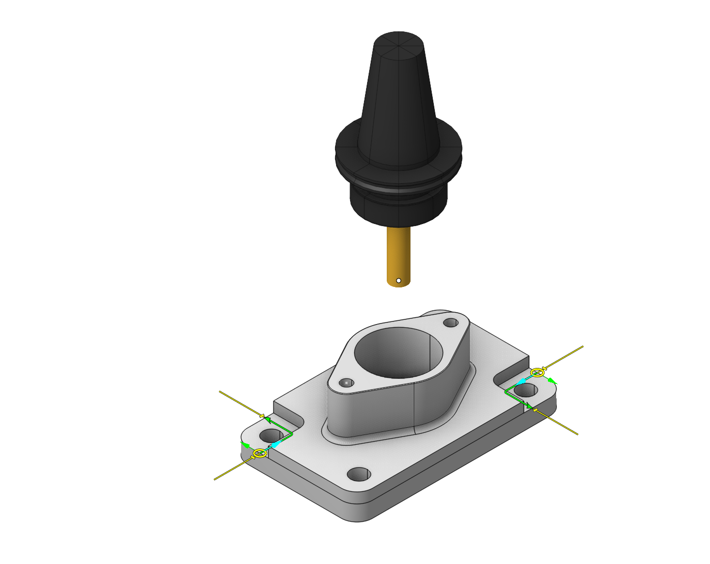

## 適用分野：

2Dおよび3D輪郭加工は、指定したカーブ、エッジ、面、またはポケットに基づいて平面ツールパスを作成するためのシンプルかつ強力なサイクルです。<strong>基準サーフェス</strong>を定義することで、円筒サーフェスや回転サーフェス上のツールパスを生成することもできます。 <strong>パーツに投影</strong>機能を使用すると、生成されたツールパスをパーツ上に投影することができます。また、<strong>工具軸方向</strong>モードを指定することで、パーツまたは基準サーフェスに対する法線によって4軸および5軸ツールパスを生成することができます。

<strong>カーブの選択方法の詳細は、対応するセクションで確認できます</strong>。[詳細を見る](10029.md)

### カーブの作業

<strong>1. 新しい輪郭を追加するには</strong>、加工する曲線、エッジ、または垂直フェイスを選択し、**Curve**ボタンを押してジョブ割り当てに追加します。接続された要素は、輪郭として結合されます。

輪郭 緑色の線は、CLDataに出力される曲線を表しています。 アプローチは黄色でマークされています（ インタラクティブ操作、また[リンク/リード](100115.md)ページで変更することができます ）。

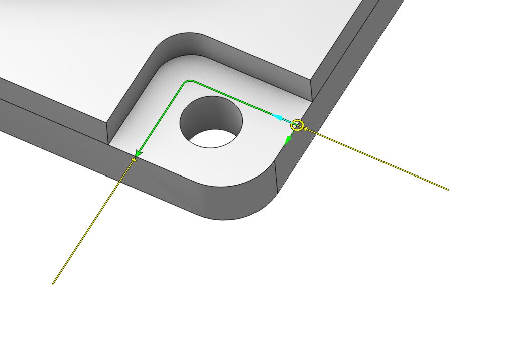

輪郭が補正され、<strong>径補正</strong>が<strong>制御機</strong>に設定されている場合、工具中心曲線（工具が移動する曲線）を示す追加の破線が表示されます。

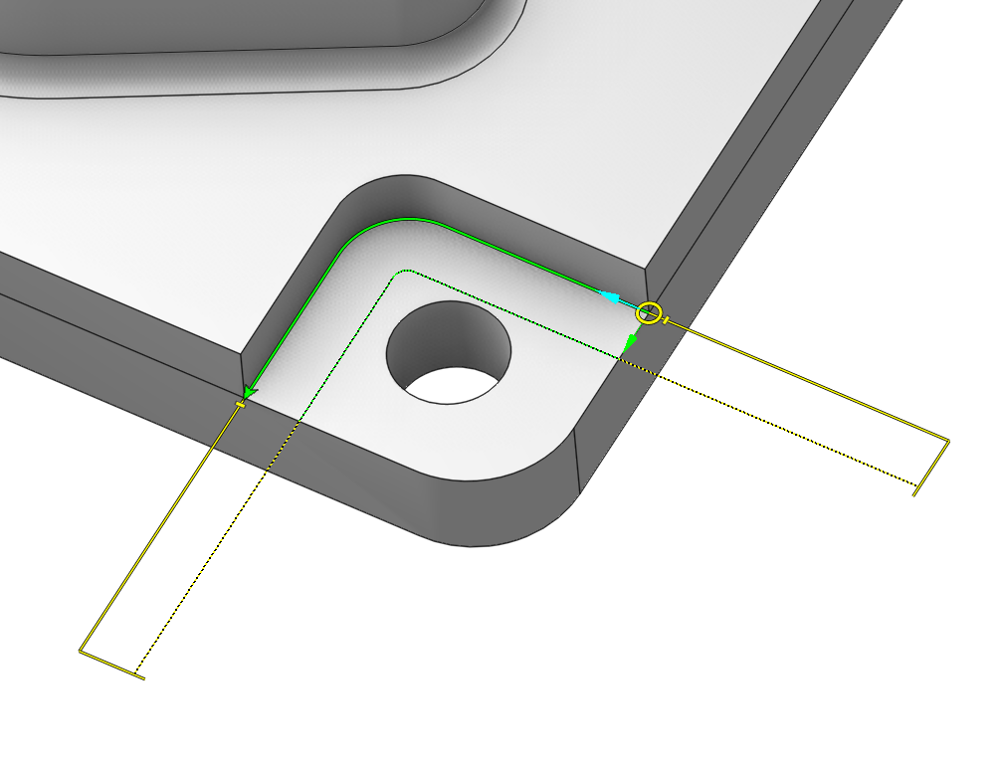

<strong>輪郭パラメータにアクセスするには</strong> 、グラフィックビューの輪郭を左クリックします。アクションバーが表示されます。 ここでは、輪郭の<strong>補正</strong>フラグおよび<strong>リターン付き加工</strong>フラグを切り替えることができます。閉じた輪郭の場合は、 <strong>開始点を固定</strong>フラグも切り替えることができます。

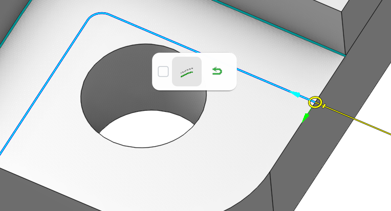

複数の輪郭のパラメータをまとめて変更

これを行うには、複数の輪郭を選択し、そのうちの1つのパラメータを編集します。1つの輪郭のパラメータを変更すると、その変更は選択されているすべての輪郭に適用されます。このようにして、 <strong>補正</strong>フラグ、 <strong>リターン付き加工</strong>フラグ、 <strong>開始点を固定</strong>フラグ、輪郭方向、輪郭側面を変更することができます。

複数の輪郭を選択する

- 複数の輪郭を選択するには、キーボードの[<strong>Ctrl</strong>]キーを押しながらマウスで選択します。
- ジョブ割り当てのすべての輪郭を選択するには、グラフィックビューで任意の輪郭をダブルクリックします。
- 特定の条件で輪郭を選択するには、まず輪郭をクリックし、表示されるアクションバーのチェックボックスをクリックして、表示されるプロパティツリーで条件を指定します。

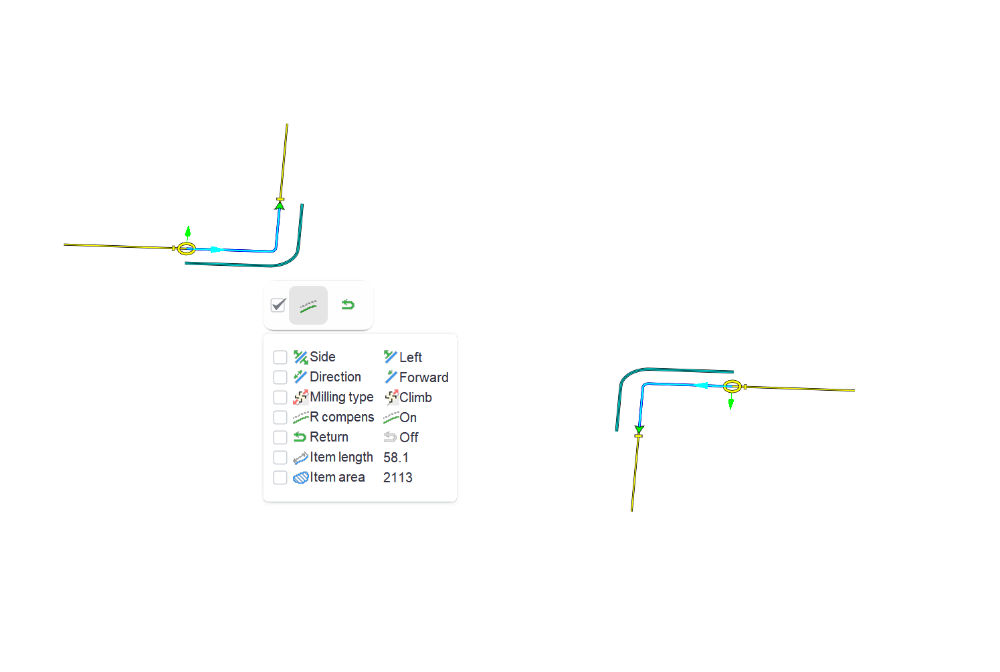

2. <strong>輪郭開始点</strong> (黄色の円) 開始点の位置を変更するには、マウスでドラッグします。また、X寸法とY寸法で開始点位置を変更することもできます。点を左クリックし、表示される寸法を編集できます。

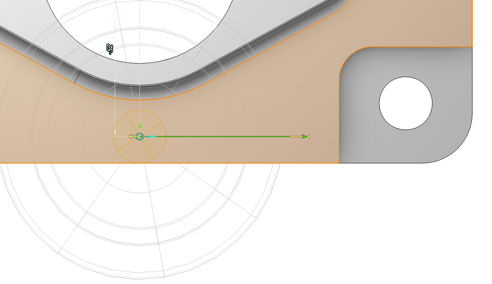

3. <strong>輪郭の終了点</strong> (開いた輪郭は緑の矢印、閉じた輪郭は黄色の円の中央にある黄色の点) マウスで終点をドラッグし、X、Y寸法で位置を変更することができます。

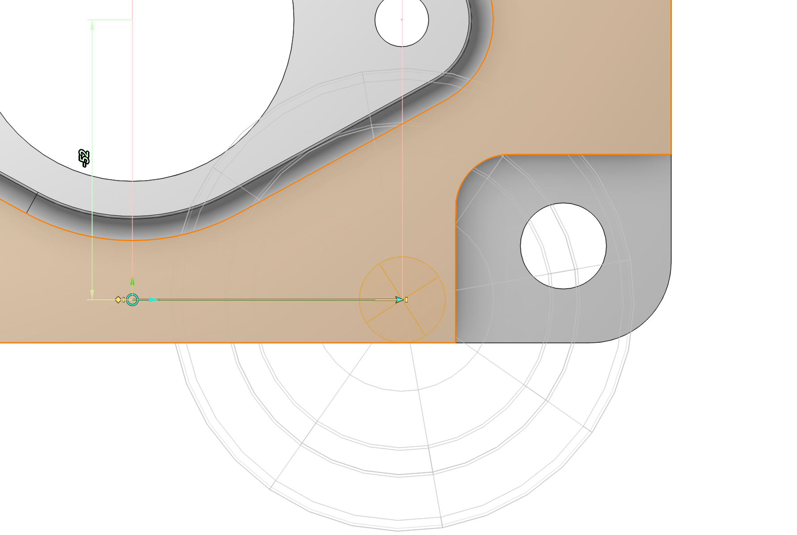

閉じた輪郭のデフォルトの開始点位置は<strong>自動</strong>です。これは、ツールパス生成中に、操作によって点の位置が決定されることを意味します。自動開始点と通常の開始点は、その視覚的な表現で区別できます。自動開始点は内側に黄色い点のない状態で表示され、通常の開始点は内側に黄色い点が表示されます。

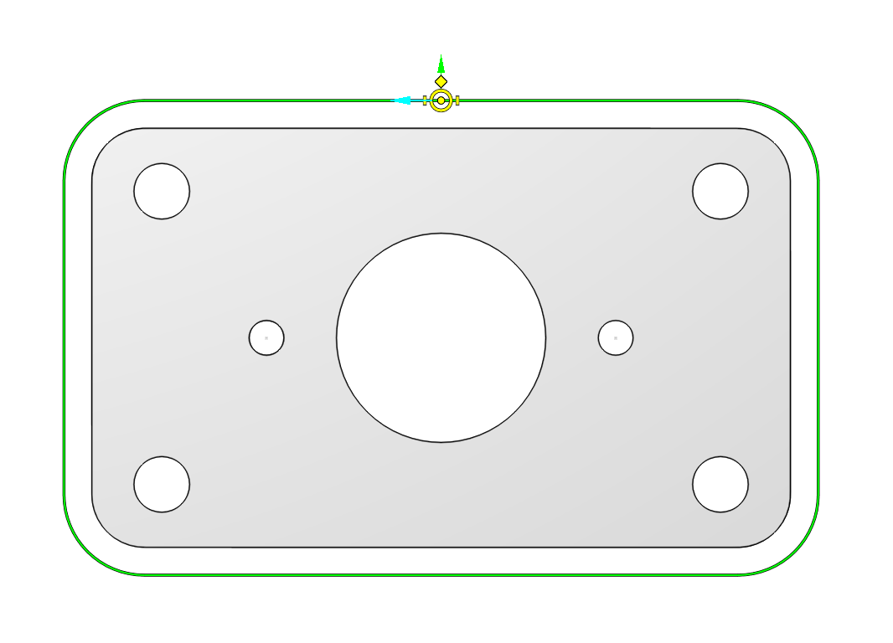 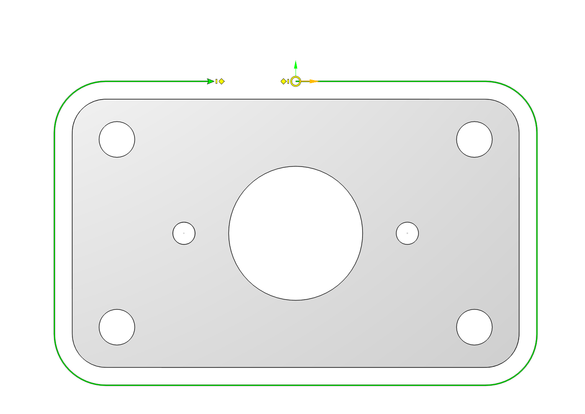

4. <strong>輪郭方向</strong>。上図では、開始点に付いた水色の矢印で示します。矢印をクリックすると輪郭方向を変更できます。方向矢印は水色またはオレンジ色で表示され、その色によって輪郭のミーリングモードを示します。水色はダウンカット、オレンジ色はアップカットです。

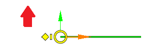 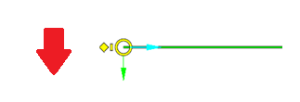

5. <strong>輪郭加工側</strong> 上図において輪郭の開始点に付いているライム色の矢印です。加工側を変更するには、この矢印をクリックします。

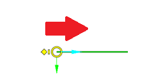 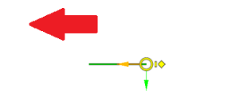

6. <strong>輪郭のオーバーラップ</strong>。上図では、輪郭の開始点と終点の横にある黄色い短線で示します。オーバーラップは、輪郭の外側までツールパスを延長するために使用します。黄色い短線をドラッグするか、クリックして表示される寸法値を編集すると、オーバーラップ量を変更できます。

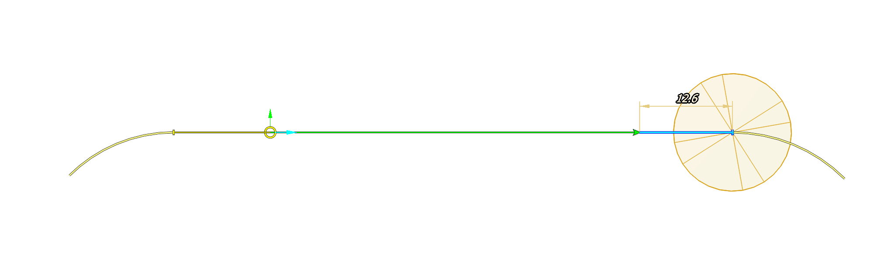

ワンクリックで複数のオーバーラップを編集

オーバーラップパラメーターを編集すると、選択されたすべてのオーバーラップに変更が適用されることに注意してください。複数の重なり部分を編集する作業を迅速かつ簡単にするために、CAMシステムは同一のオーバーラップを自動的にハイライトし、選択します。この機能はいつでも無効にできます。グラフィックビュー上部の“魔法の杖”ボタンをクリックしてください。

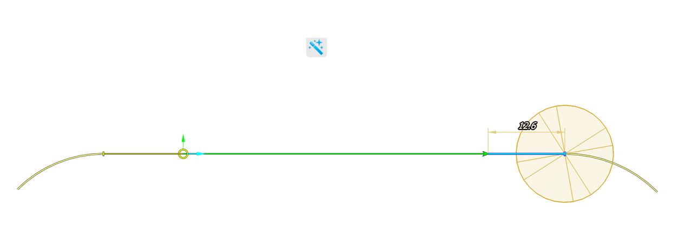 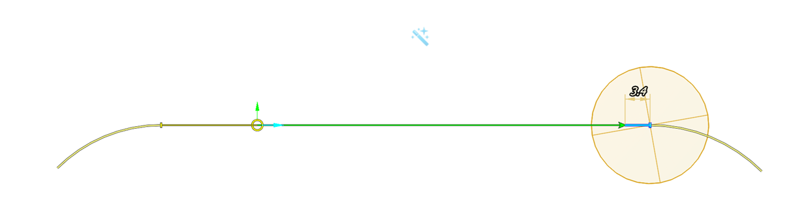

条件に基づいてオーバーラップを選択するには、オーバーラップをクリックし、次に表示されるアクションバーのチェックボックスをクリックし、オーバーラップを選択したい条件にチェックを入れます。

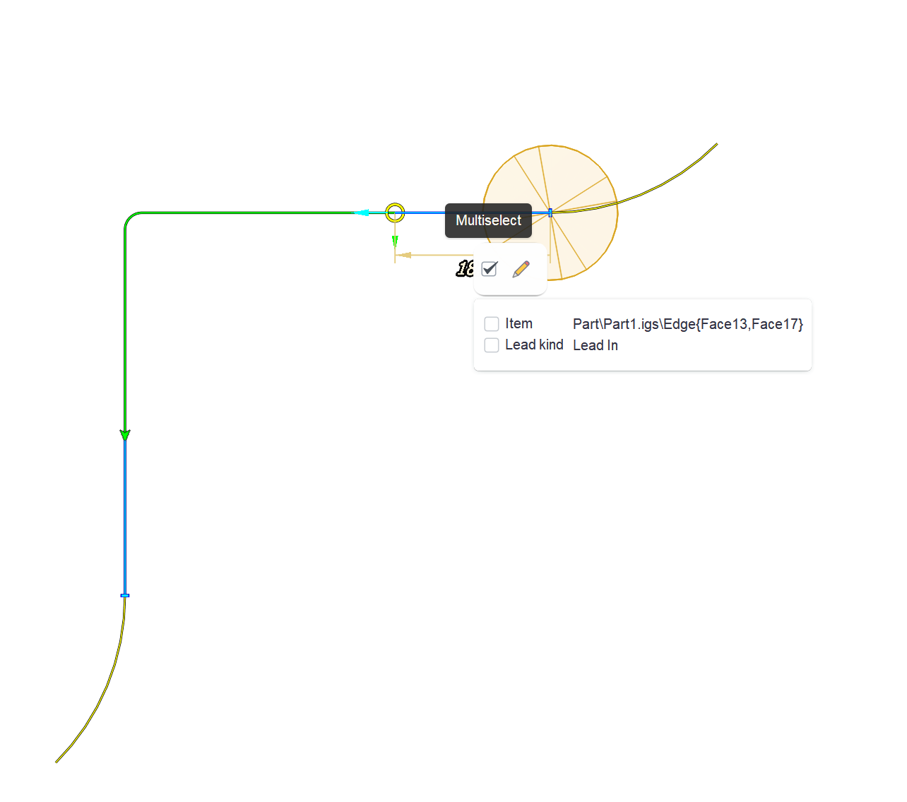

7. <strong>輪郭のリード</strong> 上記画像に表示されている黄色のダイヤです。リードを変更するには、対応するダイヤをマウスでドラッグします。その後、表示されたリード寸法を編集することができます。

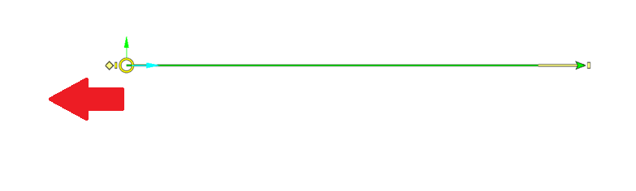 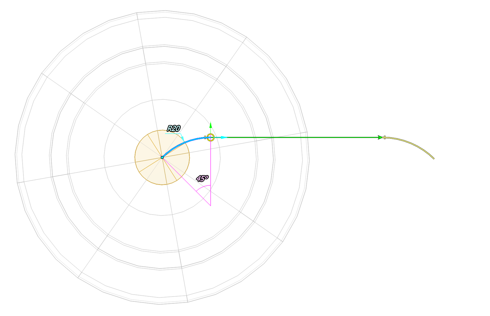

リードは3種類あります。 <strong>なし</strong>、 <strong>直線</strong> 、 <strong>円弧</strong>です。リードタイプを変更するには、リードを左クリックし、表示されるアクションバーからリードタイプを選択します。

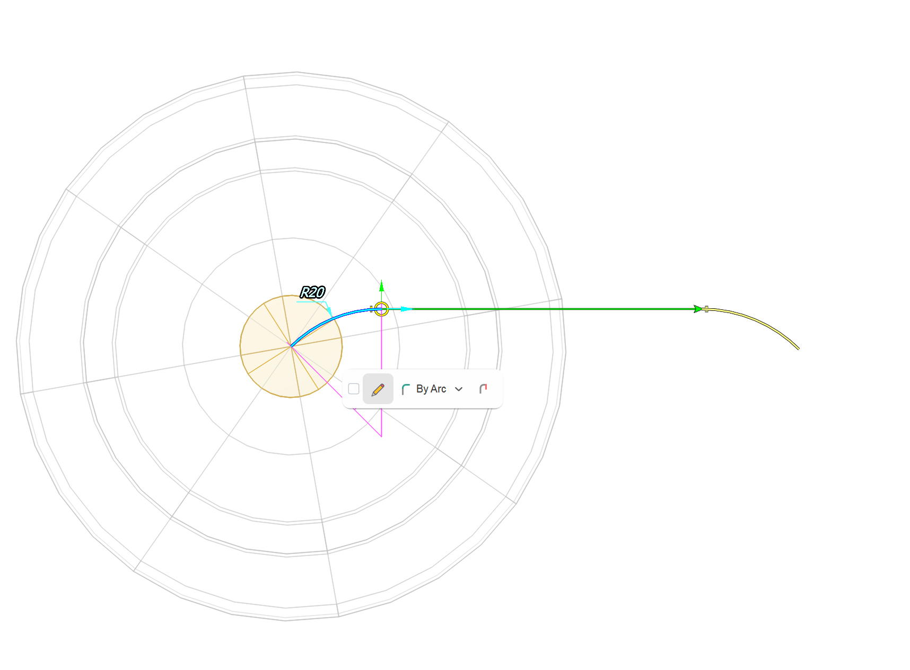

<strong>補正された</strong>輪郭と<strong>制御機</strong>径補正では、追加の破線が表示されます。この直線は工具中心曲線を表します。リード寸法は工具中心曲線のために指定されます。これにより、リードパラメーターは現在の補正タイプに依存しなくなります。ドラッグアンドドロップ操作で補正されたリードのサイズを変更したい場合は、補正されていないリードの曲線の終了点ではなく、工具中心曲線の終了点の黄色い点をクリックしてください。

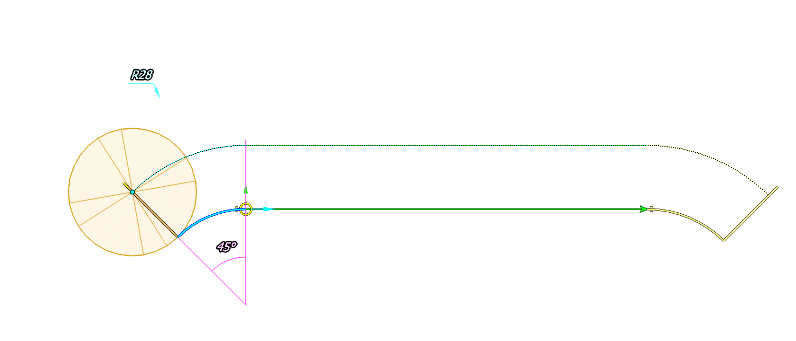

ワンクリックで複数のリードを編集

リードパラメータを編集すると、選択したすべてのリードに変更が適用されます。複数のリードを編集する作業を迅速かつ簡単にするために、CAMシステムは同一のリードを自動的にハイライトし、選択します。グラフィックビューの上部にある魔法の杖ボタンをクリックすれば、この動作を無効にすることができます。特定の1つのリードのみを選択するには、そのリードを2回クリックします。条件に基づいてリードを選択するには、まず1つのリードをクリックし、表示されるアクションバーのチェックボックスをクリックして、リードを選択したい条件を指定します。

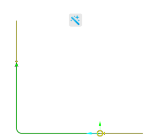 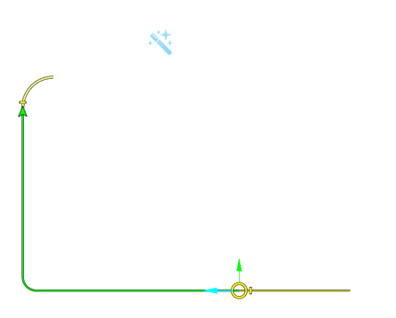

8. <strong>輪郭進入線</strong> 進入線は、<strong>補正タイプ</strong>が<strong>コンピューター</strong>以外の場合、補正された輪郭のリードに自動的に追加されます。これらは、補正切替線の役割を果たします。進入線は<strong>「直線」</strong>リードに沿って追加されません。これは不要のためです。ただし、リードをクリックして表示されるアクションバーの<strong>進入線を使用</strong>ボタンをチェックすることで、明示的に進入線を切り替えることもできます。

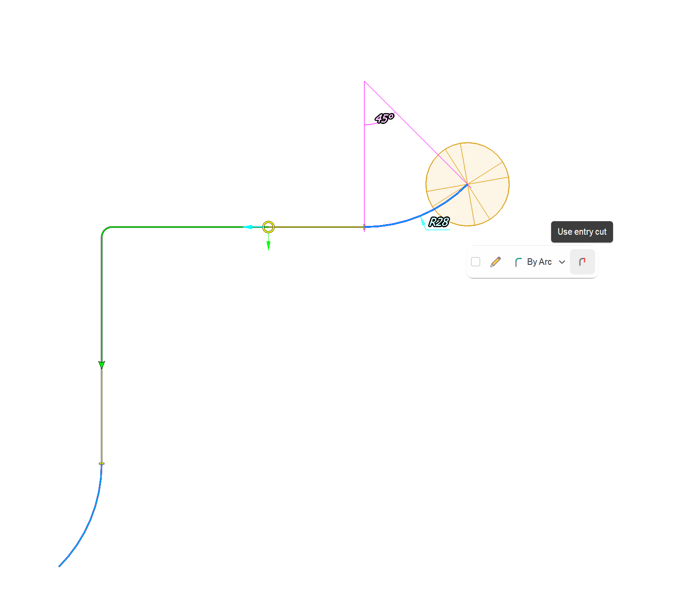 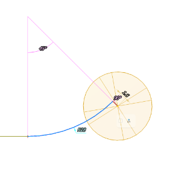

以下は、<strong>制御機</strong>径補正を使った進入線の例です。

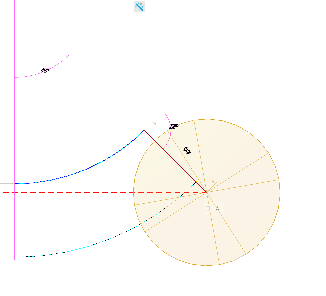

<strong>9. 輪郭オフセット/径補正</strong>

輪郭径補正は、一般的に、パーツラインの曲線（エッジや垂直な壁の面など）があり、このパーツラインの側面から素材を加工したい場合に使用します。 輪郭の径補正をオンにするには、グラフィックビューで輪郭を選択し、表示されるアクションバーの <strong>補正</strong>ボタンをクリックします。輪郭のオフセット半径には、デフォルトで工具の最大半径が使用されます。ただし、工具パラメータで工具接触点を明示的に指定することもできます。この場合、輪郭オフセット距離は工具接触点から取ります。

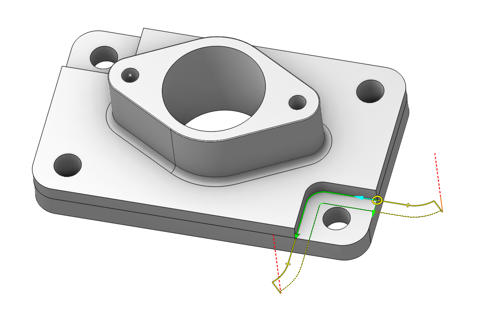

径補正の方法は、オペレーションパラメータ<strong>径補正</strong>によって決定されます。パラメータインスペクターまたはオペレーションパラメータウィンドウで選択できます。例：2D輪郭の場合 - 出力 [詳細を見る](404.md)
