# カーブ

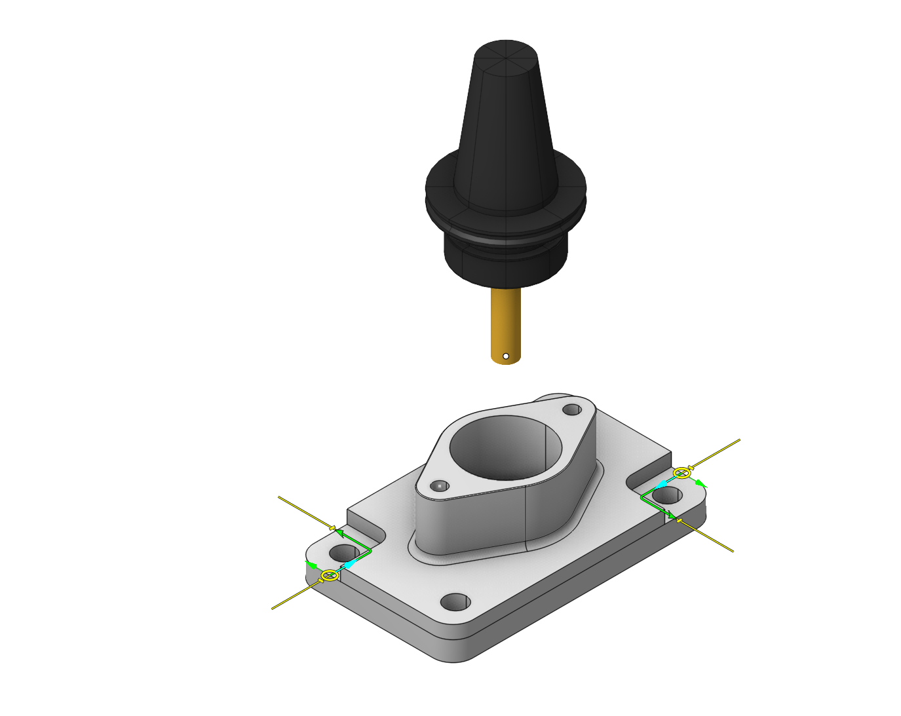

## 適用分野：

2Dおよび3D輪郭加工は、指定したカーブ、エッジ、面、またはポケットに基づいて平面ツールパスを作成するためのシンプルかつ強力なサイクルです。<strong>基準サーフェス</strong>を定義することで、円筒サーフェスや回転サーフェス上のツールパスを生成することもできます。 <strong>パーツに投影</strong>機能を使用すると、生成されたツールパスをパーツ上に投影することができます。また、<strong>工具軸方向</strong>モードを指定することで、パーツまたは基準サーフェスに対する法線によって4軸および5軸ツールパスを生成することができます。

<strong>カーブの選択方法の詳細は、対応するセクションで確認できます</strong>。[詳細を見る](10029.md)

### カーブの作業

1. 新しい輪郭をジョブ割り当てに<strong>追加</strong>するには、加工したいカーブ、エッジ、または垂直面を選択し、`カーブ`ボタンを押します。接続された要素は輪郭として結合されます。

輪郭 緑色の線は、CLDataに出力される曲線を表しています。 アプローチは黄色でマークされています（ インタラクティブ操作、また[リンク/リード](100115.md)ページで変更することができます ）。

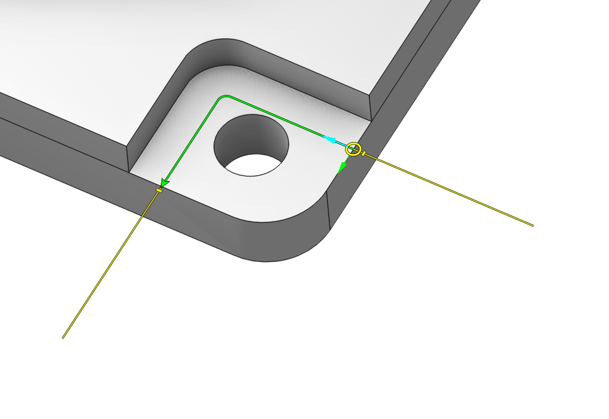

輪郭が補正され、`径補正`が`制御機`に設定されている場合、工具中心曲線（工具が移動する曲線）を示す追加の破線が表示されます。

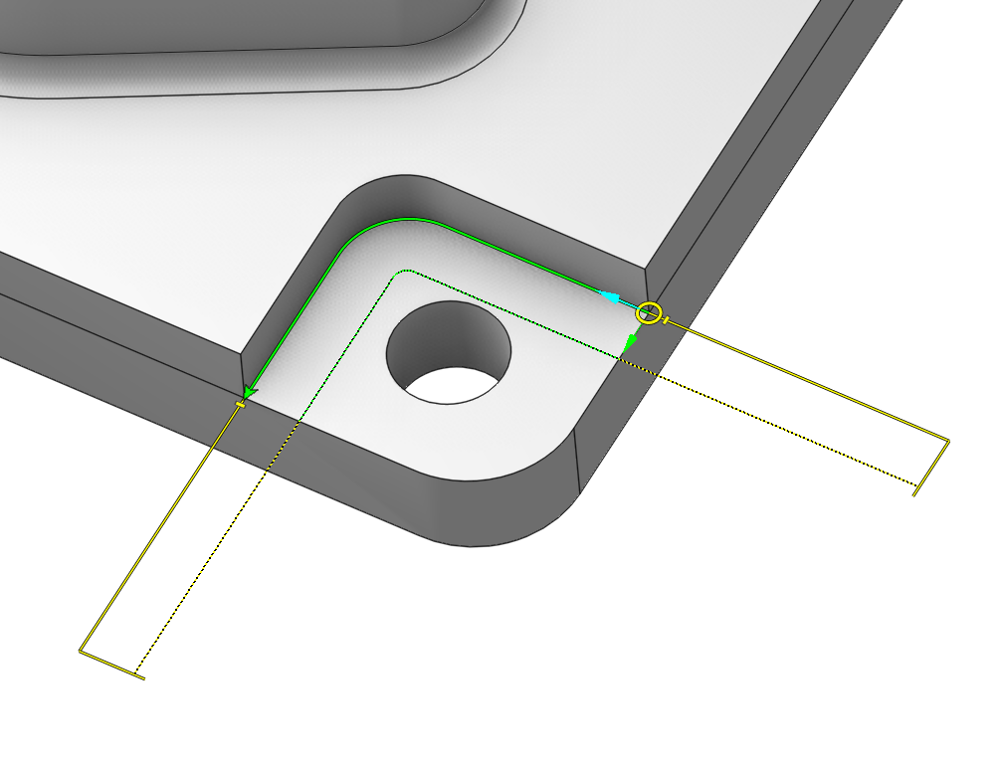

<strong>輪郭パラメータにアクセスするには</strong> 、グラフィックビューの輪郭を左クリックします。アクションバーが表示されます。 ここでは、輪郭の`補正`フラグおよび`リターン付き加工`フラグを切り替えることができます。閉じた輪郭の場合は、 `開始点を固定`フラグも切り替えることができます。

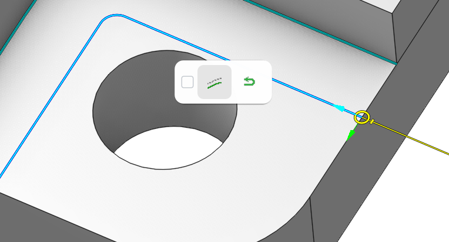

複数の輪郭のパラメータをまとめて変更

これを行うには、複数の輪郭を選択し、そのうちの1つのパラメータを編集します。1つの輪郭のパラメータを変更すると、その変更は選択されているすべての輪郭に適用されます。このようにして、 <strong>補正</strong>フラグ、 <strong>リターン付き加工</strong>フラグ、 <strong>開始点を固定</strong>フラグ、輪郭方向、輪郭側面を変更することができます。

複数の輪郭を選択する

- 複数の輪郭を選択するには、キーボードの[<strong>Ctrl</strong>]キーを押しながらマウスで選択します。
- ジョブ割り当てのすべての輪郭を選択するには、グラフィックビューで任意の輪郭をダブルクリックします。
- 特定の条件で輪郭を選択するには、まず輪郭をクリックし、表示されるアクションバーのチェックボックスをクリックして、表示されるプロパティツリーで条件を指定します。

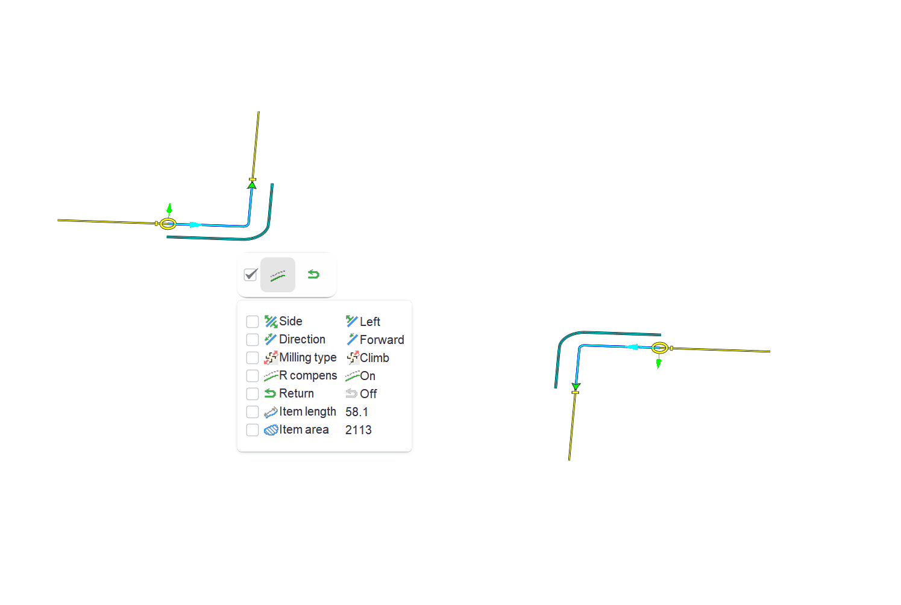

2. <strong>輪郭開始点</strong> (黄色の円) 開始点の位置を変更するには、マウスでドラッグします。また、X寸法とY寸法で開始点位置を変更することもできます。点を左クリックし、表示される寸法を編集できます。

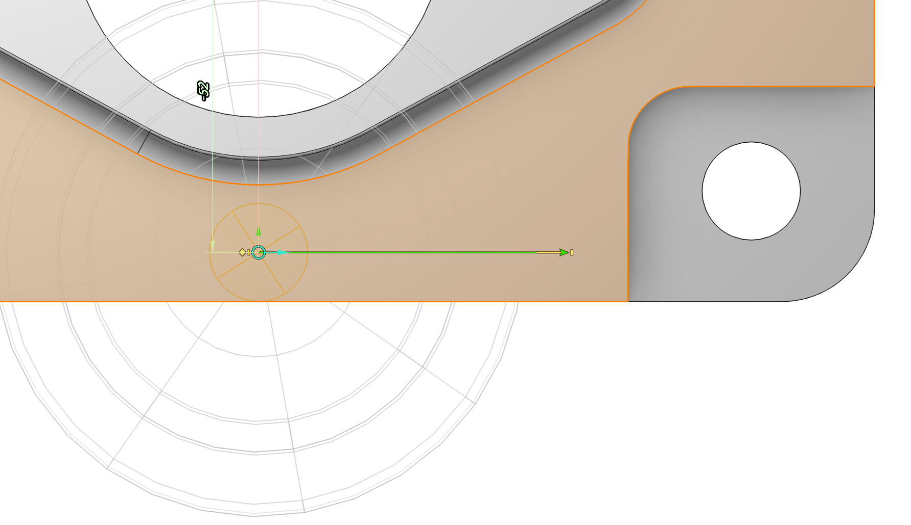

3. <strong>輪郭の終了点</strong> (開いた輪郭は緑の矢印、閉じた輪郭は黄色の円の中央にある黄色の点) マウスで終点をドラッグし、X、Y寸法で位置を変更することができます。

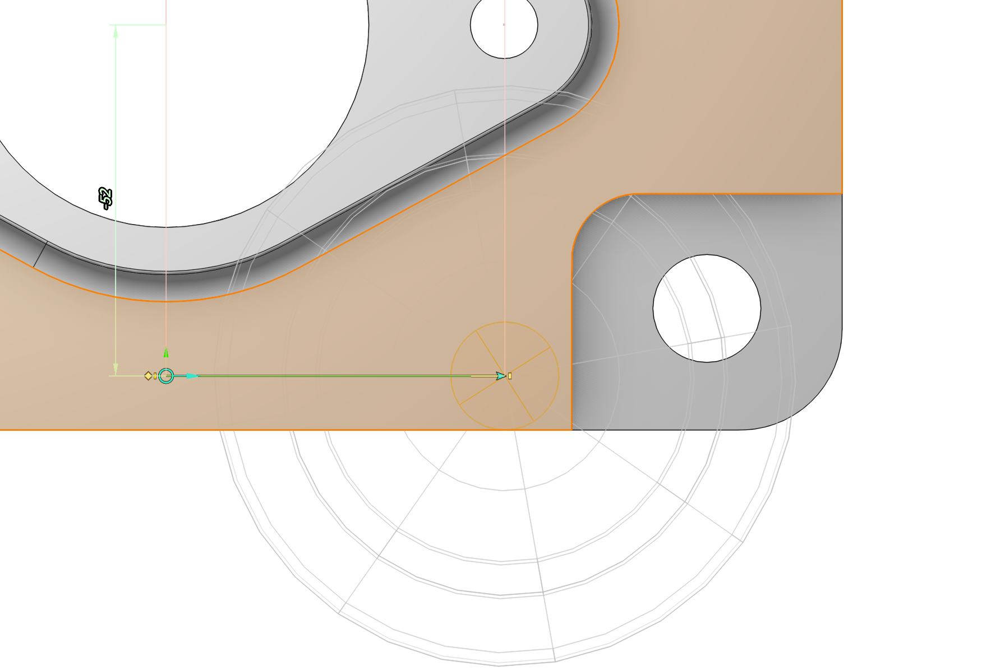

閉じた輪郭のデフォルトの開始点位置は`自動`です。これは、ツールパス生成中に、操作によって点の位置が決定されることを意味します。自動開始点と通常の開始点は、その視覚的な表現で区別できます。自動開始点は黄色の点がない状態で表示されず、通常の開始点は黄色の点が表示されます。

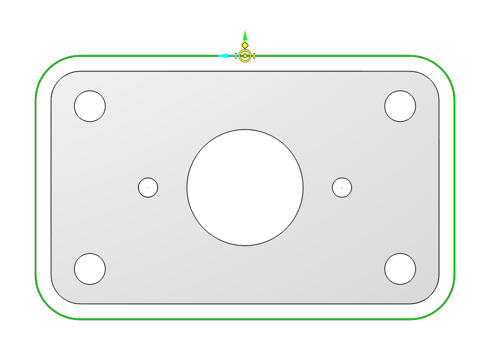 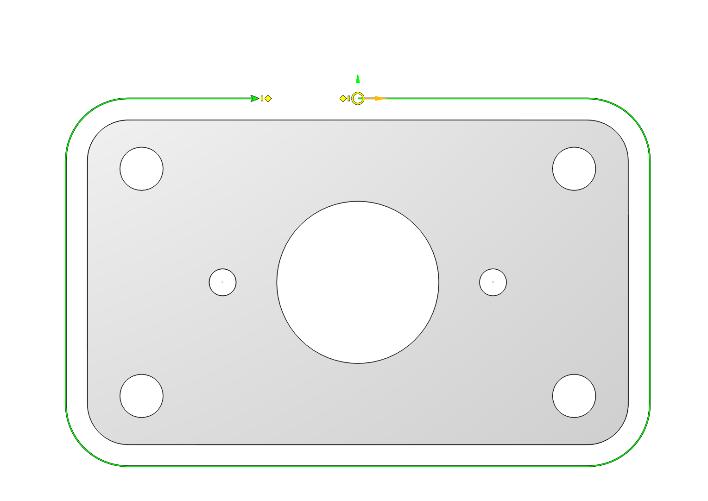

4 <strong>輪郭方向</strong> 上の画像の開始点に付けられた水色の矢印です。輪郭の方向を変更するには、この矢印をクリックしてください。矢印の色は水色とオレンジ色の2種類あります。方向矢印の色は輪郭のフライス加工モードを示します。ダウンカットの輪郭は水色、アップカットの輪郭はオレンジ色です。

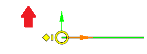 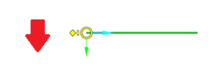

5. <strong>輪郭加工側</strong> 上図において輪郭の開始点に付いているライム色の矢印です。加工側を変更するには、この矢印をクリックします。

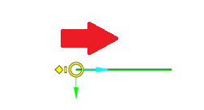 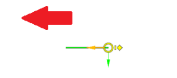

6.<strong>輪郭オーバーラップ</strong> 上図において輪郭の開始点および終了点の横に表示される黄色の破線です。オーバーラップは、ツールパスを輪郭自体よりも延長するために使用されます。オーバーラップ値を変更するには、黄色の破線をマウスでドラッグするか、クリックして表示される寸法値を編集します。

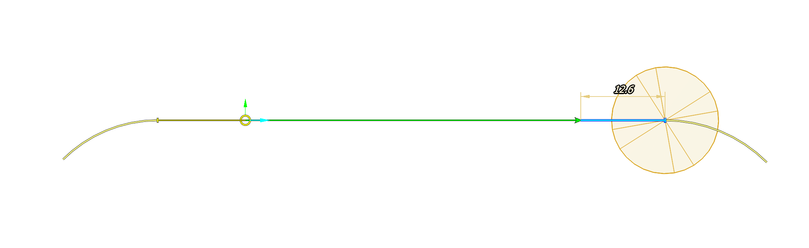

ワンクリックで複数のオーバーラップを編集

オーバーラップパラメーターを編集すると、選択されたすべてのオーバーラップに変更が適用されることに注意してください。複数の重なり部分を編集する作業を迅速かつ簡単にするために、CAMシステムは同一のオーバーラップを自動的にハイライトし、選択します。この機能はいつでも無効にできます。グラフィックビュー上部の“魔法の杖”ボタンをクリックしてください。

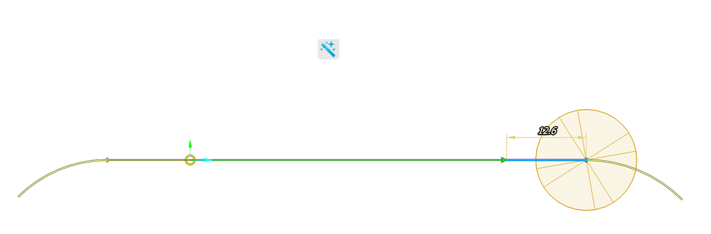 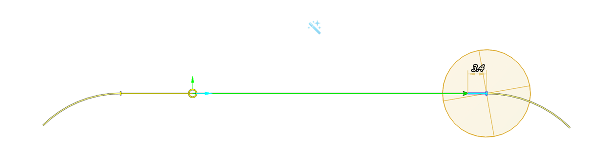

条件に基づいてオーバーラップを選択するには、オーバーラップをクリックし、次に表示されるアクションバーのチェックボックスをクリックし、オーバーラップを選択したい条件にチェックを入れます。

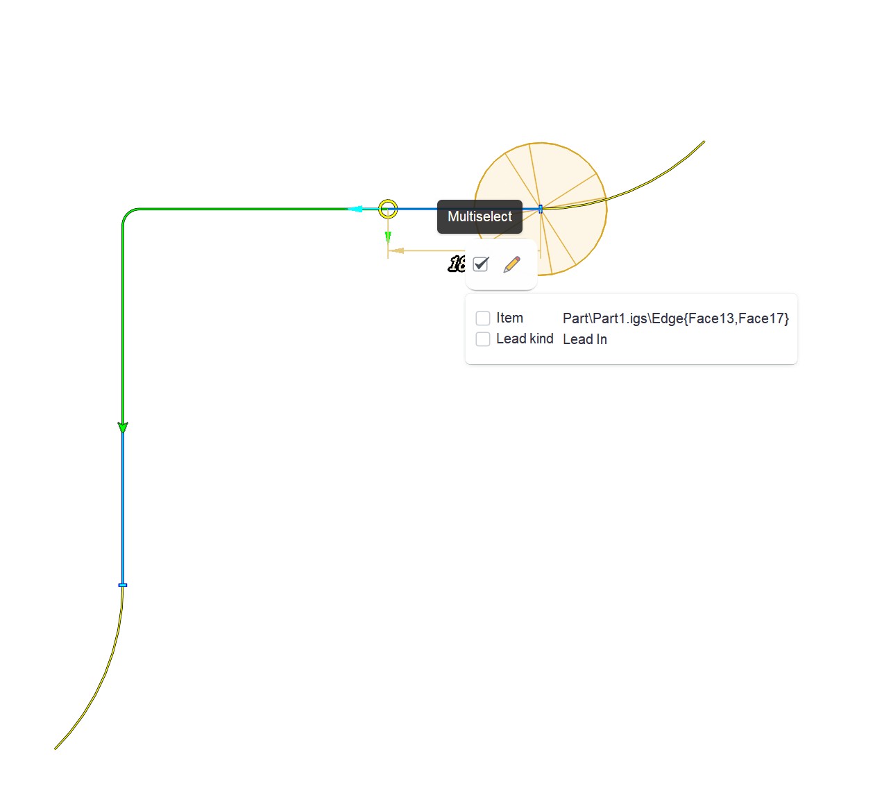

7. <strong>輪郭のリード</strong> 上記画像に表示されている黄色のダイヤです。リードを変更するには、対応するダイヤをマウスでドラッグします。その後、表示されたリード寸法を編集することができます。

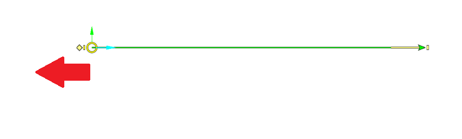 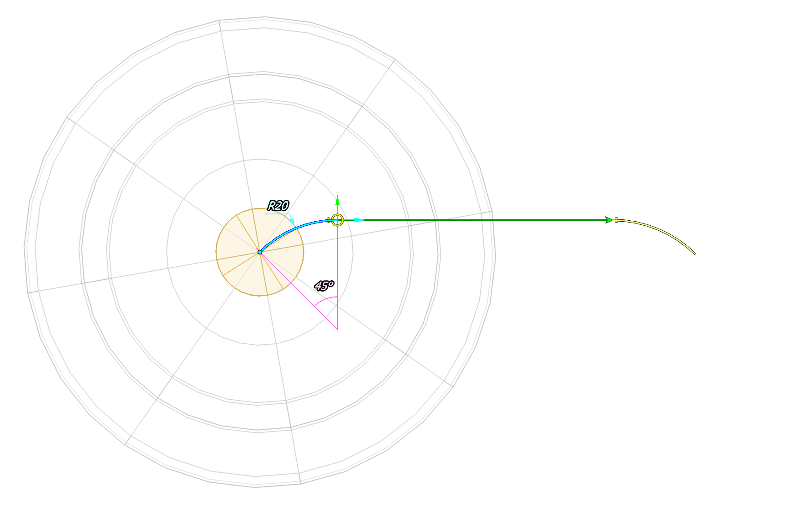

リードは3種類あります。 <strong>なし</strong>、 <strong>直線</strong> 、 <strong>円弧</strong>です。リードタイプを変更するには、リードを左クリックし、表示されるアクションバーからリードタイプを選択します。

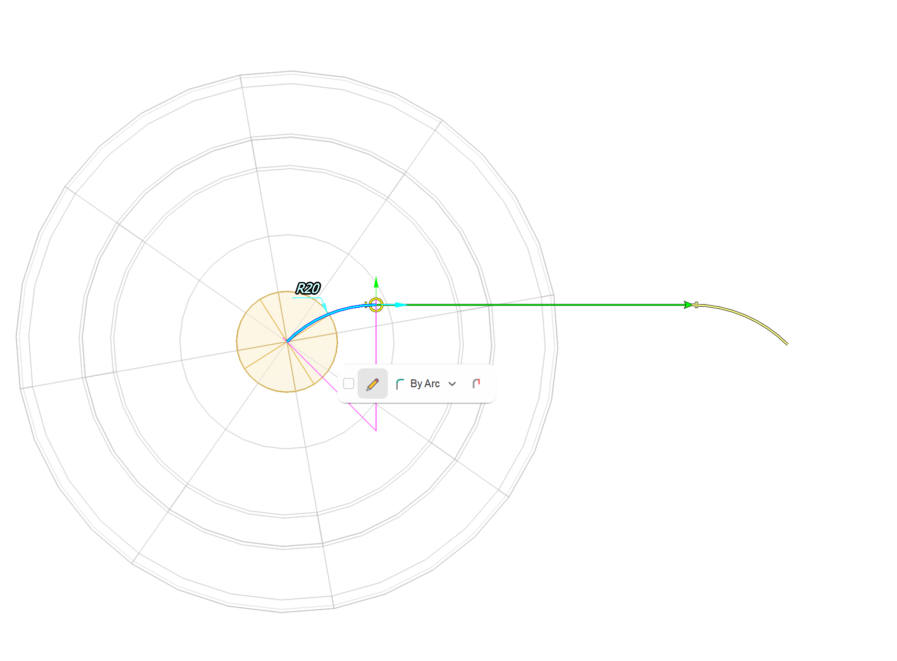

<strong>補正された</strong>輪郭と`制御機`径補正では、追加の破線が表示されます。この直線は工具中心曲線を表します。リード寸法は工具中心曲線のために指定されます。これにより、リードパラメーターは現在の補正タイプに依存しなくなります。ドラッグアンドドロップ操作で補正されたリードのサイズを変更したい場合は、補正されていないリードの曲線の終了点ではなく、工具中心曲線の終了点の黄色い点をクリックしてください。

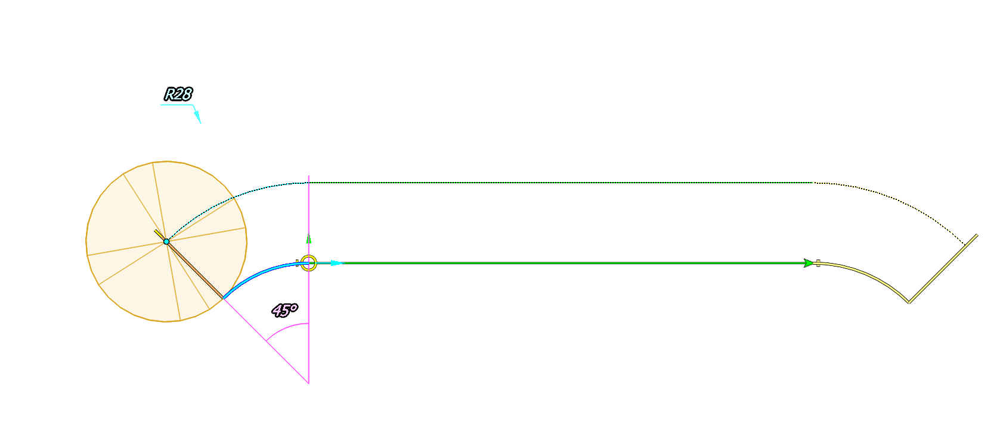

ワンクリックで複数のリードを編集

リードパラメータを編集すると、選択したすべてのリードに変更が適用されます。複数のリードを編集する作業を迅速かつ簡単にするために、CAMシステムは同一のリードを自動的にハイライトし、選択します。グラフィックビューの上部にある魔法の杖ボタンをクリックすれば、この動作を無効にすることができます。特定の1つのリードのみを選択するには、そのリードを2回クリックします。条件に基づいてリードを選択するには、まず1つのリードをクリックし、表示されるアクションバーのチェックボックスをクリックして、リードを選択したい条件を指定します。

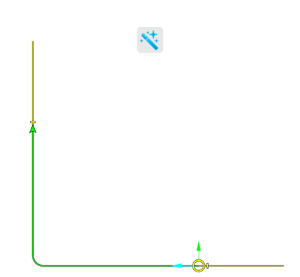 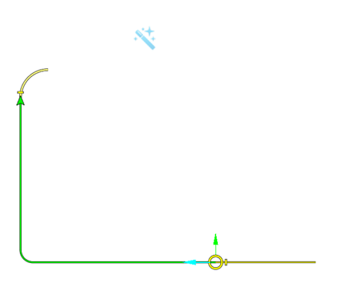

8. <strong>輪郭進入線</strong> 進入線は、`補正タイプ`が`コンピューター`以外の場合、補正された輪郭のリードに自動的に追加されます。これらは、補正切替線の役割を果たします。進入線は<strong>「直線」</strong>リードに沿って追加されません。これは不要のためです。ただし、リードをクリックして表示されるアクションバーの`進入線を使用`ボタンをチェックすることで、明示的に進入線を切り替えることもできます。

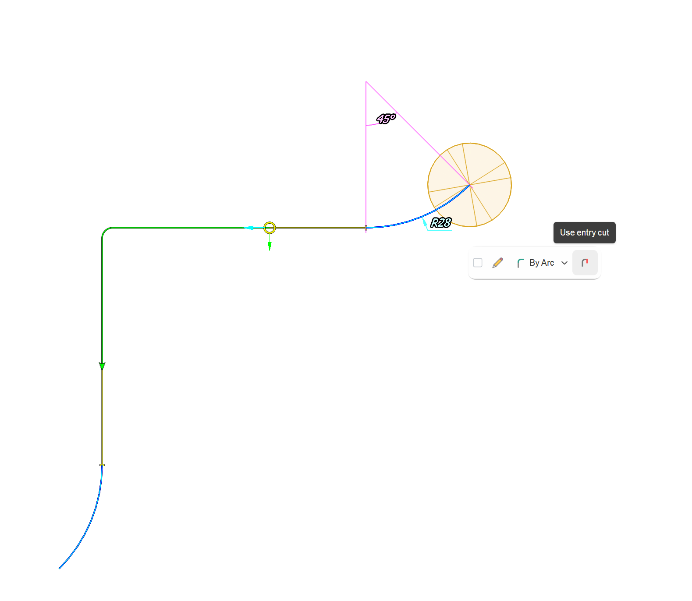 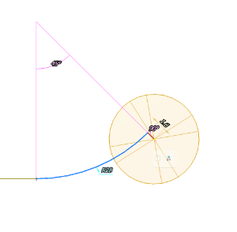

以下は、`制御機`径補正を使った進入線の例です。

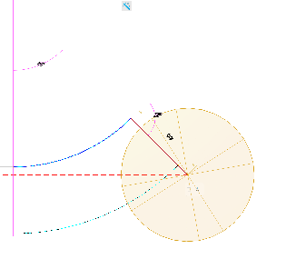

<strong>9. 輪郭オフセット/径補正</strong>

輪郭径補正は、一般的に、パーツラインの曲線（エッジや垂直な壁の面など）があり、このパーツラインの側面から素材を加工したい場合に使用します。 輪郭の径補正をオンにするには、グラフィックビューで輪郭を選択し、表示されるアクションバーの `補正`ボタンをクリックします。輪郭のオフセット半径には、デフォルトで工具の最大半径が使用されます。ただし、工具パラメータで工具接触点を明示的に指定することもできます。この場合、輪郭オフセット距離は工具接触点から取ります。

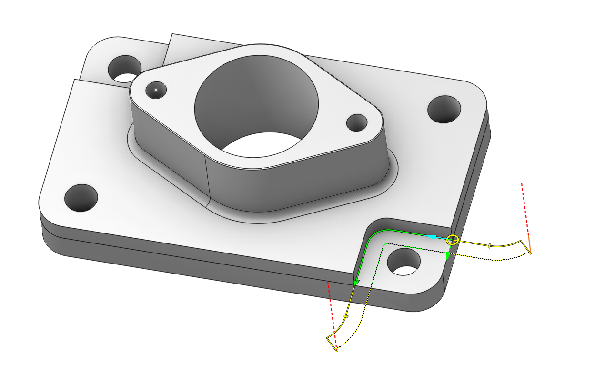

径補正の方法は、オペレーションパラメータ`径補正`によって決定されます。パラメータインスペクターまたはオペレーションパラメータウィンドウで選択できます。例：2D輪郭の場合 - 出力 [詳細を見る](404.md)
