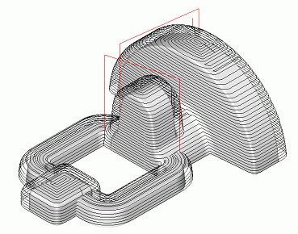

# Operação combinada (linhas de nível e curvas-guia)

Com a operação combinada, é possível obter um acabamento igualmente bom em áreas planas e íngremes. Uma altura de crista proporcionalmente uniforme pode ser obtida mesmo com um passo fixo. A estratégia combinada proporciona condições de trabalho mais favoráveis para a fresa, o que permite usar ferramentas mais longas e de menor diâmetro. A operação garante um acabamento de boa qualidade, independentemente da complexidade dos ângulos das superfícies do modelo, e também minimiza o tempo de usinagem.

Para cada objeto geométrico ou grupo de objetos, é possível definir um sobremetal adicional que, durante a usinagem, será somado ao sobremetal principal da operação.

Se o bruto e o modelo restritivo não forem definidos, o sistema usinará toda a superfície disponível do modelo usinado. Caso contrário, serão usinadas apenas as áreas da superfície que se encontram dentro do bruto e fora do modelo restritivo.

O bruto pode ser definido como um cubo, um cilindro, um molde com sobremetal ou uma forma prismática, como material residual após a usinagem por operações anteriores e também como um modelo geométrico de forma livre, composto por corpos sólidos, superfícies, malhas e prismas cujas bases são projeções de curvas fechadas. No modelo restritivo, podem ser definidos corpos sólidos, superfícies e malhas que precisam ser controlados durante a usinagem, além de áreas de usinagem e áreas restritas definidas por projeções de curvas fechadas.

O percurso da ferramenta para a usinagem da superfície de um modelo volumétrico é criado em duas etapas. Primeiro, são construídos os percursos horizontais da ferramenta (como na operação de linhas de nível) e, em seguida, pelas regras da operação por curvas-guia, são criados percursos da ferramenta ao longo de uma curva-guia (nesse caso, as curvas-guia são as bordas das áreas não usinadas). Assim, as áreas da superfície do modelo próximas da vertical são usinadas como na operação de linhas de nível, e as áreas planas, como no acabamento por curvas-guia. Isso permite obter uma usinagem proporcionalmente boa para modelos de praticamente qualquer formato. O passo entre as passadas é definido separadamente para o plano vertical e para o plano horizontal e também pode ser calculado a partir da altura de crista definida.

Ao usar um sistema de coordenadas local ou um eixo rotativo, a posição do modelo usinado não muda, o eixo de rotação da ferramenta é paralelo ao eixo Z do sistema de coordenadas local, as passadas horizontais ficam paralelas ao plano XY do sistema de coordenadas atual e, em seguida, todas as áreas não usinadas são fresadas de acordo com as regras da operação por curvas-guia.

Também é possível impedir que o percurso da ferramenta resultante entre nas áreas do modelo restritivo e nas áreas de arredondamento de arestas.

A junção das passadas de trabalho em um único percurso da ferramenta pode ser feita de cima para baixo ou de baixo para cima. A transição entre passadas de trabalho vizinhas pode ser feita sobre a superfície, com movimentos de retração e aproximação, ou pelo plano de segurança.
