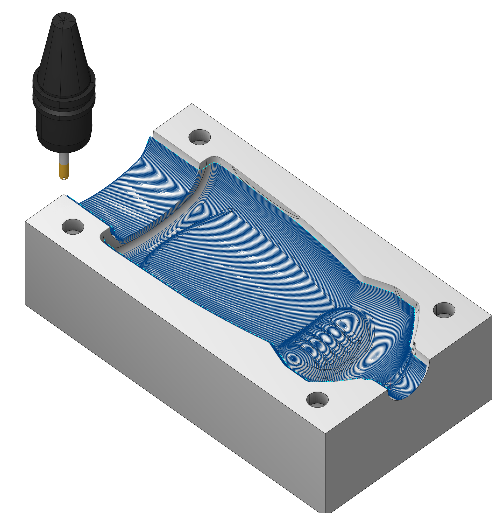
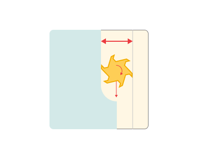
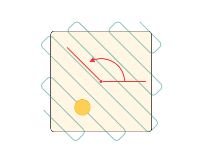
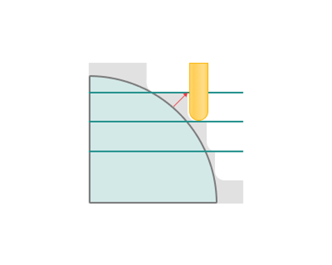
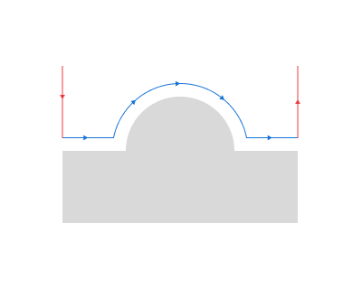
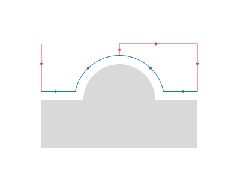
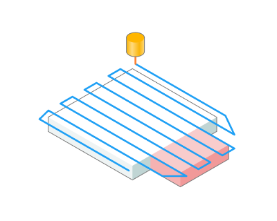
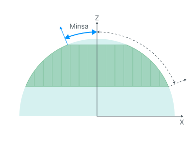

# 平面仕上げ加工

## 適用分野：

平面仕上げ加工オペレーションは、モデル表面の平滑な領域、およびツールパスに沿って急斜面（Steep）の加工を行う、垂直に近い領域の加工を目的として設計されています。他の領域を追加で再加工する場合は、ウォーターライン加工 ([詳細を見る](841.md))あるいは最初の加工とツールパスが直交する別の平面加工を使用することをお勧めします。

### セットアップ：

<strong>セットアップ</strong>タブは、プロジェクトの主要なパラメータを設定するために使用します。これには、装置上の部品の位置決めや部品の座標系などが含まれます。[詳細を見る](1022.md)

### ジョブ割り当て:

<strong>フェイス</strong> 部品のさまざまな面を加工対象として選択します。システムは、選択された面に基づいて軌道を計算します。[詳細を見る](102121.md)

<strong>ポケット</strong> 一般的なプリズマティック部品や旋削フライス部品は、多くの単純形状で構成されています。この作業を簡略化するために、3Dモデル内の部品要素を認識し、加工領域や加工高さなどの基本的なジョブ割り当て項目に自動変換できます。[詳細を見る](10154.md)

<strong>ジョブゾーン</strong>（加工領域） ジョブゾーンは、荒加工と仕上げ加工で加工される部品領域を定義するために使用します。[詳細を見る](10151.md)

<strong>制限領域</strong> <strong>ジョブゾーン</strong> に加えて、<strong>制限領域</strong>を使用することで、現在のオペレーションで加工しないワーク領域を指定できます。[詳細を見る](10152.md)

<strong>上部高さ</strong> モデル要素に基づいて上部高さを指定します。 [詳細を見る](10153.md)

<strong>底部高さ</strong> モデル要素に基づいて底部高さを指定します。 [詳細を見る](10153.md)

<strong>プロパティ</strong> 要素のプロパティを表示します。ストックを追加することも可能です。また、リスト内の項目をダブルクリックすることでも、このメニューを表示できます。

<strong>削除</strong> リストから項目を削除します。

<strong>制限</strong> 加工してはならない領域を制限できます。[詳細を見る](101231.md)

### 加工設定：

#### ステップ

切削の最大許容幅を設定します。

詳細を表示

<strong>角度</strong> 平面加工における切削方向の角度を設定します。

<strong>スキャロップ</strong> <strong>無効にした場合:</strong> パス間の距離は<strong>ステップ</strong>パラメータのみを使用して計算されます。

<strong>有効にした場合：</strong>指定した<strong>スキャロップの最大高さ</strong>に基づいて、加工ピッチが自動的に計算されます。必要に応じて、望ましいスキャロップの高さを実現するために、ツールパスはより狭い間隔で生成されます。

#### 加工深さ：

工具軸に沿った加工範囲を定義します。 このパラメーターグループは <strong>ウォーターライン荒加工オペレーションと同様に機能します。</strong> [詳細を見る](736.md)

#### ミーリングタイプ：

曲線加工オペレーションを除き、ほとんどすべての加工で設定可能です。この設定により、ツールパスの計算プロセス中に、必要なフライス加工タイプ（ダウンカットまたはアップカット）を制御できます。このパラメーターグループは <strong>ウォーターライン荒加工オペレーションと同様に機能します。</strong> [詳細を見る](736.md)

#### 並べ替え

面加工中のツールパスの順序を設定します 。

詳細を表示

<strong>上方向 無効な場合</strong>: 工具は<strong>上下両方向</strong>に移動できます。

<strong>有効な場合</strong>: 工具は<strong>上方向</strong>にのみ移動できます。必要に応じて、ツールパスは分割され、再リンクされます。

#### ジョブゾーン

<strong>ジョブ割り当て</strong>タブで最初に選択された加工領域の追加修正が可能です。

詳細を表示

<strong>サーフェスロールタイプ</strong> サーフェスロール手法

<strong>サーフェスのみ</strong> 選択された表面のみを加工します。

<strong>エッジ付き</strong> 選択した平面およびエッジ部を加工します。 <strong>エッジ付き</strong> モードでは、結果として得られるツールパスは、形状を作成するサーフェスの加工領域と、エッジのロール加工領域で構成されます。このモードは、例えば加工代が正のモデルを加工する際に、エッジを丸めるために使用できます。

<strong>制限モデル付き</strong> 選択した平面上での 加工、 制限付き加工、およびエッジ加工に対応します。 <strong>制限モデル付き</strong>モードでは、モデルおよび制限モデルのすべての加工および圧延領域が、生成されるツールパスに含まれます。

<strong>最小傾斜角度</strong> 本システムでは、サーフェスの法線と垂直軸Zの間の角度に基づいて、モデルのサーフェス領域を選択的に加工することができます。加工範囲は、 <strong>最小</strong>傾斜角および最大傾斜角によって設定できます。

<strong>最大傾斜角度</strong> 本システムでは、サーフェスの法線と垂直軸Zの間の角度に基づいて、モデルのサーフェス領域を選択的に加工することができます。加工範囲は、最小傾斜角および<strong>最大</strong>傾斜角度によって設定できます。

<strong>正面角度</strong> 正面角度とは、工具の移動方向の水平面への投影と、切削点におけるサーフェスの法線との間の角度を指します。[詳細を見る](163.md)

#### コーナーの円滑化

工具方向が急変する場合、フライス制御は回転開始前に減速し、その後再び加速します。この動作により、振動が発生しやすくなり、工具およびフライス盤の摩耗が増大する可能性があります。ツールパスの途切れを極力減らすことで、この問題は解決できます。このため、システムにはモデルの内側や外側のコーナーを加工する際に、指定された半径を用いてツールパスを滑らかにする機能があります。

#### トリミング

加工対象外のサーフェスをスキップしたり、 ツールパスを延長したりできます。 一部のパラメーターグループは<strong>ウォーターライン荒加工オペレーションと同様に機能します。</strong> [詳細を見る](736.md)

詳細を表示

<strong>ギャップキャッピング</strong> 有効にすると、切削中に発生した指定値以下のサイズの隙間が線で接続されます。

.png) .png)

### パラメータ:

このタブには、部品、ワーク、治具、およびその他の軌跡に影響を与える要素を制御するための主要なパラメータが含まれており、ツールパスを変更できます。 [詳細を見る](100112.md)

### リンク／リード:

リンク／リードタブでは、早送り動作のパラメータを設定します。これらの移動には、工具交換位置からのアプローチ、切削パス開始点までの位置決め、最終切削後の退避動作、各パス間の移行移動、そして工具交換位置への復帰が含まれます。座標軸ごとの動作順序、各移動の軌跡、および移動量を設定できます。

詳細を表示

<strong>以下の項目で構成されます。</strong>

<strong>アプローチ／リターン。</strong> このパラメータグループは、工具交換位置から進入動作の開始位置までの工具移動と、その復帰動作を管理します。[詳細](100116.md)。

<strong>安全動作</strong> <strong>安全サーフェス</strong>のタイプとワークから安全サーフェスまでの距離を設定します。このサーフェスは、加工サーフェスまたはツールパス間の移動を円滑にし、アプローチまたはリターンの最初の段階は、この面に向かって行います。[詳細を見る](100117.md)

<strong>高度なリンク設定</strong> このパラメータグループは、主に5軸加工において、回転軸の最適な動きを考慮した軌道形成の特性を指定します。[詳細を見る](100118.md)

<strong>リンク。</strong> 進入／退出リンクと加工動作間のリンクのルールを設定します。[詳細](100131.md)。

<strong>リード。</strong> 加工移動に、その送り速度を使用する追加の切込みと退避を付加できます。[詳細を見る](100135.md)。

<strong>距離。</strong> 送りを切り替えるために必要な距離です。[詳細を見る](100138.md)。

### 送り速度設定

このダイアログでは、主軸回転速度、早送り速度、およびツールパスの各領域の送り速度を設定できます。主軸回転速度は、毎分回転数または切削速度のいずれかで指定できます。基準となる値には下線が表示されます。もう一方の値は、工具径を考慮して基準値から再計算されます。[詳細](100142.md)

### 変換：

オペレーション内で計算された工具の軌跡に対して座標変換を行うためのパラメータグループです。[詳細を見る](10168.md)

### パーツ：

パーツは、干渉をチェックする空間を定義する幾何要素のグループです。[詳細を見る](330.md)

### ワーク：

加工のワークモデルは、加工する素材を定義します。[詳細を見る](738.md)

### 治具：

治具には通常、チャック、グリップ、クランプなどの固定補助具と、その他の種類の制限領域を指定します。[詳細を見る](10283.md)
