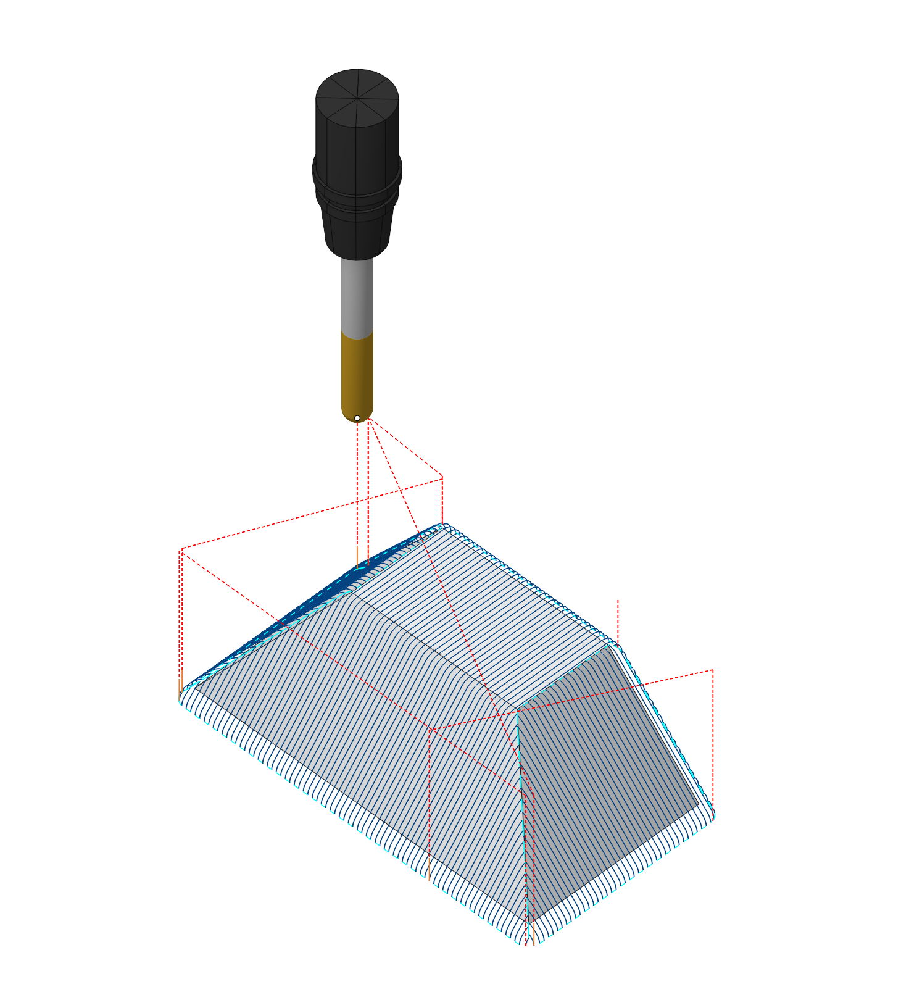

# Usinagem por planos otimizados

## Área de aplicação:

O percurso da ferramenta de plano otimizado consiste em duas passadas de acabamento por planos situadas em planos mutuamente perpendiculares. Cada passada usina apenas as áreas em que o ângulo frontal de inclinação da superfície, medido em relação à direção de corte, é de 45 graus ou menos. Isso garante que nenhuma superfície seja usinada duas vezes e, graças a isso, obtém-se uma altura de crista uniforme em toda a peça. Por isso, o plano otimizado é uma boa opção para o acabamento de alta qualidade de peças complexas.

### Setup:

A guia <strong>Setup</strong> é usada para configurar os parâmetros primários do projeto. Isso pode envolver o posicionamento da peça no equipamento, o sistema de coordenadas da peça, entre outros. [Detalhes](1022.md)

### Definição da tarefa:

<strong>Faces.</strong> Selecione várias superfícies da peça como tarefa de trabalho. O sistema calculará o percurso com base nas superfícies escolhidas. [Detalhes](102121.md)

<strong>Pocket.</strong> Uma peça prismática ou de torno-fresamento típica é composta por muitas formas simples. Para simplificar essa tarefa, é possível reconhecer os elementos da peça em um modelo 3D e convertê-los automaticamente em itens básicos da definição da tarefa, como zonas de trabalho e níveis de usinagem. [Detalhes](10154.md)

<strong>Zona de trabalho.</strong> As zonas de trabalho são usadas para definir as áreas da peça que devem ser usinadas por operações de fresamento de desbaste e acabamento. [Detalhes](10151.md)

<strong>Zona restrita.</strong> Além das <strong>Job Zones</strong>, é possível usar <strong>Restrict Zones</strong> para especificar as áreas do bruto que não devem ser usinadas na operação atual. [Detalhes](10152.md)

<strong>Nível superior.</strong> Definição do nível superior por elementos do modelo. [Detalhes](10153.md)

<strong>Nível inferior.</strong> Definição do nível inferior por elementos do modelo. [Detalhes](10153.md)

<strong>Propriedades.</strong> Exibe as propriedades de um elemento. É possível adicionar sobremetal. Esse menu também pode ser aberto com um clique duplo em um item da lista.

<strong>Excluir.</strong> Remove um item da lista.

<strong>Restrições.</strong> Permite restringir as áreas que não devem ser usinadas. [Detalhes](101231.md)

### Estratégia:

Este grupo de parâmetros funciona de forma semelhante à <strong>operação de acabamento Plane.</strong> [Detalhes](713.md)

### Parâmetros:

Esta aba contém os principais parâmetros de controle da peça, do bruto, dos dispositivos de fixação e de outros elementos que permitem modificar o percurso da ferramenta. [Detalhes](100112.md)

### Ligações e entradas/saídas:

Na aba **Links/Leads**, são definidos os parâmetros dos movimentos rápidos: aproximação a partir da posição de troca da ferramenta, entrada no início do movimento de trabalho, saída após o último corte, transições entre passadas e retorno ao ponto de troca. É possível configurar a sequência dos movimentos ao longo das coordenadas, seus percursos e as distâncias dos deslocamentos.

Clique aqui para expandir...

**Componentes:**

**Aproximação/retorno.** Controla os movimentos da ferramenta entre a posição de troca e o início do percurso de entrada, nos dois sentidos. [Detalhes](100116.md).

**Movimentos seguros.** Define o tipo de superfície de segurança e sua distância ao bruto. Essa superfície permite as transições entre superfícies ou percursos usinados; a primeira etapa da aproximação ou do retorno é realizada em direção a ela. [Detalhes](100117.md).

**Configurações avançadas de ligações.** Define as características de formação do percurso, principalmente para operações de cinco eixos, considerando os movimentos ideais dos eixos rotativos. [Detalhes](100118.md).

**Ligações.** Define as regras das ligações de entrada e saída e das ligações entre movimentos de trabalho. [Detalhes](100131.md).

**Entradas e saídas.** Acrescenta movimentos de entrada e saída aos movimentos de trabalho, usando os avanços correspondentes. [Detalhes](100135.md)

**Distâncias.** Distâncias necessárias para a troca de avanços. [Detalhes](100138.md).

### Avanços e velocidades:

Esta janela permite definir a rotação do fuso, o avanço rápido e os avanços dos diferentes trechos do percurso. A rotação do fuso pode ser definida em rotações por minuto ou pela velocidade de corte. O valor de referência fica sublinhado; o outro valor é recalculado a partir dele, considerando o diâmetro da ferramenta. [Detalhes](100142.md)

### Transformações:

Conjunto de parâmetros da operação que permite transformar as coordenadas do percurso da ferramenta calculado na operação. [Detalhes](10168.md)

### Peça:

A peça é um grupo de elementos geométricos que define a região a ser verificada quanto a cortes indevidos. [Detalhes](330.md)

### Bruto:

O modelo do bruto de uma operação define o material a ser usinado. [Detalhes](738.md)

### Dispositivos de fixação:

Os dispositivos de fixação normalmente incluem mandris, garras, grampos e outros elementos de fixação, além de áreas de restrição de qualquer natureza. [Detalhes](10283.md)
