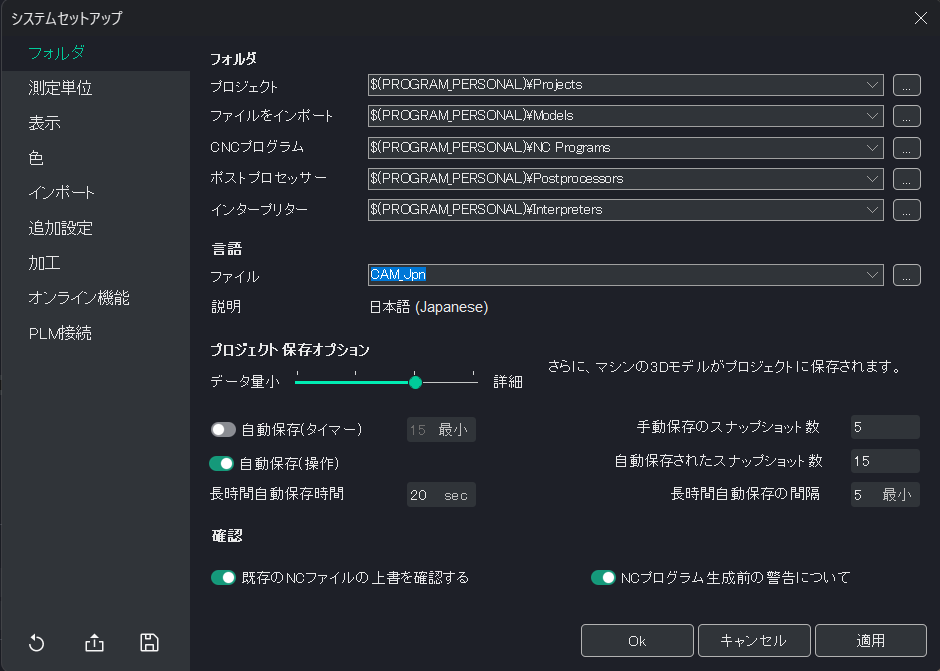

# <フォルダ>タブ

このウィンドウでは、CAMシステムファイルのデフォルトパスを設定できます。

- <strong>`プロジェクト`</strong>: プロジェクトを読み込みおよび保存するためのデフォルトのフォルダ
- <strong>`ファイルのインポート`</strong>：幾何モデルファイル（IGES、DXFなど）を読み込むためのデフォルトフォルダ
- <strong>`CNCプログラム`</strong>：ポストプロセッサによって生成された [NC-プログラム](69.md)のデフォルト保存フォルダです。
- <strong>`ポストプロセッサー`</strong>：ポストプロセッサーファイルを読み込むためのデフォルトフォルダ。
- <strong>`インタープリター`</strong>：インタープリターファイルを読み込むためのデフォルトフォルダ

パスは手動で入力することも、パス選択ダイアログを使用して指定することもできます。このダイアログは、  ボタンをクリックで開きます。

## ディレクトリを定義するための定義済み変数：

- <strong>`$(ENCYDIR)`</strong>：CAM システムの起動元ディレクトリ
- <strong>`$(PRJDIR)`</strong>： <strong>`プロジェクト`</strong> 欄で定義されたディレクトリ
- <strong>`$(PROGRAM_PERSONAL)`</strong>：インストール時にユーザーの個人ドキュメントフォルダ <strong>My Documents</strong> に作成されるディレクトリ
- <strong>`$(PROGRAM_COMMON_DOCUMENTS)`</strong>：インストール時にローカルコンピュータのパブリックドキュメントフォルダ <strong>Public Documents</strong> に作成されるディレクトリ

CAMシステムで実際に使用されるディレクトリパスを定義する際、これらの変数は、システムの起動時、またはユーザーが定義した設定に基づいて、対応するフルパスに置き換えられます。

## 追加設定：

- <strong>システム言語</strong> は <strong>`言語`</strong> パネルで変更できます。言語変更は現在のセッションに適用されます。
- <strong>`プロジェクトの保存オプション`</strong>：これらのオプションは、プロジェクトファイルのサイズを制御します。保存される情報が詳細であればあるほど、プロジェクトファイルは大きくなります。必要最小限の情報から最も完全な情報まで、以下の方法が順にリストされています。
  1. ソースデータ（幾何モデル、座標系、オペレーション、およびそれらのパラメータ）のみが保存されます。
  2. 上記に加えて、加工のツールパスも保存されます。
  3. 上記に加えて、マシンのスキーマファイルやツールの3Dモデルも保存されます。
  4. 上記に加えて、ワークの中間状態も保存されます。
- <strong>自動保存とスナップショット</strong>: プロジェクトのバックアップバージョン作成を設定するためのオプションのグループです。これには、タイマーによる<strong>自動保存（タイマー）、</strong>イベントによる<strong>自動保存（操作）、手動保存のスナップショット数、自動保存されたスナップショット数、長時間自動保存時間、長時間自動保存の間隔</strong>などが含まれます。 詳細は [自動保存とプロジェクトのスナップショット](10424.md) の記事を参照してください。
- <strong>確認</strong>： <strong>`確認`</strong> パネルで既存のファイルを上書きする場合、NCファイル生成時の確認メッセージを無効にすることができます。また、 <strong>NC プログラム</strong>を生成する前の警告に対する確認を設定し、ワークフローの重要なステップをさらに制御することもできます。
