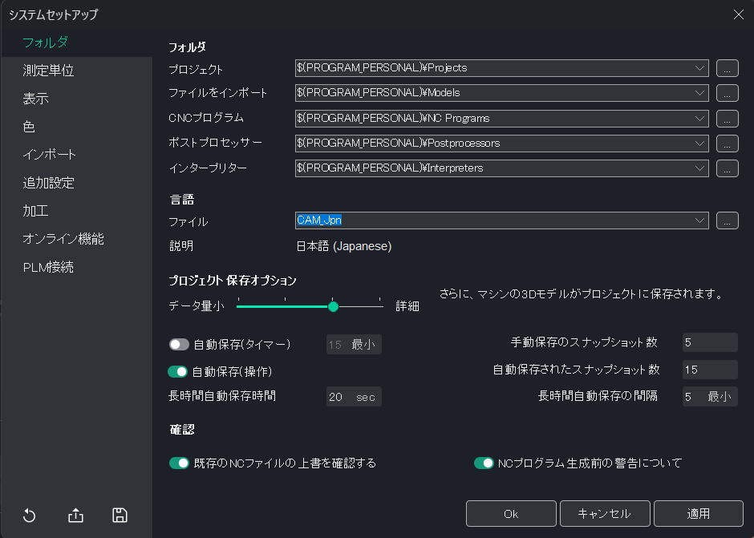

# Aba Pastas

Nesta janela, o usuário pode definir caminhos padrão para os arquivos do sistema CAM.

- <strong>Project</strong>: A pasta padrão para carregar e salvar projetos.
- <strong>Import files</strong>: A pasta padrão para carregar arquivos de modelo geométrico (IGES, DXF, etc.).
- <strong>`CNC-programs`</strong>: A pasta padrão para salvar os [programas NC](69.md) gerados pelo pós-processador.
- <strong>Postprocessor</strong>: A pasta padrão para carregar arquivos de pós-processador.
- <strong>Interpreter</strong>: A pasta padrão para carregar arquivos do interpretador.

Os caminhos podem ser inseridos manualmente ou usando a caixa de diálogo de seleção de caminho, que pode ser acessada clicando no botão .

## Variáveis predefinidas para definir diretórios:

- <strong>`$(ENCYDIR)`</strong>: O diretório a partir do qual o sistema CAM foi iniciado.
- <strong>`$(PRJDIR)`</strong>: O diretório definido no campo <strong>Project</strong>.
- <strong>`$(PROGRAM_PERSONAL)`</strong>: O diretório criado na pasta de documentos pessoais do usuário <strong>My Documents</strong> durante a instalação.
- <strong>`$(PROGRAM_COMMON_DOCUMENTS)`</strong>: O diretório criado na pasta de documentos públicos <strong>Public Documents</strong> no computador local durante a instalação.

Ao definir os caminhos de diretório reais usados pelo sistema CAM, essas variáveis serão substituídas pelos caminhos completos correspondentes na inicialização do sistema ou com base nas configurações definidas pelo usuário.

## Configurações adicionais:

- <strong>Os idiomas do sistema</strong> podem ser alterados no painel <strong>Languages</strong>. A alteração de idioma será aplicada à sessão atual.
- <strong>Project save options</strong>: Essas opções controlam o tamanho dos arquivos de projeto. Quanto mais detalhadas forem as informações salvas, maior será o arquivo do projeto. Os seguintes métodos estão disponíveis, listados desde salvar as informações mínimas necessárias até as mais completas:
  1. Somente os dados de origem (modelos geométricos, sistemas de coordenadas, operações e seus parâmetros) são salvos.
  2. Além dos itens acima, os percursos da ferramenta das operações são salvos.
  3. Além dos itens acima, são salvos os modelos 3D dos arquivos de esquema da máquina e das ferramentas.
  4. Além dos itens acima, os estados intermediários do bruto são salvos.
- <strong>Autosaves and snapshots</strong>: Um grupo de opções que permite configurar a criação de versões de backup dos projetos, incluindo <strong>Autosaves by timer</strong>, <strong>Autosaves by events</strong>, <strong>Manually saved snapshots count</strong>, <strong>Autosaved snapshots count</strong>, <strong>Long autosave time</strong> e <strong>Interval between long autosaves</strong>. Consulte o artigo [Salvamentos automáticos e instantâneos do projeto](10424.md) para obter mais detalhes.
- <strong>Confirmations</strong>: No painel <strong>Confirmation</strong>, é possível desativar a mensagem de confirmação exibida durante a geração de arquivos NC ao substituir um arquivo existente. Também é possível configurar confirmações <strong>sobre avisos antes de gerar programas NC</strong>, proporcionando controle adicional sobre as etapas críticas do fluxo de trabalho.
