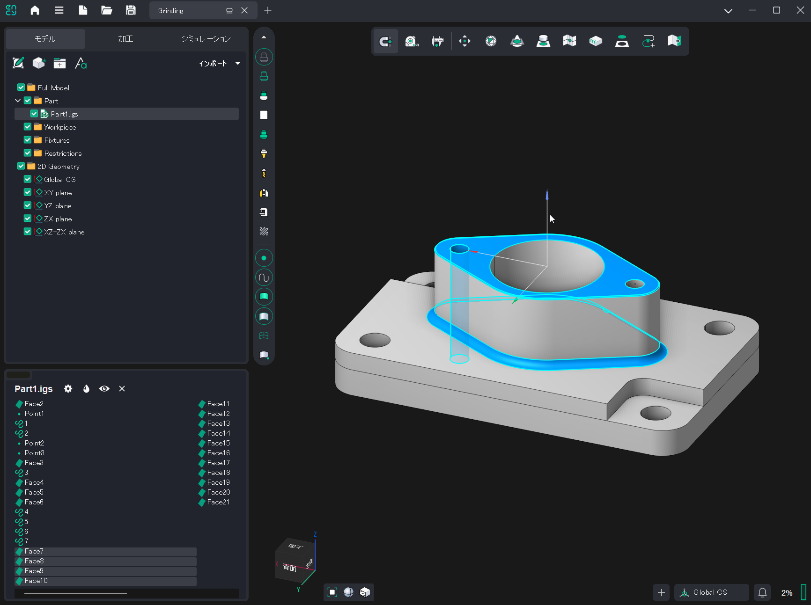
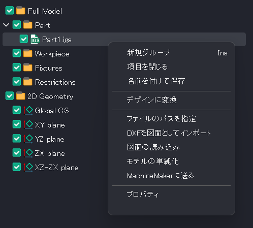
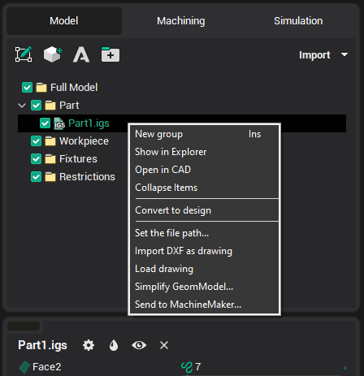
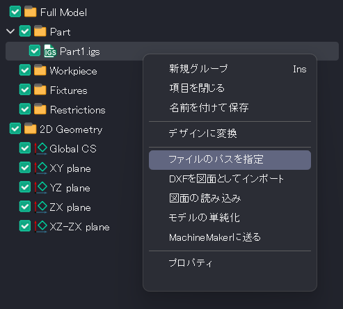
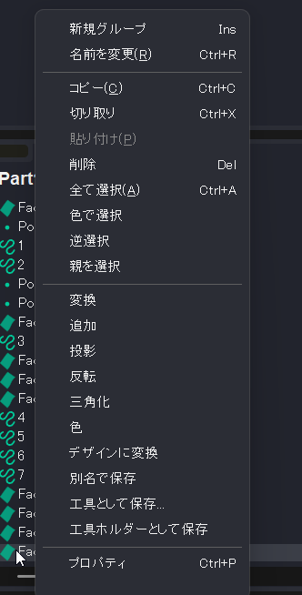
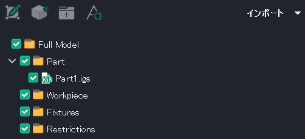

# 幾何モデル構造ウィンドウ

幾何

モデル構造ウィンドウは、<strong>`ツールパネル`、`モデルツリー`、`利用可能オブジェクトの一覧`</strong> の3つのパネルで構成されています。

上部の`モデルツリー`パネルには、モデル全体の構造が表示されます。モデルのグループは3つのノードで構成されており、それぞれ異なる階層に配置されています。[アクティブグループ](1.md)は強調表示されます。マウスまたはキーボードを使用して非アクティブなグループを選択すると、そのグループがアクティブになり、それに応じて利用可能なオブジェクトの一覧も変更されます。

> 以下、ポップアップウィンドウからのコマンドが考慮され、繰り返されるコマンドはスキップされます。

`モデルツリー`の通常のグループ上で右クリックすると、以下のポップアップウィンドウが表示されます。

コマンド：

- <strong>新しいグループ</strong> - [アクティブグループ](1.md)に新しいオブジェクトを追加します。
- <strong>スケッチとしてDXFをインポート</strong>、<strong>スケッチを読み込む</strong> - [スケッチ](833.md)で作業するためのコマンドです。

`モデルツリー`でインポートされたモデルのノード上で右クリックすると、以下のポップアップウィンドウが表示されます。

コマンド：

- <strong>エクスプローラーで表示</strong> - インポートされたファイルを含むフォルダを開きます。
- <strong>CADで開く</strong> - ファイルはリンクされたCADで開かれます。 リンクされていない場合は、ウィンドウ選択画面が表示されます。

> インポートされたファイルが変更された場合、グループ名は<strong>太字</strong>で表示されます。また、ツールバーには "[モデルファイルアップデートマネージャ](6231.md)"  ボタンが表示され、ポップアップウィンドウには「<strong>[アップデート](6231.md)</strong> （選択したグループのみ更新）」コマンドが表示されます。
>
> 
>
> インポートされたファイルが名前の変更、移動、または削除されている場合、 <strong>ファイルパスの設定</strong>を実行してください。(インポートしたファイルの新しい場所を指定できます)コマンドがポップアップウィンドウに表示されます。
>
> 

`利用可能オブジェクトの一覧`内の任意のグループ上で右クリックすると、以下のポップアップウィンドウが表示されます。

Commands:

- <strong>名前の変更</strong> - 選択されたオブジェクトの名前を編集できます。
- <strong>コピー</strong>、 <strong>切り取り</strong>、 <strong>貼り付け</strong> - [交換バッファでの作業](749.md)
- <strong>削除</strong> - 選択されたオブジェクトを削除します。
- <strong>全てを選択</strong> - すべての幾何オブジェクトを選択します。
- <strong>色で選択</strong> - ツリー内の選択されたオブジェクトと同じ色を持つすべての要素を選択します。
- <strong>逆選択</strong> - 他のすべてのオブジェクトを選択し、現在の選択はキャンセルされます。
- <strong>[変形移動](116.md)、[結合](400.md)、[投影](401.md)、</strong><strong>[三角分割](619.md)</strong> -コマンドは<strong>ツールパネル</strong>で重複しており、以下で説明します。
- <strong>[反転](34.md)</strong> - 面の法線を反転します。
- <strong>色</strong> - 選択されたオブジェクトの色を変更できます。
- <strong>別名で保存：</strong>- 選択した幾何オブジェクトをサポートされている形式のいずれかで保存します。
- <strong>[工具として保存](10343.md)</strong>- 選択されたオブジェクトを任意の形状のツールの形で保存します。
- <strong>工具ホルダーとして保存</strong> - 選択されたオブジェクトを任意のホルダーの形で保存します。
- <strong>[プロパティ](57.md)</strong> -幾何オブジェクトのプロパティウィンドウを呼び出します。

`利用可能オブジェクトの一覧`には、[アクティブグループ](1.md)に含まれているすべてのグループ、オブジェクトが表示されます。つまり、現在選択および編集が可能なオブジェクトが表示されます。一覧に表示されているオブジェクトを左クリックすると、そのオブジェクトが選択されます。

-  - [選択されたオブジェクト](57.md)のプロパティの表示と編集
-  - 選択したオブジェクトの色を設定
-  - 選択したサーフェスの表示/非表示を設定
-  - 選択したオブジェクトを削除

-  - [CAMシステムのCAD作図](20000.md)を開始
-  - [テキストを作成](617.md)

-  - 選択されたオブジェクトの[空間変換](116.md)
-  - [サーフェスの三角化](619.md)
-  - 平面によって [3Dモデルを切断](289.md)し、断面の曲線を取得
-  - [サーフェス境界投影](401.md)
-  - [フェイスステッチ](1000.md)
-  - [選択された曲線の三角測量、またはメッシュの穴の修復](10060.md)
-  - [曲線を結合](400.md)
