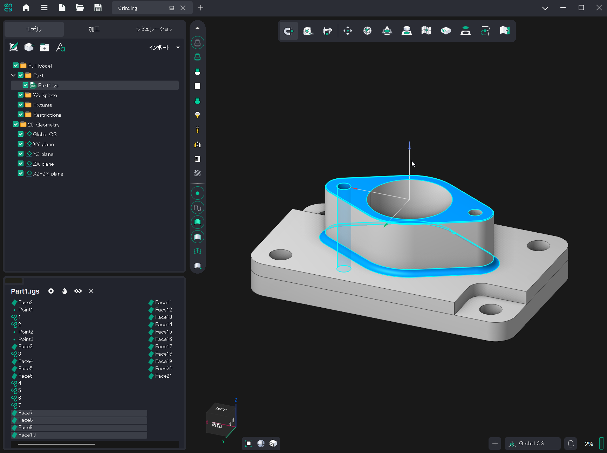
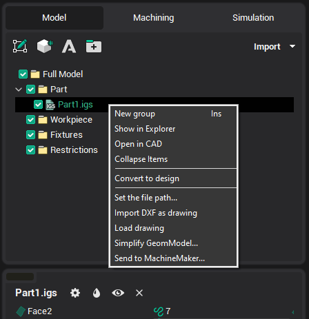
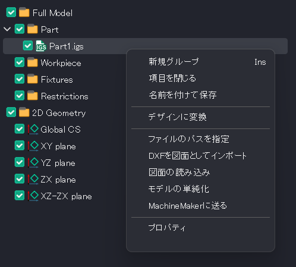
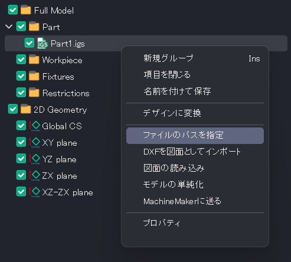
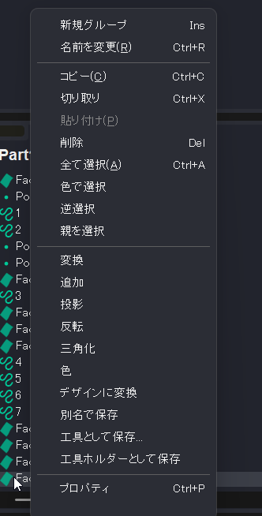
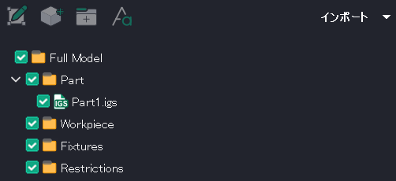

# Janela da estrutura do modelo geométrico

A janela da estrutura do modelo consiste em três painéis: o **painel de ferramentas**, a **árvore do modelo** e uma **lista de objetos disponíveis**.

No painel **árvore do modelo** acima, a estrutura de todo o modelo é exibida. Três nós compõem os grupos do modelo, que estão localizados em níveis diferentes. Os [grupos ativos](1.md) são destacados. Ao selecionar um grupo inativo usando o mouse ou o teclado, o grupo se torna ativo e a lista de objetos disponíveis muda de acordo.

> Abaixo, os comandos das janelas pop-up serão considerados, os comandos repetidos serão ignorados.

Clicar com o botão direito do mouse em um grupo normal na **árvore do modelo** abre a seguinte janela pop-up:

Comandos:

- <strong>New group</strong> - adiciona um novo objeto ao [grupo ativo](1.md).
- <strong>Import DXF as sketch</strong>, <strong>Load sketch</strong> - comandos para trabalhar com [esboços](833.md).

Clicar com o botão direito do mouse no nó do modelo importado na **árvore do modelo** gera a seguinte janela pop-up:

Comandos:

- <strong>Show in Explorer</strong> - abre a pasta que contém o arquivo importado;
- <strong>Open in CAD</strong> - o arquivo será aberto no CAD vinculado; caso contrário, será exibida uma janela de seleção.

> Se o arquivo importado tiver sido alterado, o nome do grupo será exibido em <strong>negrito</strong>, o botão "[Model files update manager](6231.md)"  aparecerá na barra de ferramentas e o comando <strong>[Update](6231.md)</strong> (atualiza somente o grupo selecionado) aparecerá em uma janela pop-up:
>
> 
>
> Se o arquivo importado tiver sido renomeado, movido ou excluído, o comando <strong>Set File Path...</strong> (permite especificar o novo local do arquivo importado) será exibido em uma janela pop-up.
>
> 

Clicar com o botão direito do mouse em qualquer grupo da **lista de objetos disponíveis** gera a seguinte janela pop-up:

Comandos:

- <strong>Rename</strong> - permite editar o nome do objeto selecionado;
- <strong>Copy</strong>, <strong>Cut</strong>, <strong>Paste</strong> - [trabalho com a área de transferência](749.md);
- <strong>Delete</strong> - exclui os objetos selecionados;
- <strong>Select All</strong> - seleciona todos os objetos geométricos;
- <strong>Select by color</strong> - seleciona todos os objetos da árvore que têm a mesma cor que o objeto selecionado:
- <strong>Inverse Selection</strong> - seleciona todos os outros objetos e cancela a seleção atual;
- **[Transform](116.md), [Join](400.md), [Project](401.md),** **[Triangulate](619.md)** - os comandos são duplicados no **painel de ferramentas** e descritos abaixo;
- <strong>[Inverse](34.md)</strong> - inversão das normais das superfícies;
- <strong>Color</strong> - permite alterar a cor do objeto selecionado;
- <strong>Save as...</strong> - permite salvar os objetos geométricos selecionados em um dos formatos suportados;
- <strong>[Save as tool...](10343.md)</strong> - salva o objeto selecionado como uma ferramenta de formato arbitrário;
- <strong>Save as tool holder</strong> - salva o objeto selecionado como um porta-ferramentas arbitrário;
- <strong>[Properties](57.md)</strong> - abre a janela de propriedades dos objetos geométricos.

Na **lista de objetos disponíveis**, são exibidos todos os grupos e objetos geométricos que fazem parte do [grupo ativo](1.md). Ou seja, os objetos que estão disponíveis no momento para seleção e modificação. Clicar com o botão esquerdo do mouse em qualquer um dos objetos listados seleciona esse objeto.

-  – Visualização e edição das [propriedades dos objetos selecionados](57.md).
-  – Definição da cor dos objetos selecionados.
-  – Torna as superfícies selecionadas visíveis/invisíveis.
-  – Exclui os objetos selecionados.

-  – Inicia o [desenho CAD do sistema CAM](20000.md).
-  – [Criação de textos](617.md).

-  – [Transformações espaciais](116.md) dos objetos selecionados.
-  – [Triangulação de superfícies](619.md).
-  – Obtenção de curvas como [seção do modelo 3D](289.md) por um plano.
-  – [Projeção do contorno das superfícies](401.md) no plano.
-  – [Costurar faces](1000.md).
-  – [Triangulação de curvas selecionadas ou correção de furos em malhas](10060.md).
-  – [União de curvas](400.md).
