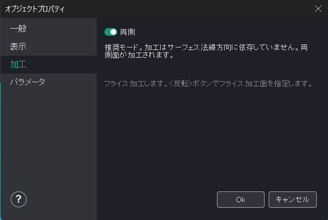
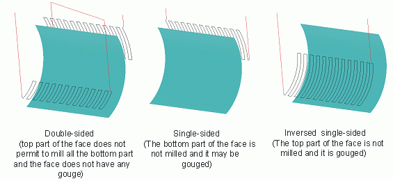

# Registerkarte Bearbeitung

**Double sided (Beidseitig).** Legt fest, ob eine Fläche von beiden Seiten bearbeitet werden darf. Beim Laden eines geometrischen Modells werden alle Flächen zunächst als beidseitig behandelt. Die Bearbeitung ist dann unabhängig von der Richtung des Normalenvektors auf beiden Seiten möglich. Die zu bearbeitende Seite wird durch die räumliche Lage bestimmt: Bearbeitet wird die obere Seite. Dieser Modus wird für Flächenmodelle empfohlen und hat nur geringen Einfluss auf die Berechnungszeit.

Sie können die Bearbeitungsseite auch ausdrücklich festlegen. Deaktivieren Sie dazu **Double sided**. Das System erlaubt die Bearbeitung dann nur auf der Seite, in die der Normalenvektor zeigt. Die gewünschte Seite wird mit der Funktion [Inverse](34.md) (Umkehren) gewählt. Bei einseitiger Bearbeitung wird der Werkzeugweg schneller berechnet als bei beidseitiger Bearbeitung. In Bereichen mit nach unten gerichteten Normalen kann jedoch ein Teil der Fläche angeschnitten werden. Dieser Modus wird für Volumenmodelle mit durchgehend nach außen gerichteten Normalen oder für Modelle mit wenigen Flächen empfohlen.

*Achtung: Eine falsche Richtung der Normalenvektoren kann bei nicht beidseitigen Flächen zu fehlerhaften Bearbeitungsergebnissen führen.*
