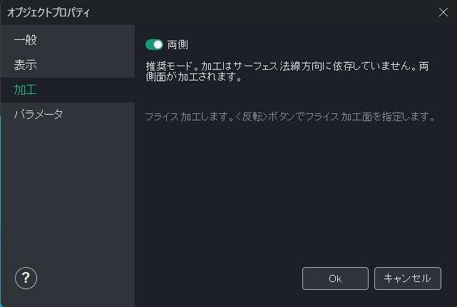
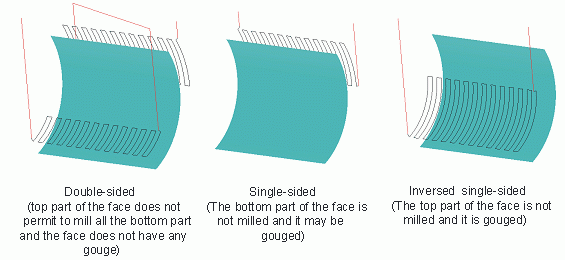

# <加工>タブ

＜<strong>両側</strong>＞ サーフェスのタイプを設定することができます。ジオメトリモデルを読み込むと、すべてのサーフェスは 「両面」 に設定されます。これは、法線ベクトルの方向に関係なく、両側からサーフェス加工が実行されます。そのため、実際に加工されるサーフェスの面は 空間上の位置に判断され、上側の面が加工されます。このモードは サーフェスモデルに対して使用することが推奨されます。また、この設定は 計算時間にほとんど影響を与えません。

ユーザーは、加工する面の側を指定することもできます。そのためには、＜<strong>両側</strong>＞フィールドのチェックを外す必要があります。この場合、システムは サーフェスの法線ベクトルが向いている側のみ加工を許可します。加工する側は、[反転](34.md)機能を使用して選択します。サーフェス加工を片面モードで行う場合、ツールパスの計算は 両面サーフェスを加工する場合よりも高速になりますが、法線が下向きになっているサーフェス部分は加工されない可能性があります。このモードは、すべての法線が外側を向いているソリッドモデル、または サーフェス数が少ないモデルでの使用が推奨されます。

<em>注意: 「両面」ではないサーフェスにおいて法線ベクトルの向きが正しくない場合、加工操作の実行時に誤った結果が生じる可能性があります。</em>
