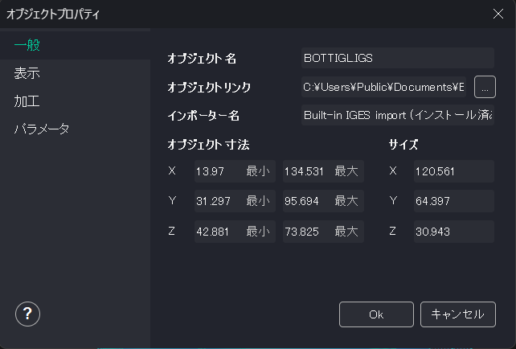

# Aba Geral

Na guia de propriedades gerais, se um objeto for selecionado, seu nome poderá ser alterado. Também são exibidas as coordenadas mínimas e máximas dos objetos selecionados ao longo de cada um de seus eixos.

**Object Name** - nome do objeto selecionado. Se vários nomes forem selecionados, o campo ficará vazio.

**Object dimensions** - dimensões gerais do objeto selecionado.
