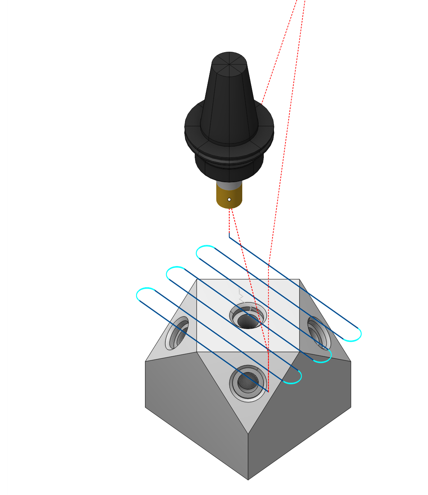
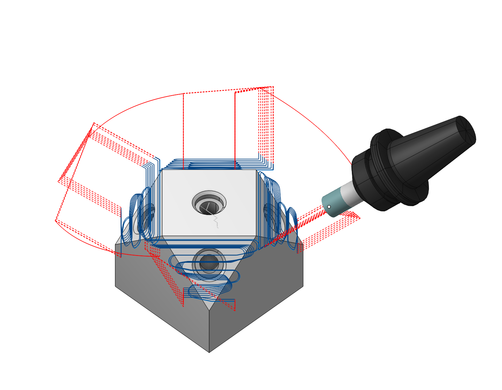
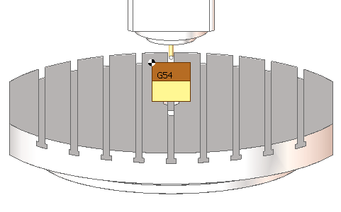
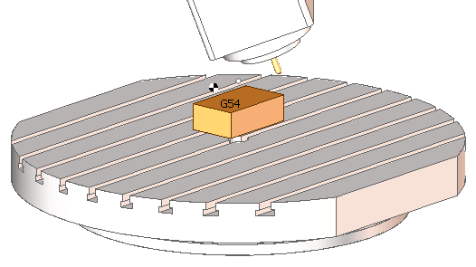
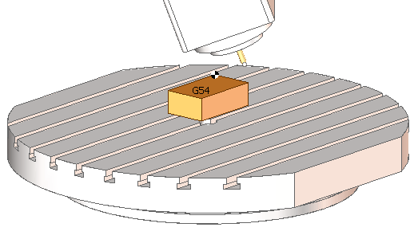

# オペレーションのローカル座標系

 

## 適用分野：

ワーク座標系に対してオフセットと回転を加えた座標系内で軌跡を生成することができます。例えば、ワーク座標系に基づく傾斜ポケット加工プログラムは、ポケットの傾斜に合わせたローカル座標系で作成すると、はるかに簡単になります。この方法は、割出5軸（3+2）加工に使用されます。「自動」を選択すると、ローカル座標系におけるZ軸の方向は、「工具の向き」グループのパラメータによって定義される工具回転軸に沿って自動的に設定されます。

## 操作の基本原則

オペレーションは、<strong>ローカル座標系</strong>でツールパスを生成します。デフォルトでは、オペレーションは [ワーク座標系](https://confluence.encycam.com/pages/viewpage.action?pageId=128526534)（G54）でツールパスを生成します。ただし、セットアップパネルの<strong>ローカル座標系</strong>パラメータを指定することで、この動作を変更することができます。

パラメータは2つの方法で設定できます。ドロップダウンリストからローカル座標系を選択し、「…」ボタンをクリックしてインタラクティブモードでローカル座標系を設定することができます。

ドロップダウンリストには以下のオプションがあります。

1. `オフ` ローカル座標系は無効です。ツールパスは[ワーク座標系](https://confluence.encycam.com/pages/viewpage.action?pageId=128526534)で生成されます。

<strong>初期マシン</strong><strong>構成 (A0 C0)</strong> G54はワークの左上隅にあり、ツーリングポイントは工具先端にあります。

<strong>ローカル座標系が有効になっていない5軸位置決め後のマシン構成（A20 C-40）</strong>ワークと工具は移動しますが、G54とツーリングポイントは変わりません。生成されるツールパスは、ワークのセットアップと工具の長さに依存します。

2. `自動` ローカル座標系の位置は、機械の回転軸の現在位置によって決定されます。 ローカル座標系のZ軸は、工具軸方向に整列しています。ローカル座標系の原点はワークのゼロ点（G54）の位置と一致しますが、インタラクティブモード（「…」ボタン）で簡単に移動できます。

<strong>初期マシン</strong><strong>構成 (A0 C0)</strong> G54はワークの左上隅にあり、ツーリングポイントは工具先端にあります。

<strong>ローカル座標系を自動に設定した5軸位置決め後のマシン構成（A20 C-40）</strong> G54は再びワークの左上隅にあり、ツーリングポイントは再び工具先端にあります。生成されるツールパスは、ワークのセットアップや工具の長さに依存しません。

そのため、通常はローカルCSパラメータの自動 オプションを使用します。詳細は オペレーションのローカル座標系を参照にしてください。

3. [幾何座標系](753.md)の一覧。オペレーションのローカル座標系を正確に定義するには、適切な幾何座標系を作成し、[ローカル座標系] のドロップダウンリストから選択します。

ローカル座標系CAMシステムを有効にすると、CLDataのヘッダセクションに原点コマンドが生成されます。 原点コマンドは、ツールパスの後処理に必要なすべてのデータを含んでいます。これらは以下の通りです。

1. MCS - 機械座標系(G54)に対するローカル座標系の相対位置です。このマトリックスは、工具中心点管理機能（TCPM）がない旧型コントローラで使用されます。

2. WCS - ワーク座標系（G54はワークと一緒に回転）に対するローカル座標系の位置です。このマトリックスは、TCPM機能によるコントロールで使用されます。

3. ローカル座標系の Z 軸に沿って工具軸を位置決めする回転軸の座標です。

ローカル座標系パラメータの横にある「…」のボタンをクリックすると、ローカル座標系定義のインタラクティブモードに入ります。ローカル座標系の位置決めが終わったら、OKをクリックして変更を適用します。[詳細を見る](260.md)

加えて、一部のコントローラでは、空間角度によるローカル座標系の定義をサポートしていません。これらの制御では、ローカルCSが実際の機械の回転角度によって定義され、ローカル座標系のZ軸に沿って工具軸方向を揃える必要があります。CAMシステムはそのようなコントロールをサポートします。対応するオプションは、機械プロパティの「コントロールパラメータ」セクションにあります。

別のコントロール機能として、 ローカル座標系の位置決めモードが用意されています。 このオプションは、原点コマンドを処理する際の制御装置の動作を決定します。CAMシステムは ローカル座標系位置決めの以下のモードをサポートします。(<strong>マシンセットアップ - 制御機パラメータ - 割出5軸加工 - ローカル座標系(原点)</strong>)

1.固定 - 原点コマンドは機械軸を移動させません。

2.回転 - 原点コマンドは、工具軸方向がローカル座標系のZ軸に整列するように、機械軸を回転させます。

3.移動 - 原点コマンドは、工具軸をローカル座標系のZ軸に一致させるように機械の回転軸を回転させ、さらに工具先端の位置がワークに対して同じ位置を保つように直線軸を移動させます。

次の表には、ポストプロセッサーが `原点` コマンドの代わりに生成できる最も一般的に使用されるCNC制御機用のコマンドが示されています。

| 原点 | G92 G68 | TRANS ROT | Cycle 7 Cycle 19 |
|---|---|---|---|
