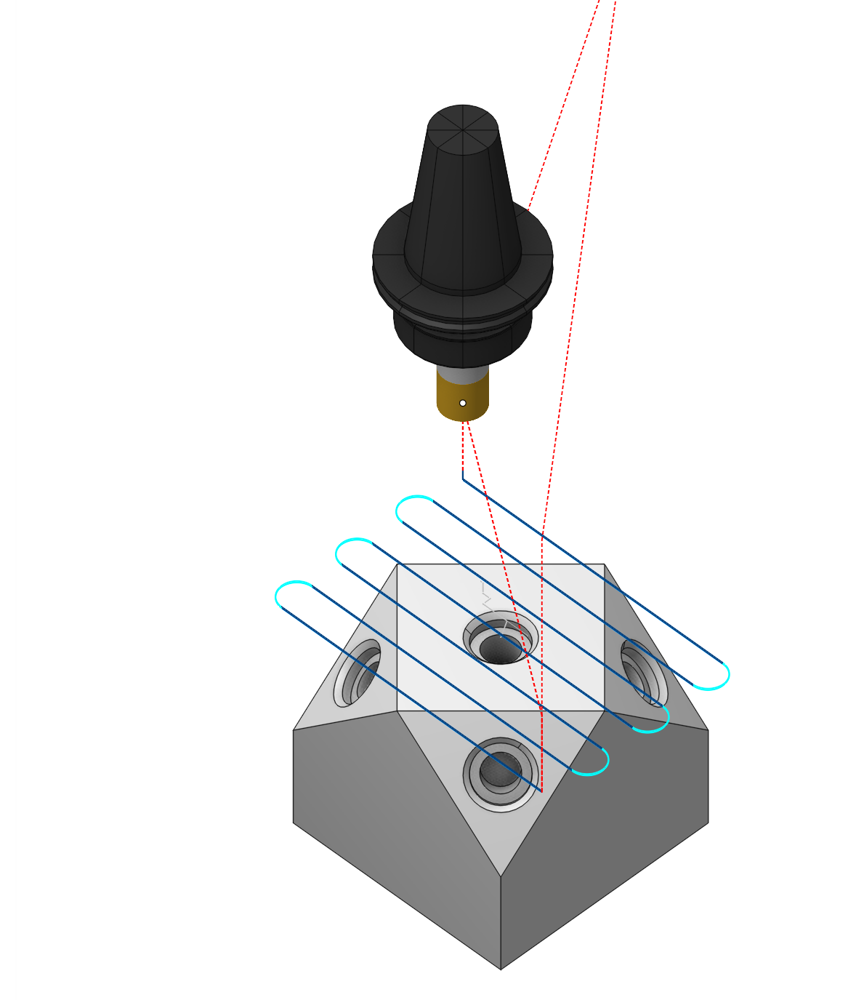
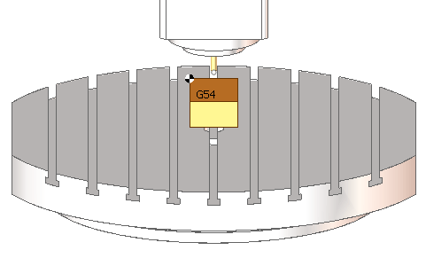
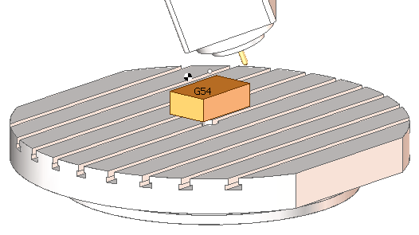
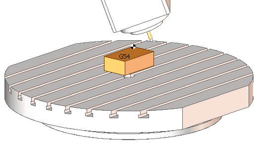

# Sistema de coordenadas local da operação

 

## Área de aplicação:

Permite gerar uma trajetória em um sistema de coordenadas adicionalmente deslocado e girado em relação ao sistema de coordenadas da peça de trabalho. Por exemplo, um programa para usinagem de um bolsão inclinado referente ao sistema de coordenadas da peça será muito mais simples se for derivado em um sistema de coordenadas local alinhado com a inclinação do bolsão. Esse método é usado para usinagem posicional de 5 eixos (3+2). Ao selecionar o valor 'Auto', a direção do eixo Z no sistema de coordenadas local é automaticamente definida ao longo do eixo de rotação da ferramenta, que é definido pelos parâmetros no grupo Tool Orientation.

## Princípios de trabalho

Uma operação gera o percurso da ferramenta em um sistema de coordenadas local. Por padrão, uma operação gera o percurso da ferramenta no [sistema de coordenadas da peça de trabalho](10068.md) (G54). No entanto, você pode alterar esse comportamento especificando o parâmetro Local CS no painel Setup.

O parâmetro pode ser definido de duas maneiras. Você pode selecionar o sistema de coordenadas local na lista suspensa e pode definir o sistema de coordenadas local no modo interativo clicando no botão de reticências.

A lista suspensa contém as seguintes opções:

1. **Off** - o sistema de coordenadas local está desativado - o percurso da ferramenta é gerado no [sistema de coordenadas da peça de trabalho](10068.md).

<strong>Configuração inicial da máquina (A0 C0)</strong>. O G54 está no canto superior esquerdo da peça de trabalho e o ponto da ferramenta está na ponta da ferramenta.

<strong>Configuração da máquina após o posicionamento de 5 eixos sem o Local CS ativado (A20 C-40)</strong>. A peça de trabalho e a ferramenta são movidas, mas o G54 e o ponto da ferramenta permanecem os mesmos. O percurso da ferramenta gerado dependerá da fixação da peça de trabalho e do comprimento da ferramenta.

2. **Auto** - a posição do sistema de coordenadas local é determinada pela posição atual dos eixos rotativos da máquina. Os eixos Z do LCS estão alinhados com a direção do eixo da ferramenta. A origem do LCS coincide com a posição do ponto zero da peça de trabalho (G54), mas é possível realocá-la facilmente no modo interativo (botão de reticências).

<strong>Configuração inicial da máquina (A0 C0)</strong>. O G54 está no canto superior esquerdo da peça de trabalho e o ponto da ferramenta está na ponta da ferramenta.

<strong>Configuração da máquina após o posicionamento de 5 eixos com Local CS definido como AUTO (A20 C-40)</strong>. O G54 está novamente no canto superior esquerdo da peça de trabalho e o ponto da ferramenta está novamente na ponta da ferramenta. O percurso da ferramenta gerado será independente da fixação da peça de trabalho e do comprimento da ferramenta.

Portanto, em geral, use a opção Auto do parâmetro Local CS. Para obter mais informações, consulte o tópico Sistema de coordenadas local da operação.

3. A lista de [sistemas de coordenadas](753.md) geométricos. Para definir o sistema de coordenadas local da operação exatamente como você deseja, é possível criar um sistema de coordenadas geométricas apropriado e selecioná-lo na lista suspensa Local CS.

 Quando você ativa um sistema de coordenadas local, o sistema CAM gera o comando Origin na seção de cabeçalho do CLData. O comando de origem contém todos os dados necessários para o pós-processamento do caminho da ferramenta. São elas:

1. MCS - a posição do sistema de coordenadas local em relação ao sistema de coordenadas da máquina (G54). Essa matriz é usada em controles antigos sem a função de gerenciamento do ponto central da ferramenta (TCPM).

2. WCS - a posição do sistema de coordenadas local em relação ao sistema de coordenadas da peça de trabalho (G54 girado junto com a peça de trabalho). Essa matriz é usada nos controles com a função TCPM.

3. Coordenadas dos eixos rotativos que posicionam o eixo da ferramenta ao longo do eixo z do sistema de coordenadas local.

Ao clicar no botão de reticências ao lado do parâmetro Local CS, você entra no modo interativo de definição do Local CS. Depois de posicionar o sistema de coordenadas local, basta clicar em OK para aplicar as alterações. [Detalhes](260.md)

Além disso, alguns controles não suportam a definição de um sistema de coordenadas local por ângulos espaciais. Esses controles exigem que o CS local seja definido pelos ângulos de rotação reais da máquina, alinhando a direção do eixo da ferramenta ao longo do eixo Z do sistema de coordenadas local. O sistema CAM suporta esses controles. A opção correspondente está disponível na seção Parâmetros de controle nas propriedades da máquina.

Outro recurso de controle é o modo de posicionamento Local CS. Essa opção determina o comportamento do controle quando ele trata o comando Origin. O sistema CAM suporta os seguintes modos de posicionamento do CS local. (Configuração da máquina - Parâmetros de controle - Usinagem indexada de 5 eixos - Sistema de coordenadas local (ORIGIN))

1. Stay (Permanecer) - o comando de origem não move os eixos da máquina.

2. Girar - o comando de origem gira os eixos da máquina de forma que a direção do eixo da ferramenta fique alinhada com o eixo Z do sistema de coordenadas local.

3. Mover - o comando de origem gira os eixos da máquina para alinhar o eixo da ferramenta com o eixo Z do sistema de coordenadas local e move os eixos lineares de forma que a posição da ponta da ferramenta permaneça a mesma em relação à peça de trabalho.

Na próxima tabela, há comandos para os controles CNC mais usados que podem ser gerados pelo pós-processador em vez do comando **ORIGIN**.

| Origin | G92 G68 | TRANS ROT | Cycle 7 Cycle 19 |
|---|---|---|---|
