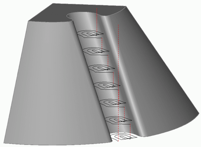

# 取り残し加工

取り残し加工では、前回の加工の後に未加工の加工代が残っている領域のみを対象に加工を行うことができます。また、ユーザーが定義した工具リストを使用して実行した「仮想」加工後に残った加工代を加工することもできます。これらの加工は、前工程で使用した工具とは異なる形状の工具または小径の工具を使用して、荒加工または仕上げ削りを行うために設計されています。取り残し加工を使用することで、複雑な形状を持つモデルの加工時間を大幅に短縮でき、コスト削減につながります。

取り残し加工は、他の加工と同じで、異なるのは割り当てられたデフォルトのパラメーターのみです。これらのデフォルト設定では、より小径の[工具](37.md)が選択され、ワークは「取り残し素材」として設定されます。取り残し加工では、荒取り加工が“体積”として残っている残材を除去し、仕上げ加工は未加工領域にあるモデル表面のみを加工します。

取り残し加工では、ワークを「それまでの前工程のすべてのオペレーション後に残った材料」として選択することで、システム内で残り加工を有効にできます。ワークの計算および未加工領域の選択は、システムによって自動的に行われます。この方法は、広く使用されている任意のサイズの工具で加工後に残材を処理する方法と比較して、いくつかの大きな利点があります。第一に、前工程の加工で互換性のない定義が使用されていた場合でも、残材を正しく計算することができます。また、取り残し加工方法を作成する際には、これまでに使用したすべての加工とその特性（工具の種類など）が考慮されます。

取り残し加工におけるすべての加工特性は、同種の通常の加工と同様です。
