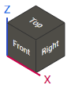
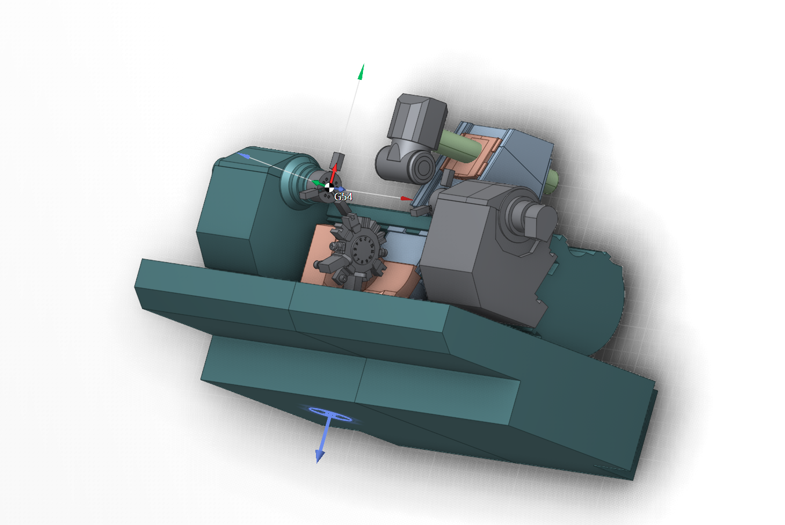
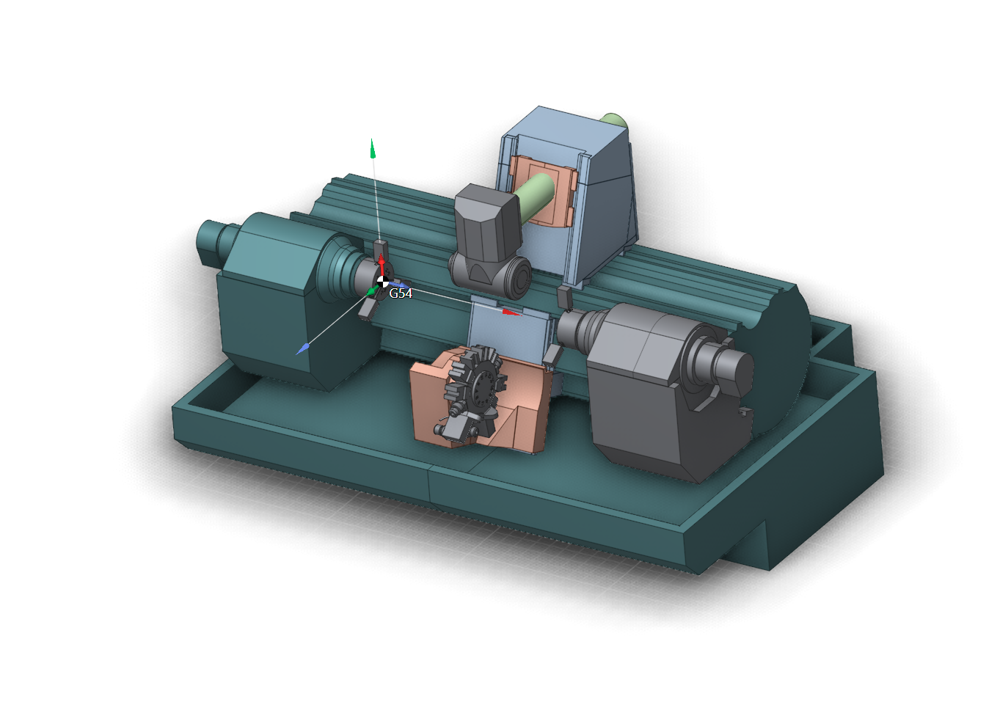

# ビューキューブ

メインウィンドウの標準ビューパネルは、旋削加工やフライス加工などの機械の種類によって異なる場合があります。 ボタンの1つが選択されると、対応するビューベクトルがグラフィックウィンドウに設定されます。グラフィックウインドウのビューベクトルが他の方法で変更された場合、パネル上の選択されたボタンは自動的に解除されます。

<strong>[マウス中央ボタン</strong>]（マウスホイール）をクリックすると、最も近い標準ビューの1つが設定されます。

## ビューキューブのメニュー

カーソルをビューキューブに重ねると、その左上隅に **⋮** ボタンが表示されます。このボタンで開くメニューから、シーンの環境表示のオン/オフを切り替え、床に対する機械の位置を設定します。

**Environment**（環境）。グラフィックウィンドウに床を表示または非表示にします。Studio テーマでは、床と一緒にスタジオの壁と床の影も表示されます。選択した状態はセッション間で保持されます。スケッチグリッドがオンの間は、この項目は使用できません。

床のコマンドは、**Environment** がオンで、グラフィックウィンドウに機械が表示されている場合に使用できます。

**Define floor**（床の定義）。選択したサーフェスを基準に、機械を床に配置します。コマンドを選択した後、床に接する機械のサーフェスをクリックします。カーソルの下のマーカーが、点とサーフェスの法線方向を示します。選択をキャンセルするには、**Esc** を押すか、マウスの右ボタンをクリックするか、グラフィックウィンドウの外側をクリックします。

*床を定義した後の機械。*

*床の位置が自動の機械。*

**Rotate 90°**（90°回転）。床の上の機械を垂直軸まわりに 90° 回転します。

**Reset**（リセット）。機械の底面で決まる床の自動位置に戻します。このコマンドは、**Define floor** または **Rotate 90°** で床の位置を変更した場合に使用できます。

メニューのコマンドで設定した床の位置はプロジェクトに保存されます。自動位置はプロジェクトに書き込まれません。

*機械の全体表示では、ビューキューブの面は床に従います。部品を拡大表示すると、キューブはシーン座標系に戻ります。*
