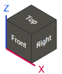
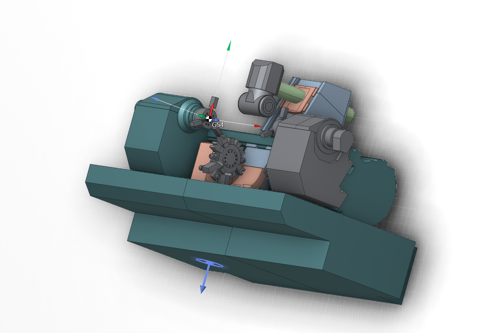
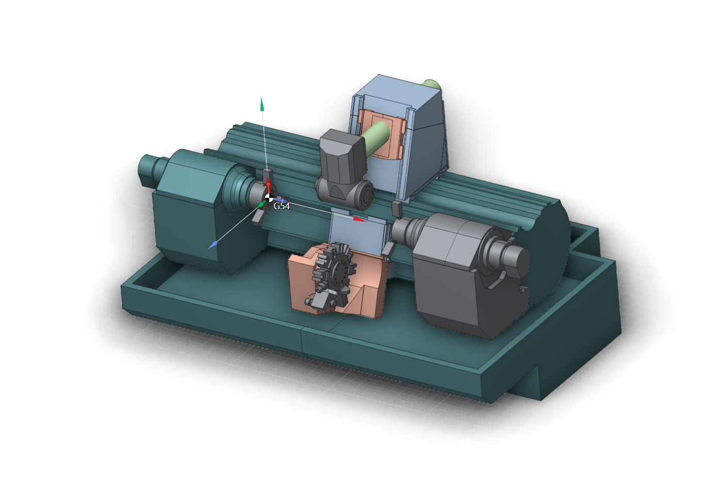

# View cube

The standard views panel in the main window may vary depending on the type of machine, such as turning or milling, etc. When one of the buttons is selected, the corresponding view vector is set in the graphic window. If the view vector in the graphic window is changed by another method, the selected button on the panel will automatically release.

Clicking the [<strong>Middle Mouse Button</strong>] (Mouse Wheel) sets one of the nearest standard views.

## View cube menu

When the cursor hovers over the view cube, the **⋮** button appears in its upper-left corner. The button opens a menu that turns the scene environment on or off and sets the position of the machine on the floor.

**Environment.** Shows or hides the floor in the graphic window. In the Studio theme, the studio walls and the shadows on the floor are displayed together with the floor. The selected state is kept between sessions. The item is unavailable while the sketch grid is turned on.

The floor commands are available when **Environment** is turned on and the machine is displayed in the graphic window.

**Define floor.** Places the machine on the floor by the selected surface. After selecting the command, click the surface of the machine that stands on the floor. A marker under the cursor shows the point and the normal direction of the surface. To cancel the selection, press **Esc**, click the right mouse button, or click outside the graphic window.

*Machine after defining a custom floor.*

*Machine with the automatic floor position.*

**Rotate 90°.** Rotates the machine on the floor by 90° about the vertical axis.

**Reset.** Restores the automatic floor position defined by the bottom of the machine. The command is available when the floor position has been changed with **Define floor** or **Rotate 90°**.

The floor position set with the menu commands is saved in the project. The automatic position is not written to the project.

*In an overall view of the machine, the faces of the view cube follow the floor. When the view is zoomed in on the part, the cube returns to the scene coordinate system.*