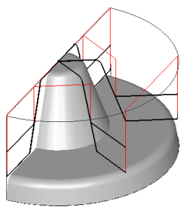

# ドライブ荒加工オペレーション

ドライブ曲線による荒加工後のモデルは、必要な仕上がり形状に非常に近くなる場合があります。ただし、除去する材料の体積が均一でないため、必ずしも加工時間を最適化できるとは限りません。ドライブ荒加工オペレーションは、モデルの周辺（外縁）が中心より低く、ワークの外側輪郭がモデルの輪郭に近い場合に推奨されます。

ドライブ荒加工の加工対象モデルは、ソリッドボディ、サーフェス、およびメッシュオブジェクトの集合で指定します。幾何オブジェクトまたはそのグループごとに追加のストックを定義でき、加工時にオペレーション全体のストックへ加算されます。

ワークには、直方体、円柱、ストック付きの型形状、角柱形状、前のオペレーションによる加工後の残材、または任意形状の幾何モデルを指定できます。任意形状モデルは、ソリッドボディ、サーフェス、メッシュ、および閉曲線の投影を底面とする角柱で構成できます。制限モデルには、加工時に考慮するソリッドボディ、サーフェス、メッシュのほか、閉曲線の投影で定義した加工領域と制限領域を指定できます。

このオペレーションは、加工対象モデルと制限モデルの両方の外側にあるワーク素材をすべて除去します。平面加工オペレーションと同様に、個別のパスによって立体モデルのサーフェスを加工します。オペレーションのパラメータに応じて、加工パスは垂直平面内（ガイド曲線を横切る方向）、またはガイド曲線が形状と位置を定義する垂直な数学的円筒面上（ガイド曲線に沿う方向）に配置されます。隣接パス間のピックフィードは、一定値、または指定したスキャロップ高さから計算した値にできます。工具への負荷を抑えるため、切込み深さ（Z軸）を制限できます。除去するワーク素材の厚さが指定した深さを超える場合、複数回のパスで除去します。

ローカル座標系または回転ヘッドを使用する場合、加工対象モデルの位置は変わりません。工具回転軸はローカル座標系のZ軸と平行になり、すべての加工パスは、ローカル座標系の水平面に垂直な平面または数学的円筒面上に配置されます。

加工中、指定した角度を超えて工具を材料に切り込ませてはならない場合は、工具の下向き移動を制限できます。制限の種類には、上向き加工のみ、最大切込み角度を指定してシャドウ領域の取り残し加工を行わない方法、最大切込み角度を指定してシャドウ領域の取り残し加工を行う方法、および下向き移動を制御しない方法があります。

加工パス間の移動は、最短距離、アプローチと退避の移動を追加する方法、または安全平面を経由する方法で行えます。深さごとに材料を除去する場合、最初の深さの材料をすべて除去してから、次の深さの加工を開始します。

高速計算方法も使用できます。
