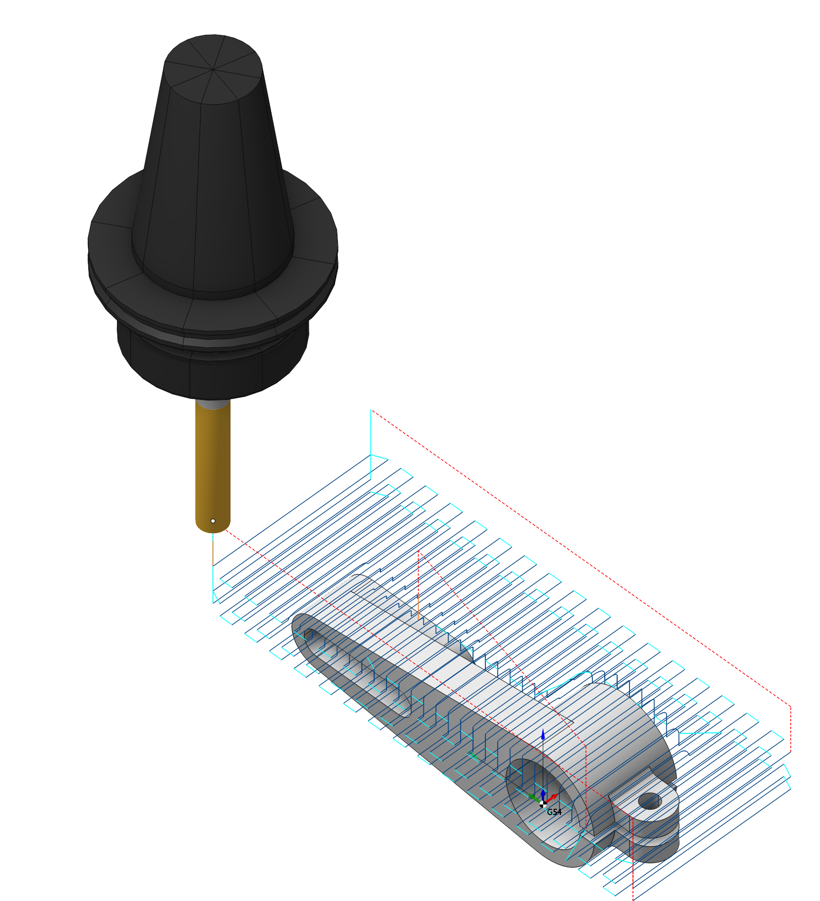
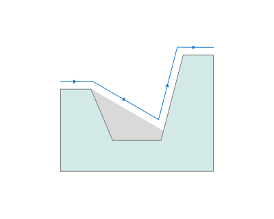
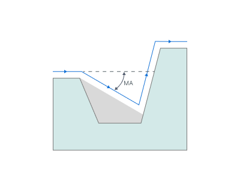
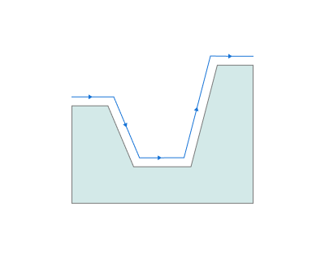
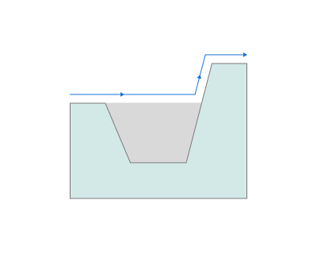

# Ebenenschruppen

## Anwendungsbereich:

Das Ebenenschruppen erzeugt bei vergleichbaren Parametern meist ein Ergebnis, das näher an der Fertigteilform liegt als bei einer Wasserlinienstrategie. Es eignet sich zum Schruppen bei deutlichen Formunterschieden zwischen Rohteil und Bauteil sowie zum Fräsen weicher Werkstoffe.

### Einrichtung:

Auf der Registerkarte **Setup** werden grundlegende Projektparameter festgelegt, beispielsweise Bauteillage und Werkstückkoordinatensystem. [Details](1022.md)

### Auftragszuweisung:

**Faces (Flächen).** Wählt die zu bearbeitenden Bauteilflächen aus. Die Bahn wird anhand dieser Flächen berechnet. [Details](102121.md)

**Pocket (Tasche).** Erkennt einfache Geometrieelemente prismatischer oder gedrehter und gefräster Bauteile und übernimmt sie als Bearbeitungsbereiche und -ebenen in die Auftragszuweisung. [Details](10154.md)

**Job Zone (Bearbeitungsbereich).** Definiert die bei Schrupp- und Schlichtoperationen zu bearbeitenden Bereiche. [Details](10151.md)

**Restrict Zone (Sperrbereich).** Definiert Bereiche, die in dieser Operation nicht bearbeitet werden sollen. [Details](10152.md)

**Top Level (Obere Ebene).** Legt die obere Bearbeitungsebene anhand von Modellelementen fest. [Details](10153.md)

**Bottom Level (Untere Ebene).** Legt die untere Bearbeitungsebene anhand von Modellelementen fest. [Details](10153.md)

**Properties (Eigenschaften).** Öffnet die Elementeigenschaften, beispielsweise zur Eingabe eines Aufmaßes. Auch durch Doppelklick auf einen Listeneintrag erreichbar.

**Delete (Löschen).** Entfernt ein Element aus der Liste.

**Restrictions (Begrenzungen).** Definiert nicht zu bearbeitende Bereiche. [Details](101231.md)

### Strategie:

#### Bahnabstand.

Maximal zulässige Schnittbreite. Diese Parameter entsprechen denen beim Ebenenschlichten. [Details](713.md)

#### Schnitttiefe.

Materialabtrag je Durchgang entlang der Werkzeugachse zwischen oberer und unterer Bearbeitungsebene.

Weitere Informationen anzeigen

**Descent (Abwärtsbewegung).** Begrenzt das Abwärtsfahren im Material. Dies ist sinnvoll, wenn Werkzeuggeometrie oder Werkstoffeigenschaften nur ein Einfahren unter begrenztem Winkel zulassen.

**Without checking (Ohne Prüfung).** Abwärtsbewegungen im Material werden nicht begrenzt. Verbleibende Formabweichungen ergeben sich ausschließlich aus der Werkzeuggeometrie.

**Max angle (Maximaler Winkel).** Abwärtsbewegungen im Material überschreiten den angegebenen Winkel nicht.

**MA** — maximaler Winkel.

**Clear shadow (Verdeckte Bereiche nachbearbeiten).** Entfernt zusätzlich das in Vertiefungen verbleibende Material. Dazu bewegt sich das Werkzeug entlang der Bahn vor und zurück und wird gleichzeitig unter dem vorgegebenen Winkel zugestellt.

**Go up only (Nur aufwärts).** Verhindert Abwärtsbewegungen innerhalb des Materials vollständig. Restmaterial in Vertiefungen wird nicht nachbearbeitet. Das Verfahren eignet sich für konvexe Bauteile; Nuten und Taschen benötigen weitere Bearbeitung.

#### Bearbeitungsebenen.

Legt den Bereich entlang der Werkzeugachse fest. Die Parameter entsprechen denen beim Wasserlinien-Schruppen. [Details](736.md)

#### Fräsart

Legt Gleich- oder Gegenlauf für die Bahnberechnung fest. Diese Einstellung steht in den meisten Operationen außer der Kurvenbearbeitung zur Verfügung. Die Parameter entsprechen denen beim Wasserlinien-Schruppen. [Details](736.md)

#### Ecken glätten.

Abrupte Richtungswechsel erfordern Abbremsen und erneutes Beschleunigen und können Schwingungen sowie erhöhten Verschleiß verursachen. Die Glättung verrundet die Bahn an Innen- und Außenecken mit dem vorgegebenen Radius und reduziert solche Unstetigkeiten.

#### Begrenzung.

Ermöglicht das Auslassen nicht zu bearbeitender Flächen und das Verlängern der Bahn. Ein Teil der Parameter entspricht dem Ebenenschlichten. [Details](713.md)

### Parameter:

Diese Registerkarte enthält die grundlegenden Einstellungen für Bauteil, Rohteil, Spannmittel und weitere Elemente, die die Werkzeugbahn beeinflussen. [Details](100112.md)

### Verbindungen und An-/Abfahrbewegungen:

Auf der Registerkarte **Links/Leads** werden die Verbindungsbewegungen festgelegt: Anfahren von der Werkzeugwechselposition, Einfahren zum Beginn der Arbeitsbahn, Abfahren nach dem letzten Arbeitsgang, Verbindungen zwischen den Bahnen und Rückkehr zur Werkzeugwechselposition. Einstellbar sind die Reihenfolge der Achsbewegungen, der Bahnverlauf und die Abstände.

Weitere Informationen anzeigen

**Parametergruppen:**

**Approach/Return (Anfahren/Rückkehr).** Steuert die Bewegung von der Werkzeugwechselposition zum Beginn der Werkzeugbahn und zurück. [Details](100116.md).

**Safe motions (Sichere Bewegungen).** Legt die Art der Sicherheitsfläche und ihren Abstand zum Rohteil fest. Die Fläche dient für Verbindungen zwischen bearbeiteten Flächen oder Werkzeugbahnen sowie für die erste Phase des Anfahrens bzw. der Rückkehr. [Details](100117.md).

**Advanced links settings (Erweiterte Verbindungseinstellungen).** Steuert die Bahnerzeugung insbesondere bei 5-Achsen-Operationen unter Berücksichtigung günstiger Drehachsbewegungen. [Details](100118.md).

**Links (Verbindungen).** Legt die Regeln für Ein- und Ausfahrverbindungen sowie Verbindungen zwischen Arbeitsbewegungen fest. [Details](100131.md).

**Leads (An-/Abfahrbewegungen).** Ergänzt zusätzliche Ein- und Ausfahrbewegungen an den Arbeitsbahnen mit den dafür vorgesehenen Vorschüben. [Details](100135.md).

**Distances (Abstände).** Abstände für das Umschalten der Vorschubart. [Details](100138.md).

### Vorschübe und Drehzahlen:

Legt Spindeldrehzahl, Eilgang und Vorschübe für die verschiedenen Bahnabschnitte fest. Die Drehzahl kann direkt in Umdrehungen pro Minute oder über die Schnittgeschwindigkeit vorgegeben werden. Der vorgegebene Wert wird unterstrichen; der andere wird anhand des Werkzeugdurchmessers berechnet. [Details](100142.md)

### Transformationen:

Koordinatentransformationen des berechneten Werkzeugwegs. [Details](10168.md).

### Bauteil:

Geometrische Elemente zur Prüfung auf unerwünschte Einschnitte. [Details](330.md)

### Rohteil:

Modell des zu bearbeitenden Materials. [Details](738.md)

### Spannmittel:

Hier werden Spannmittel wie Spannfutter, Greifer und Spannpratzen sowie weitere Sperrbereiche angegeben. [Details](10283.md)
