# ウォーターライン荒加工

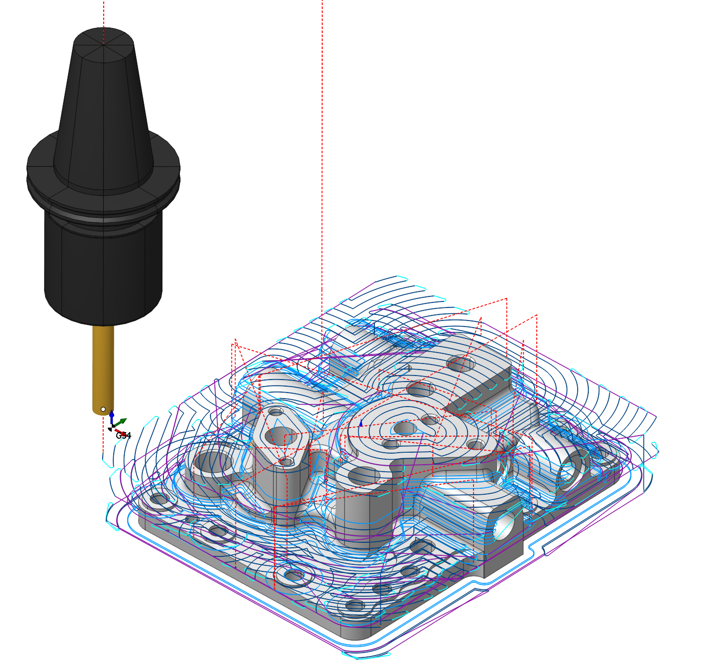

## 適用分野：

ウォーターライン荒加工は、元のワーク形状から大きく異なる複雑形状モデルの初期荒加工に使用します。ウォーターライン荒加工で加工するモデルは、ソリッドボディ、サーフェス、メッシュ要素のセットによって指定します。各幾何要素または要素グループごとに、加工中にメイン ストック に加算される追加ストックを設定できます。

### セットアップ：

<strong>セットアップ</strong>タブは、プロジェクトの主要なパラメータを設定するために使用します。これには、装置上の部品の位置、部品の座標系などが含まれます。[詳細を見る](1022.md)

### ジョブ割り当て：

<strong>フェイス</strong> 部品のさまざまな面を加工対象として選択します。システムは、選択した面に基づいて軌道を計算します。[詳細を見る](102121.md)

<strong>ポケット</strong> 典型的なプリズマティック部品や旋削フライス部品は、多くの単純形状で構成されています。この作業を簡略化するために、3Dモデルから部品の要素を認識し、加工領域や加工高さなどの基本的なジョブ割り当て項目に自動変換できます。[詳細を見る](10154.md)

<strong>ジョブゾーン</strong>（加工領域） ジョブゾーンは、荒加工と仕上げ加工で加工される部品領域を定義するために使用します。[詳細を見る](10151.md)

<strong>制限領域</strong> <strong>ジョブゾーン</strong>に加えて、<strong>制限領域</strong>を使用することで、現在のオペレーションで加工しないワーク領域を指定できます。[詳細を見る](10152.md)

<strong>上部高さ</strong> モデル要素に基づいて上部高さを指定します。 [詳細を見る](10153.md)

<strong>底部高さ</strong> モデル要素に基づいて底部高さを指定します。 [詳細を見る](10153.md)

<strong>プロパティ</strong> 要素のプロパティを表示します。ストックを追加することも可能です。また、リスト内の項目をダブルクリックすることでも、このメニューを表示できます。

<strong>削除</strong> リストから項目を削除します。

<strong>制限</strong> 加工してはならない領域を制限できます。[詳細を見る](101231.md)

### 加工設定：

#### 加工ストラテジー：

このパラメータにより、ポケット加工を行う際に、平行、等距離などのツールパスを生成することができます。

詳細を表示

<strong>加工方法の種類：</strong>

詳細を表示

<strong>等ピッチ</strong> 部品の輪郭をオフセットして得られる曲線に沿った加工方法です。 [詳細を見る](10172.md)

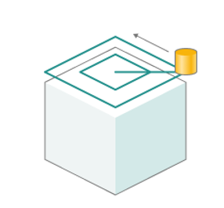

<strong>平行</strong> 平行パスによる加工方法です。 [詳細を見る](10172.md)

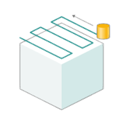

<strong>アダプティブ</strong> 高速送り、最大切削深さ（刃長まで）、および比較的浅い切削幅（工具径の5〜30％）を使用して、大量の素材を効率的に除去するために使用します。[詳細を見る](10171.md)

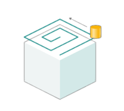

<strong>HPC</strong> HPC（ハイパフォーマンス切削）方法は、開いたポケット および閉じたポケット内の素材を効率的に除去するために設計されています。 [詳細を見る](10148.md)

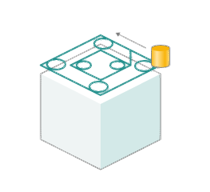

<strong>ディープHPC</strong> コーナー部での追加のループ動作を伴う等距離加工を行います。 [詳細を見る](10172.md)

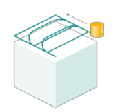

ポケット加工の選択方法についても参照してください。[詳細を見る](10172.md)

以下は主要パラメータです。設定できる項目は、<strong>加工設定</strong>セクションで <strong>選択した方法によって</strong>異なります。

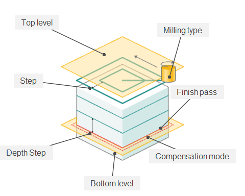

<strong>ステップ</strong> 切削の最大許容幅を設定します。

<strong>HSCステップ</strong> トロコイド円弧のステップを、現在の工具径の割合、または固定距離として設定できます。高速切削が無効になっている場合は、未加工領域が残る場合があります。

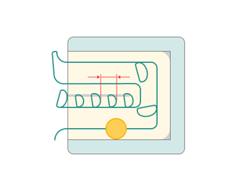

<strong>大円弧</strong> パス間の軌跡上の円弧を拡張します。

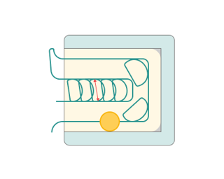

<strong>仕上げ</strong> 加工方法によっては、仕上げパスが追加されます。仕上げパスの前に、パラメータで指定した値と同じ許容量が加えられます。

 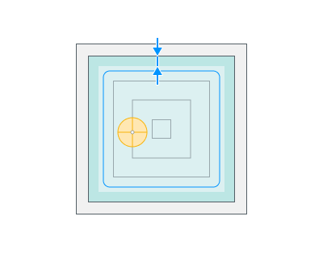

<strong>補正モード 2D輪郭加工</strong>の<strong>出力</strong>グループと同様です。<strong>[詳細を見る](404.md)</strong>

<strong>仕上げR半径</strong> 仕上げ パスでコーナーを丸めるために必要なパラメータです。

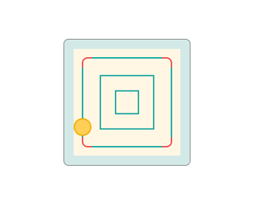

<strong>荒取りR半径</strong> 荒取りパスでコーナーを丸めるために必要なパラメータです。

<strong>リンク半径</strong> リンクの接続やトロコイド円弧間の移行動作に使用するリンク半径です。

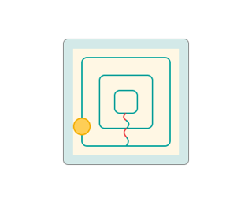

<strong>角度</strong> 平面加工における切削方向の角度を設定します。

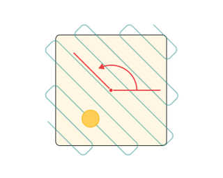

<strong>コーナーの円滑化</strong> 実質的に ほとんどのオペレーションで使用され、内側コーナーの加工時にツールパスを“丸める”役割を果たします。これにより振動が減少し、加工速度が向上します。輪郭内の荒取りパスには丸め処理は適用されません。

#### 加工高さ：

工具軸に沿った加工範囲を定義します。

詳細を表示

<strong>上部高さ</strong> 最終パスを実行する高さを設定します。デフォルトでは、加工対象パーツの最上位に設定されています。

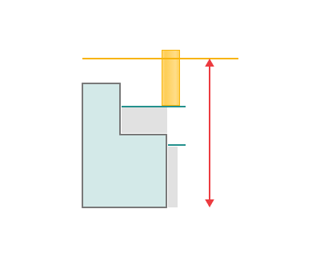

<strong>底部高さ</strong> マウスで平面をドラッグするか、平面の中心円をドラッグして「スマートスナップ」機能を使用し、フィーチャーに合わせて配置します。または、グラフビュー内の寸法をクリックして、加工する底面高さを設定します。欄内の文字が緑色で表示されている場合、その高さはパーツ、ワーク、および治具の上端として自動計算されます。自動モードに戻すには、入力欄を空にして「Enter」キーを押します。

#### 深さ方向のステップ：

<strong>上部高さ</strong>と<strong>底部高さ</strong>の間で、工具軸方向に一回のパスで除去される材料量を設定します。

以下は主要パラメータです。設定できる項目は、加工設定セクションで 選択した方法によって異なります。

詳細を表示

<strong>ステップアップ</strong> 加工は、上から下へ順番に実行されます。

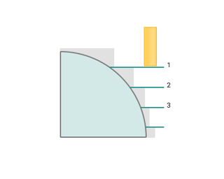 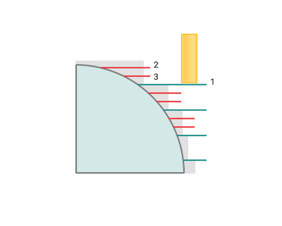

<strong>ステップアップ値</strong> 既に加工された層から、上層までの距離を設定します。

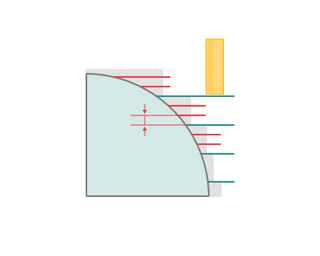

<strong>逃げ角。</strong> 正の値を入力すると、加工深さが増したときに工具シャンクが擦れることを防ぎます。[詳細を見る](256.md)

#### 平坦部の除去。

平坦面に対して追加パスを適用します。

詳細を表示

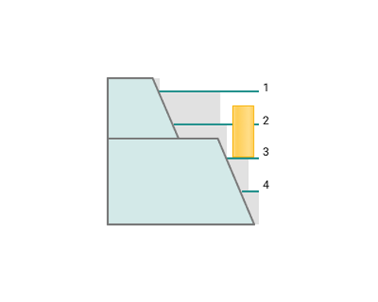 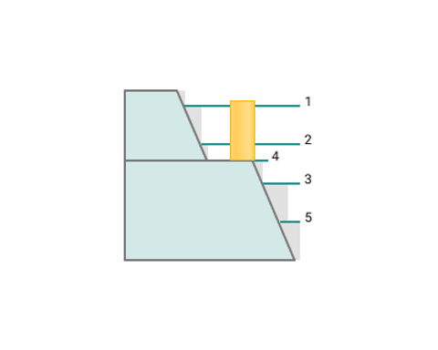

以下は主要パラメータです。設定できる項目は、<strong>加工設定</strong>セクションで <strong>選択した方法によって</strong>異なります。

<strong>平坦面仕上げ送り</strong> 平坦面のパスを仕上げ送りで出力します。仕上げ高さとは併用できません。

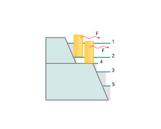

<strong>仕上げ高さ</strong> 「平坦部認識」オプションが有効な場合、平坦部認識パスからパラメータで指定した距離の位置に新しいパスを追加します。

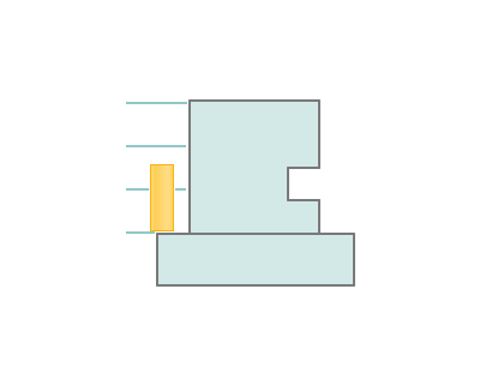 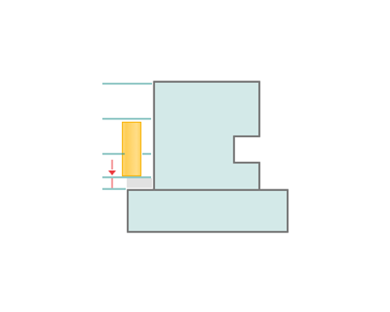

#### ミーリングタイプ：

曲線加工操作は除き、ほとんどすべてのオペレーションで設定できます。この設定により、ツールパスの計算プロセス中に、必要なフライス加工タイプ（ダウンカットまたはアップカット）を制御できます。

詳細を表示

<strong>ダウンカット</strong> 加工では、工具がワークの回転方向と同じ方向に移動する切削方法を指します。通常、工具がワークの回転と逆方向に移動する「アップカット」に比べ、工具の摩耗が少なく、仕上げ面も滑らかになります。高精度と良好な表面仕上げが求められる場合に好まれる手法です。

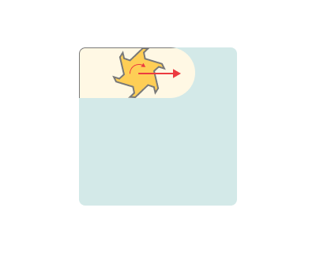

<strong>アップカット</strong> 工具がワークの回転方向に対して逆方向に移動する切削方法を指します。この切削方法も機械加工で一般的に使用されますが、工具がワークの回転と同じ方向に動く「ダウンカット」に比べ、工具の摩耗が大きくなり、仕上がりが粗くなる場合があります。アップカットは、仕上げ面よりも工具寿命や切りくず排出などを優先する場合に選択されることがあります。

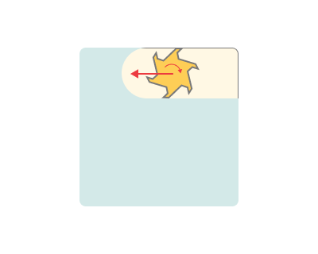

<strong>両方</strong> 加工中に「ダウンカット」と「アップカット」の両方の切削方法を使用します。この方法は、ワークの各部位や加工工程ごとの要求に応じて、工具性能、仕上げ面、その他の加工条件を最適化するために使用できます。これにより、加工結果において望ましい結果を得るための柔軟性と制御性が向上します。

#### 並べ替え：

サーフェス加工中におけるツールパスの順序を設定します 。

詳細を表示

以下は主要パラメータです。設定できる項目は、<strong>加工設定</strong>セクションで<strong>選択した方法によって</strong>異なります。

<strong>領域優先</strong> 最初の輪郭の全高さが最初に加工されます。その後、次のプロファイルの全高さが加工されます。

<strong>高さ優先</strong> すべての輪郭の最初の層が先に加工されます。その後、次の層が加工されます。

<strong>下方向のみ</strong> 加工の順序を、必ず上から下へ進むように並べ替えます。この設定により、最適ではないツールパスが作成される場合があります。高さの並び替えでエラーが発生した場合にのみ、このオプションを有効にしてください。これにより、問題が解消される場合があります。

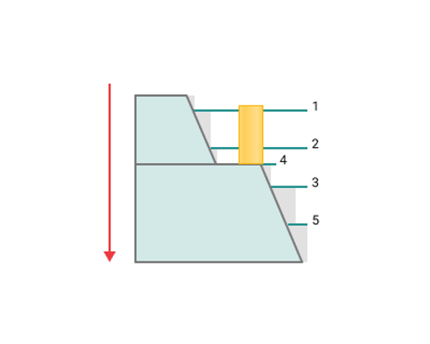

<strong>加工順序</strong> 曲線加工における加工順序を設定します。

<strong>直接</strong> 矢印（ 「角度」 パラメータ）の方向を見たときに、交点が矢印の左側から始まるように パスを並べ替えます 。 平行方法でのみ機能します。

<strong>反転</strong> 矢印（ 「角度」 パラメータ）の方向を見たときに、交点が矢印の右側から始まるように パスを並べ替えます 。 平行方法でのみ機能します。

<strong>最適化</strong> 交点が最短距離の位置から始まるようにパスを並べ替えます。（これにより、パス間の移動回数が削減されます。）このソート方法は、平行方法でのみ適用可能です。

トリミング

加工対象外の面をスキップしたり 、 ツールパスの延長またはトリミングをしたりできます。

詳細を表示

<strong>穴埋め</strong> モデルには、既に加工済みの穴や、後工程で加工する必要がある穴が含まれていることがよくあります。このような場合、穴を含む面を加工する際には、その穴を無視することができます。無視する穴は、円形に限らず任意の形状に対応しています。設定するサイズは、その穴を覆うことができるディスクの直径を表します。

 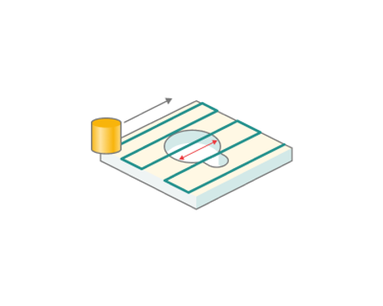

<strong>トリムロール</strong> 工具はモデルの鋭い外側コーナーに沿って“ローリング”しながら移動します。ツールパスは滑らかになりますが、必ずしも最適であるとは限りません。

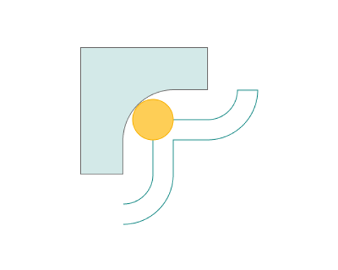 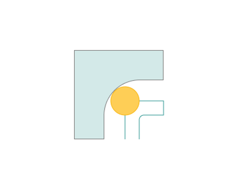

### パラメータ：

このタブには、パーツ、ワーク、治具などを制御し、ツールパスを変更するための主要なパラメータが含まれています。[詳細](100112.md)

### リンク／リード：

リンク／リードタブでは、早送り動作に関するパラメータを設定します。これらの移動には、工具交換位置からのアプローチ、切削パス開始点までの位置決め、最終切削後の退避動作、各パス間の移行移動、そして工具交換位置への復帰が含まれます。座標軸ごとの動作順序、各移動の軌跡、および移動量を設定できます。

詳細を表示

<strong>次の項目で構成されます。</strong>

<strong>アプローチ／リターン。</strong> このパラメータグループは、工具交換位置から進入動作の開始位置までの工具移動と、その復帰動作を管理します。[詳細](100116.md)。

<strong>安全動作</strong> <strong>安全サーフェス</strong>のタイプとワークから安全サーフェスまでの距離を設定します。このサーフェスは、加工サーフェスまたはツールパス間の移動を円滑にし、アプローチまたはリターンの最初の段階は、この面に向かって行います。[詳細を見る](100117.md)

<strong>高度なリンク設定</strong> このパラメータグループでは、主に5軸加工において、回転軸の最適な動きを考慮した軌道形成の特性を指定します。[詳細を見る](100118.md)

<strong>リンク。</strong> 進入/退出リンクと、加工移動間のリンクの規則を定義します。[詳細を見る](100120.md)。

<strong>距離。</strong> 送りを切り替えるために必要な距離です。[詳細を見る](100139.md)。

<strong>プランジを許可</strong> プこのオプションを有効にすると、閉じたポケット形状の加工が可能になります。CAMソフトウェアが外側から加工できない閉じたポケットを検出した場合、プランジ動作を生成します。 [詳細を見る](744.md)

### 送り速度設定：

このダイアログでは、主軸回転速度、早送り速度、およびツールパスの各領域の送り速度を設定できます。主軸回転速度は、毎分回転数または切削速度のいずれかで指定できます。基準となる値には下線が表示されます。もう一方の値は、工具径を考慮して基準値から再計算されます。[詳細](100142.md)

### 穴（穴あけ点）

1. 穴あけ点の座標、深さ、および工具直径は、編集可能な共通リストに保存されます。外側から進入できない場合のアプローチ点として使用します。[詳細を見る](125146.md)

### 変換：

オペレーション内で計算された工具の軌跡に対して座標変換を行うためのパラメータグループです。[詳細を見る](10168.md)

### パーツ：

パーツは、干渉をチェックする空間を定義する幾何要素のグループです。[詳細を見る](330.md)

### ワーク：

加工のワークモデルは、加工する素材を定義します。[詳細を見る](738.md)

### 治具：

治具には通常、チャック、グリップ、クランプなどの固定補助具と、その他の種類の制限領域を指定します。[詳細を見る](10283.md)
