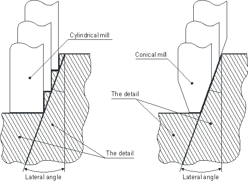

# 横方向の角度

横方向の角度は、彫刻やポケット加工で加工される（曲線）モデルの側面の傾斜を定義します。仕上げ加工（彫刻加工）では、システムはモデルの側面角度（テーパ角）と同じ円すい角を持つ彫刻[工具](37.md)を自動的に選択します。

横方向の角度が0の場合、加工対象のモデルは押出形状となり、その基準は上部加工高さの面によって定義されます。この角度が0より大きい場合、上面に線形の側面が追加され、その面と垂直方向との角度は横方向の角度と等しくなります。

横方向の角度の値は、0以上かつ90度未満でなければなりません。

横方向の角度は、**パラメータ**ページで設定できます。
