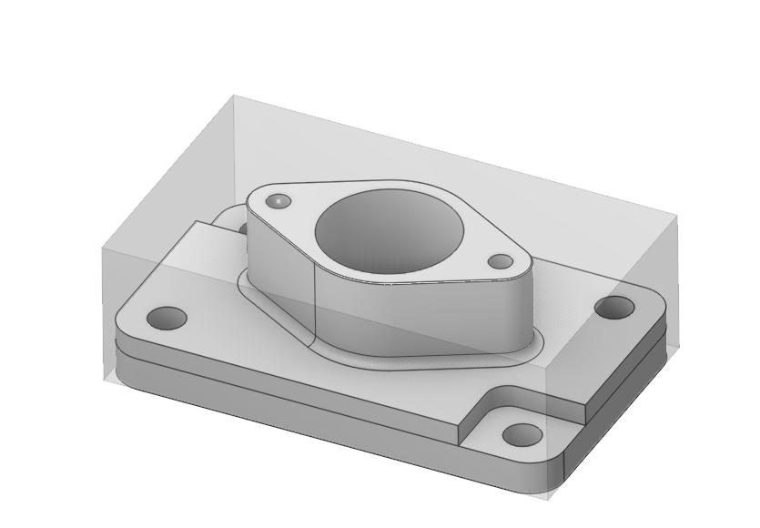

# Bruto

 

## Área de aplicação:

O modelo do bruto de uma operação define o material a ser usinado. Isso significa que ele define a forma inicial do bruto a partir da qual o componente acabado necessário será produzido.

As operações de desbaste usinam todo o bruto que fica fora do modelo que está sendo usinado. Nas operações de acabamento, o sistema usina as áreas de superfície que ficam dentro da área do bruto.

A forma inicial do bruto é especificada no nó raiz da árvore de usinagem. Ela pode ser definida como a soma dos seguintes elementos:

- Uma caixa envolvendo a peça;
- Caixa ao redor do modelo;
- Caixa ao redor da Job Assignment (somente para operações 25D);
- Caixa ao redor de um modelo geométrico;
- Caixa definida por um ponto médio e tamanho, por um ponto angular e tamanho, por dois pontos);
- Um cilindro envolvendo a peça. O eixo do cilindro é o eixo X.
- O cilindro ao redor da Job Assignment (somente para operações 25D); calculado
- O cilindro ao redor de um modelo geométrico;
- O cilindro definido por ponto central, raio e alturas;
- Um prisma extrudado a partir das curvas especificadas,
- Um corpo de revolução definido por suas curvas geratrizes.
- Um sólido projetado em um CAD independente. Nesse caso, todas as superfícies devem representar um espaço delimitado.
- Um modelo de superfícies projetado em um CAD independente pode ser convertido em sólido fechando suas faces até o nível Z especificado.

Para os elementos **A cylinder swept around the part**, o raio do cilindro é calculado pelas faces da peça e não pela caixa da peça.

Todos os cilindros podem ser orientados ao longo de qualquer um dos eixos principais, ser circunscritos à caixa, inscritos na caixa, com o eixo no meio da caixa ou no ponto de origem das coordenadas.

Existe também o tipo de definição **Auto** do bruto ou do modelo, que fica ativo se nada tiver sido adicionado à lista correspondente do modelo e do bruto.

Da primeira à última operação, o bruto muda de forma como resultado da usinagem por cada operação. O bruto intermediário é transmitido entre as operações, pois cada operação tem como bruto padrão o **Machining result of the previous operation** (resultado da usinagem da operação anterior). Dessa forma, é possível usinar apenas o material restante. Se o resultado de uma operação anterior precisar ser desconsiderado no cálculo do percurso da ferramenta, isso sempre pode ser feito substituindo o bruto padrão pelo item **Workpiece of the previous operation** (bruto da operação anterior).

<strong>Os métodos de definição do bruto são descritos aqui.</strong> [Detalhes](294.md)
