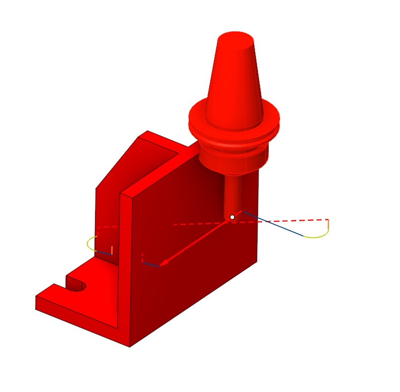
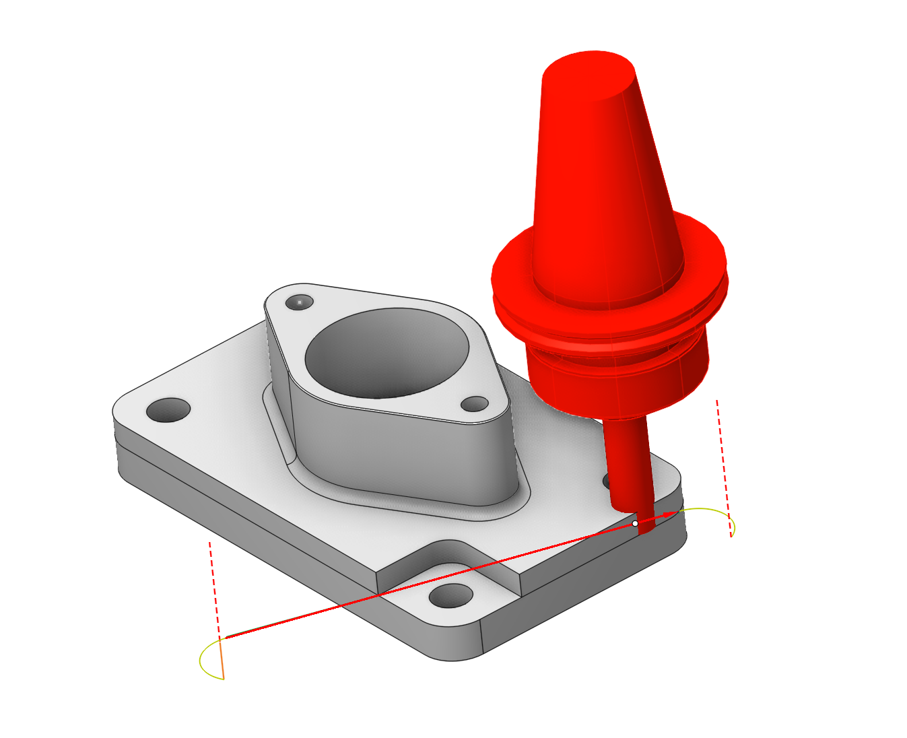

# Errori del percorso utensile rilevati dalla simulazione

 

## Ambito di applicazione:

Questa sezione descrive l'identificazione degli errori nei percorsi utensile durante la simulazione e i comandi di filtro che consentono di visualizzare o nascondere selettivamente determinati tipi di errore per un'analisi mirata.

Nel sistema CAM, nella scheda <strong>Technology</strong> (tecnologia), le operazioni hanno indicatori di stato che riflettono la loro condizione corrente. [Dettagli](1118119.md)

Nella scheda <strong>Simulation</strong> (simulazione), ogni riga CLDATA ha un proprio stato, che consente di individuare rapidamente eventuali problemi. Lo stato del nodo è indicato da un'icona:

-  - I comandi CLDATA sono disabilitati. Non vengono emessi nel programma NC e non vengono simulati.

-  - I comandi CLDATA non vengono simulati.

-  - Il comando CLDATA viene simulato senza errori.

- Il comando CLDATA viene simulato con errore (<strong>possono comparire qui varie icone, descritte in dettaglio di seguito</strong>.);

-   - Il comando CLDATA è a vuoto. Il grezzo non viene asportato da questo comando di movimento dell'utensile.

Durante l'operazione vengono eseguiti vari controlli. Se si verifica un errore, la riga CLDATA viene contrassegnata con l'icona corrispondente.

Vengono verificati i seguenti <strong>tipi di errore</strong>:

-  - L'asportazione di materiale con avanzamento rapido è vietata. Se il grezzo viene asportato e l'avanzamento è rapido, il comando viene contrassegnato come errore.
-  - Collisione del portautensile. Se il portautensile tocca il grezzo, il comando CLDATA viene contrassegnato come errore;
-  - Impossibile calcolare la compensazione. La compensazione del raggio utensile viene eseguita durante la simulazione. Il valore di compensazione è definito nella finestra dei parametri dell'operazione, nella scheda dell'utensile. Se non è possibile applicare la compensazione al comando CLDATA, il movimento viene contrassegnato come errore;
-  - Le passate di affondamento dell'utensile con un angolo superiore al valore massimo indicato nei parametri dell'utensile vengono contrassegnate come errori.
-  - Collisione dei nodi della macchina.
-  - Rilevata intaccatura del pezzo.
-  - Corsa degli assi oltre i limiti.
-  - Errore di direzione di rotazione dell'utensile e del mandrino non appropriata.
-  - Sovraccarico dell'utensile (compare se l'opzione  Mark overloads (segnala i sovraccarichi) è abilitata nella sezione *Adaptive federate* (avanzamento adattivo) del pannello dei parametri *Feeds/Speeds* per l'operazione di sgrossatura a Z costante). [Dettagli](100142.md)

<strong>Pannello Collision Check Level (livello di controllo delle collisioni).</strong>

Questo pannello contiene pulsanti simili a quelli utilizzati per la <strong>Background</strong> <strong>Simulation</strong> (simulazione in background). [Dettagli](18921.md)

Nell'uso di questo pannello occorre tenere presenti alcune considerazioni importanti:

- Per impostazione predefinita, nella <strong>scheda</strong> <strong>Simulation</strong> il livello di controllo delle collisioni coincide con il livello di controllo della <strong>Background</strong> <strong>Simulation</strong>. Ciò significa che, quando si modifica il livello di controllo della <strong>Background</strong> <strong>Simulation</strong> nelle impostazioni di sistema e si fa clic su <strong>Apply</strong> (applica), le impostazioni del livello di controllo delle collisioni nella <strong>scheda Simulation</strong> vengono aggiornate automaticamente (solo se il livello di verifica nella scheda <strong>Simulation</strong> era superiore a quello della <strong>Background</strong> <strong>Simulation</strong>).
- Nella <strong>scheda</strong> <strong>Simulation</strong> è possibile impostare un livello di controllo diverso da quello della <strong>Background</strong> <strong>Simulation</strong>, ma non inferiore al livello definito nella <strong>Background</strong> <strong>Simulation</strong>. La riduzione del livello di controllo non è consentita.

<strong>Esempio.</strong> <em>Se nella <strong>Background</strong> <strong>Simulation</strong> è selezionato il livello di controllo <strong>Machine</strong>, nella <strong>scheda</strong> <strong>Simulation</strong> non è possibile abbassarlo al di sotto di questo valore. È invece possibile aumentare il criterio di controllo spostando il cursore sulla posizione <strong>Hidden Nodes</strong>. Ciò aiuta a rilevare eventuali errori aggiuntivi, se presenti.</em>

- Quando si aumenta il livello di controllo nella <strong>scheda Simulation</strong> dopo aver eseguito un <strong>calcolo</strong> <strong>in background</strong>, lo stato dell'operazione viene reimpostato sul valore _(1).png). Analogamente, anche la modifica della precisione di simulazione reimposta lo stato dell'operazione.
- Se si esegue una <strong>simulazione</strong> <strong>passo-passo</strong> e si abbassa il livello di controllo al di sotto di quello della <strong>Background</strong> <strong>Simulation</strong>, gli stati delle operazioni cambiano in base al livello di controllo corrente.

<strong>Esempio.</strong> <em>Se come livello di controllo della <strong>Background</strong> <strong>Simulation</strong> è impostato <strong>Holder</strong> e successivamente viene eseguita una <strong>simulazione</strong> <strong>passo-passo</strong> con il livello di controllo <strong>Hidden Nodes</strong>, abbassando il livello di controllo a <strong>Machine</strong> o <strong>Dressing</strong> gli stati delle operazioni vengono aggiornati. <strong>L'utente</strong> <strong>vedrà solo gli errori che corrispondono al livello di controllo selezionato.</strong></em>

<strong>Part gouge</strong> (intaccatura del pezzo). Consente di visualizzare gli errori in cui è stata rilevata un'intaccatura del pezzo.

Il sistema include inoltre appositi pulsanti ausiliari che consentono di <strong>arrestare la simulazione completa</strong> in condizioni diverse:

-  - Consente di arrestarsi alle righe CLDATA in cui è specificato il comando di arresto M1. Il comando M1 può essere inserito mediante la funzione <strong>Macro of Toolpath Template</strong> (macro del modello di percorso utensile). [Dettagli](500.md) Per una migliore visualizzazione del processo tecnologico è possibile creare un'<strong>operazione ausiliaria</strong> (Auxiliary operation) e impostare il comando M1 anche nella sezione <strong>Macro of Toolpath Template</strong>. [Dettagli](10075.md)
-  - Consente di arrestarsi dopo ogni operazione.
-  - Il pulsante definisce l'azione da eseguire quando viene rilevato un errore. Se il pulsante è premuto, il processo di simulazione viene interrotto dopo il rilevamento dell'errore. In caso contrario, il nodo viene contrassegnato con un punto esclamativo rosso e la simulazione prosegue. Al termine della simulazione è possibile trovare i nodi contrassegnati tramite scorciatoie o dal menu contestuale:

-  - Go To Next error (vai all'errore successivo) – sposta la selezione sul nodo contrassegnato con l'errore successivo;

-  - Go To Previous error (vai all'errore precedente) – sposta la selezione sul nodo contrassegnato con l'errore precedente.
