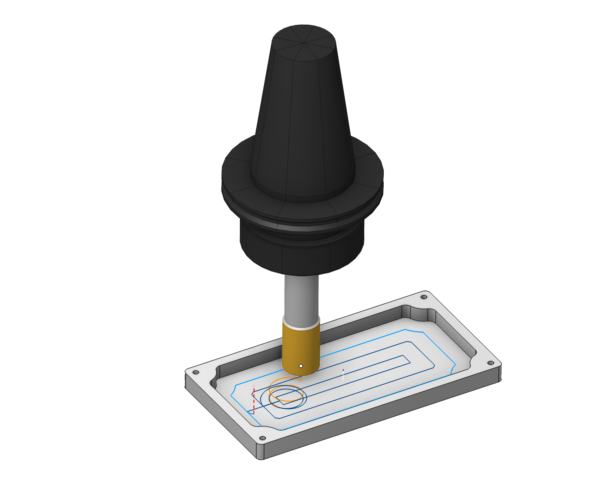
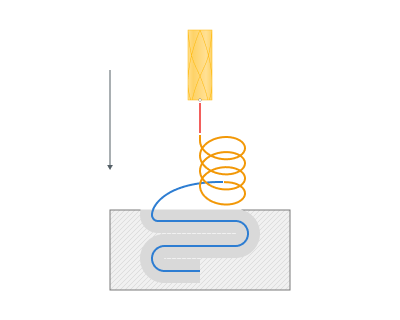
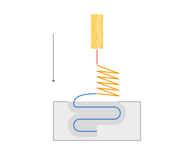
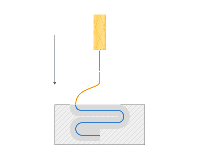
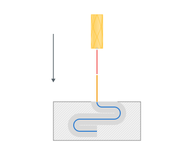
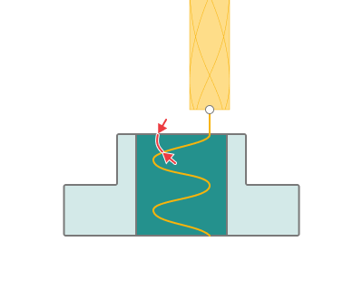
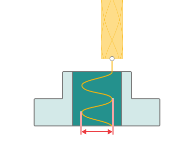

# Permitir mergulhos

## Área de aplicação:

Quando é impossível se aproximar da área de usinagem pelo lado de fora, o sistema gera automaticamente um movimento de mergulho até o primeiro ponto da passada de trabalho. Um mergulho é um trecho do percurso da ferramenta ao longo do eixo Z dentro do corpo do bruto. O <strong>Plunge</strong> é executado da seguinte forma:

- Aproximação da ferramenta ao ponto de mergulho XY no [plano de segurança](100117.md) da operação.
- Deslocamento vertical em avanço rápido até o nível de segurança ou a distância de segurança antes do início do corte (conforme as configurações). O nível de segurança é o nível Z superior do sistema de coordenadas atual. A distância de segurança é a distância até o início do mergulho definido.
- Descida vertical com o avanço de aproximação até o início do mergulho definido.
- O método de mergulho selecionado é aplicado com o avanço de aproximação até o ponto de aproximação.
- Início da aproximação.

### Os seguintes métodos de mergulho estão disponíveis no sistema:

<strong>None.</strong> Selecione essa opção para não usar mergulho.

<strong>Spiral.</strong> A ferramenta executa um movimento helicoidal ao longo de um círculo, conectado em seu último ponto ao primeiro ponto de aproximação. O raio do círculo é definido pelo usuário.

Zigzag. A ferramenta executa movimentos de vaivém ao longo de um trecho reto, conectado ao primeiro ponto de aproximação. O comprimento do trecho é definido pelo usuário.

<strong>Along curve.</strong> A ferramenta mergulha ao longo da curva de aproximação. O movimento de mergulho é concluído no final do movimento de aproximação.

Axial. O mergulho é feito ao longo de uma reta vertical até o primeiro ponto de aproximação.

<strong>Ramp angle.</strong> O <strong>Plunge Angle</strong> determina a velocidade do mergulho. Quanto maior o ângulo, mais rápido a ferramenta penetra no material.

<strong>Min size.</strong> O <strong>Min size</strong> do mergulho define:

- o diâmetro mínimo permitido da espiral nos mergulhos Spiral,

- a amplitude mínima permitida dos movimentos em ziguezague nos mergulhos <strong>Zigzag</strong> e <strong>Along Curve</strong>.

Se o software CAM não conseguir formar um mergulho sem colisão do tipo selecionado com o tamanho mínimo indicado, ele tenta usar o próximo tipo de mergulho disponível. Se não houver mais tipos de mergulho disponíveis, o bolsão fica sem usinar.

<strong>Max size.</strong> O <strong>Max size</strong> do mergulho define:

- o diâmetro ideal da espiral nos mergulhos Spiral,

- a amplitude ideal dos movimentos em ziguezague nos mergulhos Zigzag e Along Curve.

Se o software CAM não conseguir formar um mergulho sem colisão do tipo selecionado com o tamanho ideal indicado, ele tenta reduzir o tamanho pelo valor especificado no parâmetro <strong>Degression</strong> até que o mergulho se torne possível ou o tamanho atinja o valor mínimo permitido; então o software CAM tenta aplicar outro tipo de mergulho da lista.

<strong>Degression.</strong> O parâmetro <strong>Degression</strong> define o valor pelo qual o software CAM reduz o tamanho do mergulho quando não consegue formar um mergulho sem colisão. Se o software CAM não conseguir formar um mergulho sem colisão do tipo selecionado com o tamanho ideal indicado, ele tenta reduzir o tamanho pelo valor especificado no parâmetro <strong>Degression</strong> até que o mergulho se torne possível ou o tamanho atinja o valor mínimo permitido; então o software CAM tenta aplicar outro tipo de mergulho da lista.

<strong>Smooth radius.</strong>

<strong>Se ativado:</strong> a junção entre o movimento de mergulho e o movimento horizontal é arredondada com o raio de suavização.

<strong>Se desativado:</strong> o percurso de mergulho é conectado ao primeiro movimento horizontal com o ângulo de mergulho.
