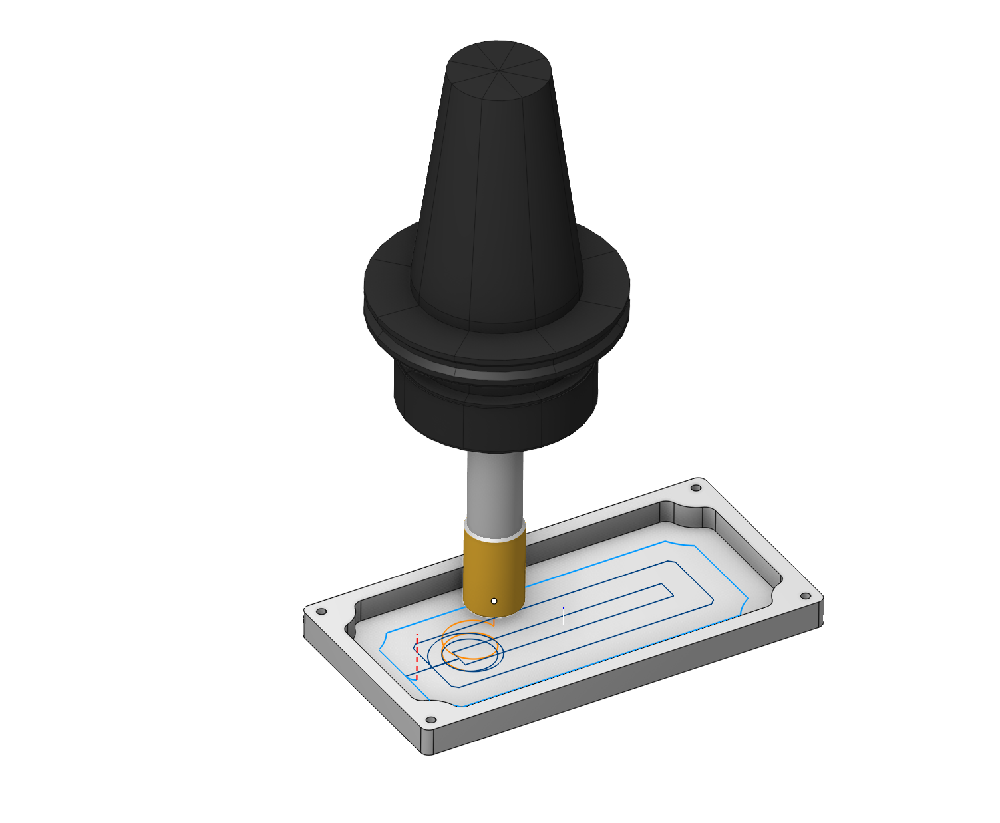
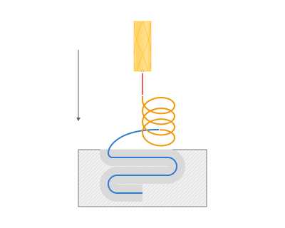
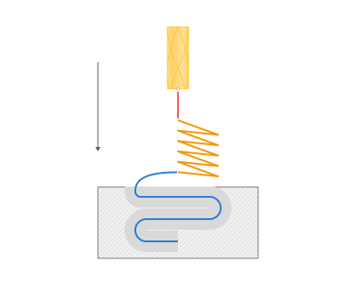
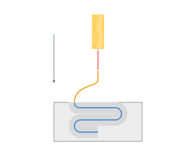
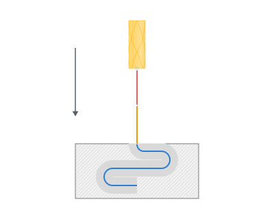
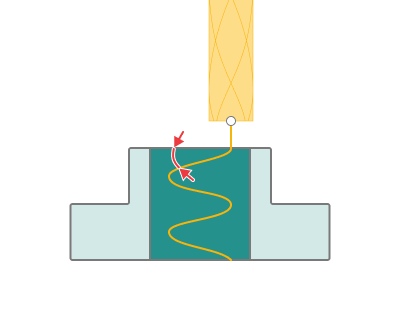
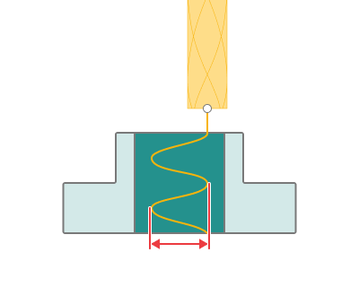

# プランジを許可

## 適用分野：

加工領域へ外側からアプローチできない場合、システムは自動的に最初の[加工パス](https://confluence.encycam.com/display/SC1/.Working+Toolpath+v20)の開始点までプランジ動作を生成します。 プランジとは、ワーク内部におけるZ軸方向のツールパス区間を指します。[プランジ](https://confluence.encycam.com/pages/viewpage.action?pageId=153787803)は以下のように実行されます。

- オペレーションの[安全平面](100117.md)でのXYプランジ点へ工具をアプローチさせます。
- 切削開始前に、設定に応じて早送りで安全高さまたは安全距離まで垂直移動します。安全高さとは、現在の座標系のZ 軸上部高さです。安全な距離とは、定められたプランジの開始点までの距離です。
- プランジの開始点まで、アプローチの送りで 垂直下降します。
- 選択されたプランジ方式は、アプローチ点へのアプローチ送りで適用されます。
- アプローチが開始します。

### 以下のプランジ方式が利用可能です。

<strong>なし</strong> プランジ加工を行わない場合に設定します。

<strong>らせん</strong> 工具は円に沿ってらせん状に動作し、その最終点は最初のアプローチ点とつながっています。円の半径はユーザーが指定可能です。

ジグザグ 工具は、最初のアプローチ点に接続された直線区間に沿って往復運動を行います。この区間の長さはユーザーが指定可能です。

<strong>カーブに沿って</strong> 工具はアプローチ曲線に沿って突入します。プランジ動作はアプローチ動作の終わりに完了します。

軸方向 最初のアプローチ点までの垂直の直線に沿って行われます。

<strong>プランジ角度 傾斜角度</strong>はプランジの速度を決定します。角度が大きいほど、工具素材への突き込む速度は速くなります。

<strong>最小径</strong> プランジの<strong>最小径</strong>の定義は以下の通りです。

- らせんプランジにおけるらせんの最小許容直径

- <strong>「ジグザグ」</strong>および<strong>「カーブに沿って」</strong>プランジにおけるジグザグ移動の最小許容振幅

CAMソフトウェアが、指定された最小サイズで、選択されたタイプの食い込みのないプランジを形成できない場合、次に使用可能なプランジタイプを使用しようとします。それ以上のプランジタイプが利用できない場合、ポケットは未加工のまま残されます。

<strong>最大径</strong> プランジの<strong>最大径</strong>の定義は以下の通りです。

- らせんプランジにおけるらせんの最適直径

- <strong>「ジグザグ」</strong>および<strong>「カーブに沿って」</strong>プランジにおけるジグザグ移動の最適振幅

CAMソフトウェアが、指定された最適なサイズで、選択されたタイプの食い込みのないプランジを形成できない場合、プランジが可能になるか、サイズが最小許容値に達するまで、減少パラメータで指定された量だけサイズを縮小しようと試みます。その後、CAMソフトウェアはリストから別のプランジタイプを適用しようとします。

<strong>減少</strong> <strong>減少</strong>は、食い込みのないプランジを形成できない場合に、CAMソフトウェアがプランジサイズを減少させる値を定義します。CAMソフトウェアが、指定された最適なサイズで、選択されたタイプの食い込みのないプランジを形成できない場合、プランジが可能になるか、サイズが最小許容値に達するまで、減少パラメータで指定された量だけサイズを縮小しようと試みます。

<strong>半径で円滑化</strong>

<strong>有効な場合：</strong>プランジ動作と水平動作の接続は、半径が円滑化され丸められます。

<strong>無効の場合：</strong>プランジツールパスは、プランジ角度の下で最初の水平動作に接続されます。
