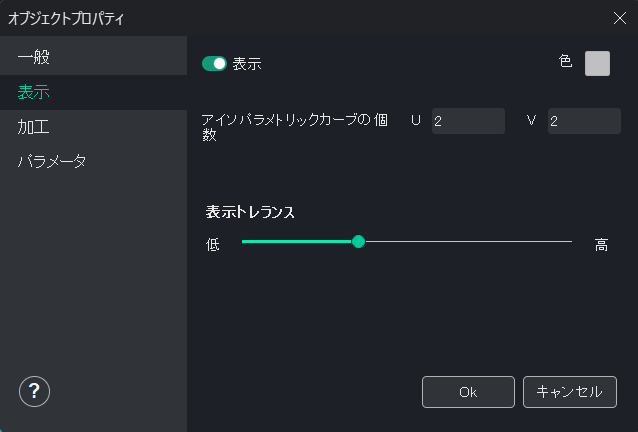

# <表示>タブ

オブジェクトの表示プロパティへのアクセスは、表示プロパティタブで重複しています。また、グラフィックウィンドウでアイソパラメトリック線の本数や形状の視覚的な公差を割り当てることも可能です。

- `表示` チェックを外すと、選択したオブジェクトは表示されません。
- `色` 選択したオブジェクトの色を変更できます。
- `等パラメトリック曲線の数`値が0の場合、アイソパラメトリック曲線は表示されません。値が1の場合、サーフェスの境界線が表示されます。値が2の場合、各サーフェスセグメントが2分割されるように表示されます。曲線およびサーフェスを画面に表示する際、システムは曲線を直線で、サーフェスを平面ポリゴンのエッジで近似して描画します。
- `表示トレランス`ユーザーは 3Dオブジェクトの表示品質を設定したり、十分な表示品質とコンピュータの処理速度のバランスを取ることができます。許容値（トレランス）は スライダーバーを使って調整します。ここでの許容値とは、画面上で曲線を描画する際に使用される断面の近似における最大偏差を意味します。3Dオブジェクトの表示トレランスを高くするほど、画面描画のために より多くのメモリリソースが使用されます。

<em>注意：低速のPCでは、視覚的な耐性を高く設定することはお勧めしません。PCのパフォーマンスに影響が出る可能性があります。</em>

モデルを読み込む際の初期表示トレランスは、 [システム設定](24.md)ウィンドウで定義されます。
