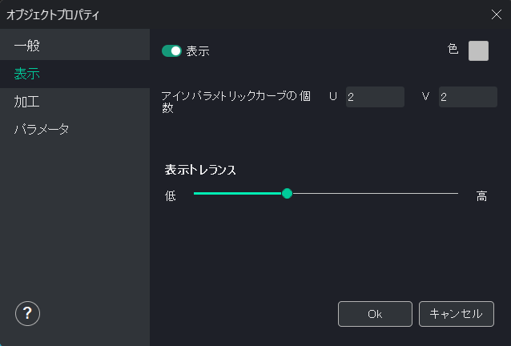

# Scheda Visual

L'accesso alle proprietà visive degli oggetti, visibilità e colore, è duplicato nella scheda delle proprietà visive. È inoltre possibile assegnare il numero di linee isoparametriche e la tolleranza di visualizzazione dell'oggetto nella finestra grafica.

- **Visible** (visibile) – se la casella è deselezionata, l'oggetto selezionato non viene visualizzato.
- **Color** (colore) – consente di modificare il colore dell'oggetto selezionato.
- **Isoparametric curves quantity** (numero di curve isoparametriche) – durante la visualizzazione delle superfici è talvolta necessario definire il numero di curve isoparametriche visualizzate. In questa scheda è possibile definire il numero di curve regolando i parametri **U** e **V**. Con valore zero le curve isoparametriche non sono visibili, con valore uno sono visibili i bordi della superficie, con valore due ogni segmento di superficie viene diviso in due e così via. Durante la visualizzazione di curve e superfici sullo schermo, il sistema approssima le curve con segmenti di retta e le superfici con facce poligonali piane.
- **Visual tolerance** (tolleranza di visualizzazione) – consente all'utente di impostare la qualità visiva degli oggetti 3D, ovvero di trovare un compromesso tra una qualità di visualizzazione soddisfacente e la velocità del computer. La tolleranza si regola con il cursore. In questo caso la tolleranza è la deviazione massima dei segmenti di approssimazione utilizzati per disegnare le curve sullo schermo. Quanto più alta è la tolleranza di visualizzazione degli oggetti 3D, tanto più risorse di memoria vengono impiegate per disegnarli sullo schermo.

<em>Nota: si sconsiglia di impostare una tolleranza di visualizzazione elevata su computer lenti, poiché le prestazioni del computer potrebbero risentirne.</em>

La tolleranza di visualizzazione iniziale, al caricamento del modello, è definita nella finestra delle [impostazioni di sistema](24.md).
