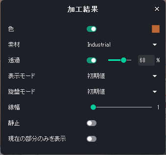
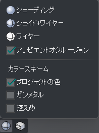

# オペレーションの幾何パラメータ

オペレーションの幾何パラメータは、ビュー上に表示されます。それらには、部品、ワーク、治具、ジョブ割り当てが含まれています。パラメータの表示プロパティは、パラメータノードの横にあるライトアイコンを使用して編集できます。このアイコンを左クリックすると、オブジェクトのオン／オフが切り替わります。ただし、選択されたパラメータは、その状態に関係なく常に表示されます。

ポップアップメニューでは、オブジェクトの色、透明度、および表示モードなどを選択できます。

`デフォルト` 表示モードは、メインツールバーのボタンで設定されたグローバル設定に従ってオブジェクトを表示するために使用されます。

その他の表示モードでは、グローバル設定に関係なくオブジェクトが強制的に表示されます。
