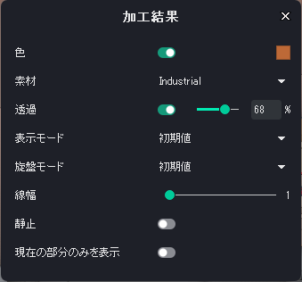
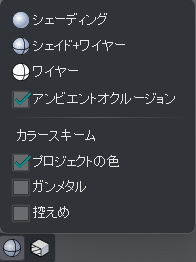

# Geometrische Parameter einer Operation

Die geometrischen Parameter einer Operation werden im Grafikfenster angezeigt. Dazu gehören Bauteil, Rohteil, Spannmittel und Auftragszuweisung. Die Darstellungseigenschaften lassen sich über das Leuchtensymbol neben dem jeweiligen Knoten ändern. Ein Klick mit der linken Maustaste schaltet die Sichtbarkeit ein oder aus. Ein ausgewählter Parameter bleibt jedoch unabhängig von dieser Einstellung sichtbar.

Im Kontextmenü können Sie Farbe, Transparenz und Darstellungsmodus festlegen.

Der Darstellungsmodus **defaults** übernimmt die globalen Einstellungen der entsprechenden Schaltfläche auf der Hauptsymbolleiste.

Die übrigen Modi stellen das Objekt unabhängig von den globalen Einstellungen dar.
