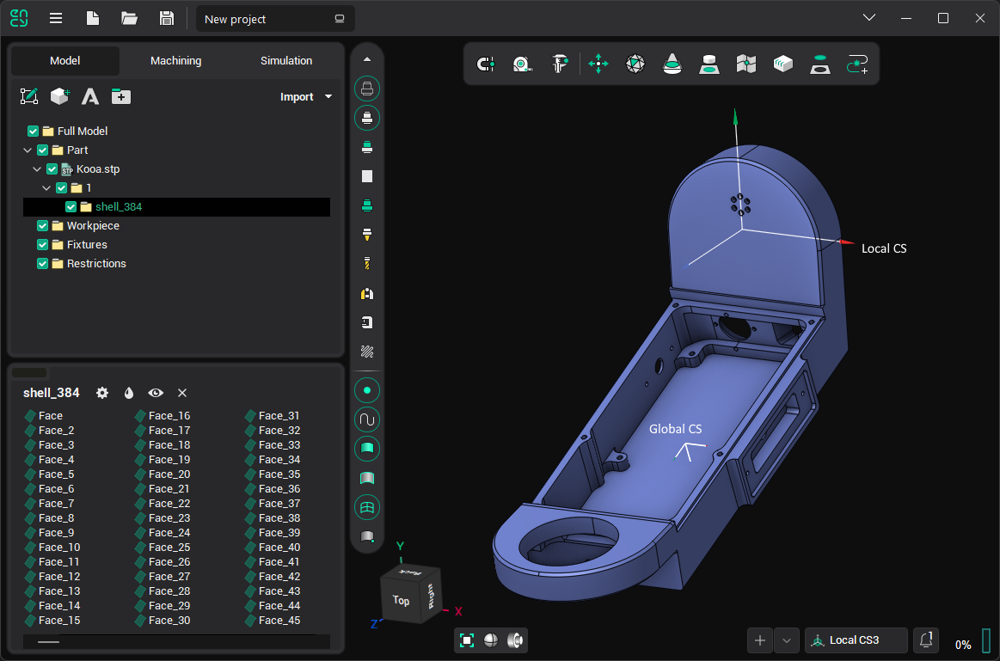
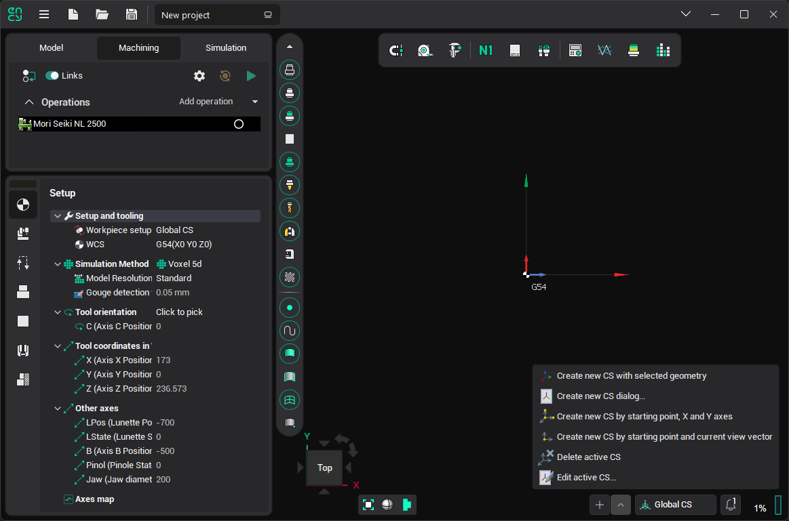

# 幾何座標系

加工プロセス生成をより便利にするために、任意の数のローカル幾何座標系（CS）を作成することが可能です。

これらのシステムは、例えば、 任意の平面に[輪郭を描いたり](833.md)、オブジェクトの寸法をチェックする必要がある場合など、図形を扱うときに便利です。また、オペレーションパラメータ ([ワーク座標系](https://confluence.encycam.com/pages/viewpage.action?pageId=128526534)、 [ローカル座標系](726.md)、回転軸、 [ツールパス乗算](10168.md) 平面) などを設定する際にも役立ちます。

<strong>座標系管理パネル</strong> はメインウィンドウの下側にあります。

<strong>有効座標系</strong>という概念があります。常に有効にできる座標系は1つだけであり、その名前はパネルに表示される。システム機能の中には、幾何形状の全体寸法をこの座標系で表示したり、有効な座標系に基づいて新しいスケッチ平面を初期化したりするなど、有効な座標系を考慮に入れたものもあります。

パネルで座標系 の名前をクリックして 座標系 のリストを開き、有効な座標系 を変更します。

座標系名の隣にあるボタンには、座標系に対して可能なアクションを含むドロップダウンメニューがあります。

-  <strong>[ダイアログで座標系を作成](402.md)</strong>：新規座標系 のパラメータを直接設定するウィンドウを開きます。クリック時に幾何要素が選択されている場合、ウィンドウは開かず、代わりに[スマート座標系作成](10007.md)手順が開始されます。
-  <strong>[開始点とX、Y軸で新しい座標系を作成](271.md)</strong>：原点と2本の主方向ベクトル（X、Y）を選択して、対話的に新しい座標系を定義します。
-  <strong>[開始点と現在の表示ベクトルで新しい座標系を作成](805.md)</strong>：原点を選択し、現在の表示ベクトルを使用して、対話的に新しい座標系を定義します。
-  <strong>有効な座標系削除：</strong>有効な座標系を削除します。下部にリストされているすべての座標系が、1つ上のレベルに移動します。グローバル座標系は削除できません。
-  [有効な座標系を編集](403.md)：有効な座標系のパラメータウィンドウを開きます。
