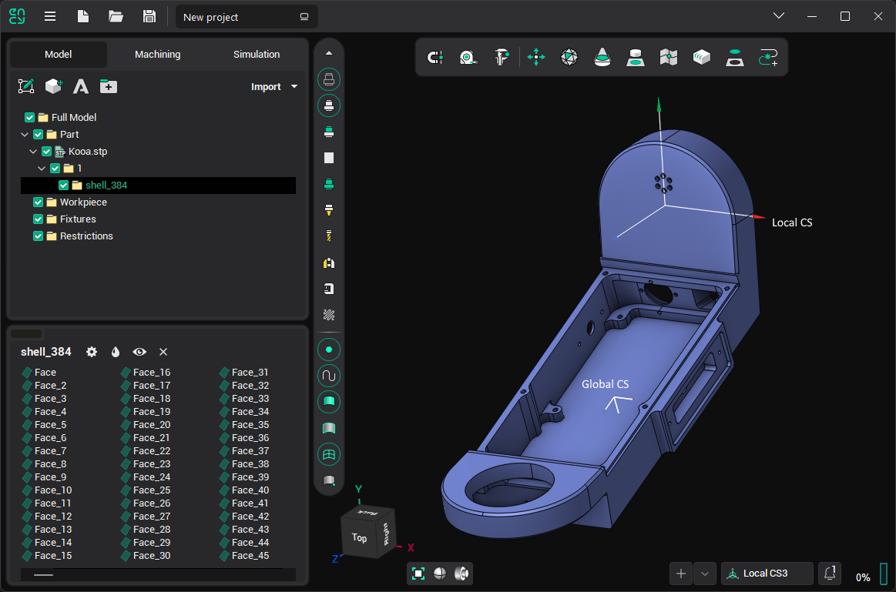
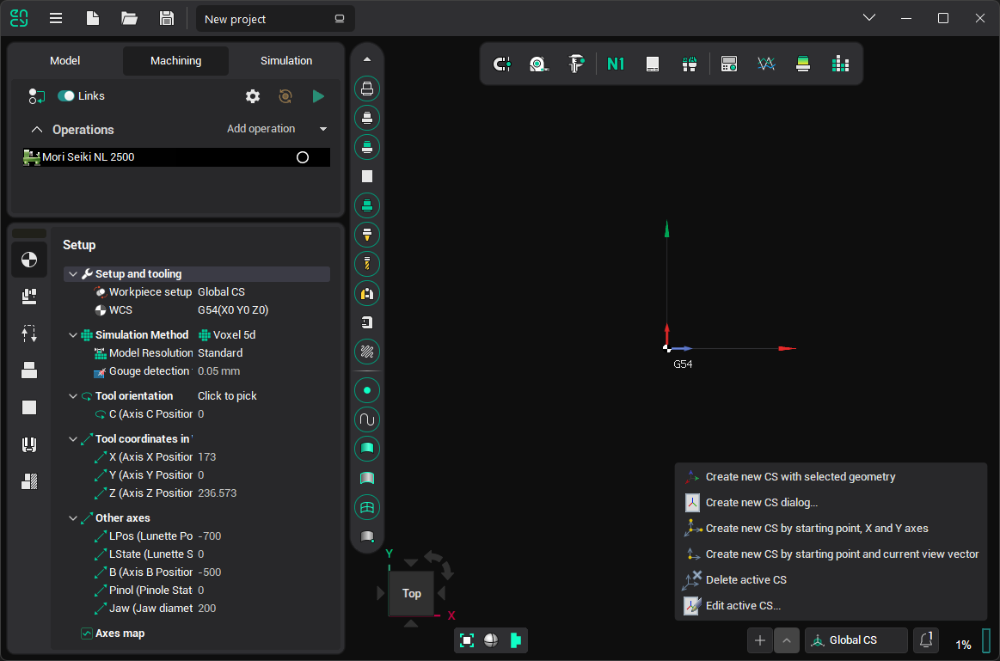
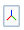
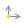
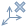
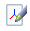

# Sistemas de coordenadas geométricos

É possível criar qualquer número de sistemas de coordenadas geométricos locais (CS) para tornar a geração do processo de usinagem mais conveniente.

Esses sistemas podem ser úteis ao trabalhar com geometria, por exemplo, para [desenhar um contorno](833.md) em um plano arbitrário ou verificar as dimensões de um objeto. Eles também são úteis ao definir parâmetros da operação ([Workpiece CS](10068.md), [Local CS](726.md), eixo rotativo, plano de [multiplicação do percurso da ferramenta](10168.md)) etc.

<strong>O painel de gerenciamento de sistemas de coordenadas</strong> fica na parte inferior da janela principal.

Existe o conceito de <strong>sistema de coordenadas ativo</strong>. Apenas um CS pode estar ativo a cada momento, e seu nome é exibido no painel. Alguns recursos do sistema levam em consideração o sistema de coordenadas ativo, como a exibição das dimensões gerais de objetos geométricos nesse CS ou a inicialização de um novo plano de esboço com base no CS ativo.

Clique no nome do CS no painel para abrir a lista de sistemas de coordenadas e alterar o ativo.

O botão ao lado do nome do CS tem um menu suspenso com as ações possíveis para sistemas de coordenadas:

-  <strong>[Create new CS dialog...](402.md)</strong>: abre uma janela em que é possível definir diretamente os parâmetros de um novo CS. Se algum elemento geométrico estiver selecionado no momento do clique, a janela não é aberta e é iniciado o procedimento de [criação inteligente de CS](10007.md).
-  <strong>[Create new CS by starting point, X and Y axes](271.md)</strong>: define interativamente o novo sistema de coordenadas selecionando o ponto de origem e dois vetores principais, X e Y.
-  <strong>[Create new CS by starting point and current view vector](805.md)</strong>: define interativamente o novo sistema de coordenadas selecionando o ponto de origem e usando o vetor da vista atual.
-  <strong>Delete active CS:</strong> exclui o sistema de coordenadas ativo. Todos os sistemas de coordenadas listados abaixo dele sobem um nível. O sistema de coordenadas global não pode ser excluído.
-  [Edit active CS](403.md): abre a janela de parâmetros do sistema de coordenadas ativo.
