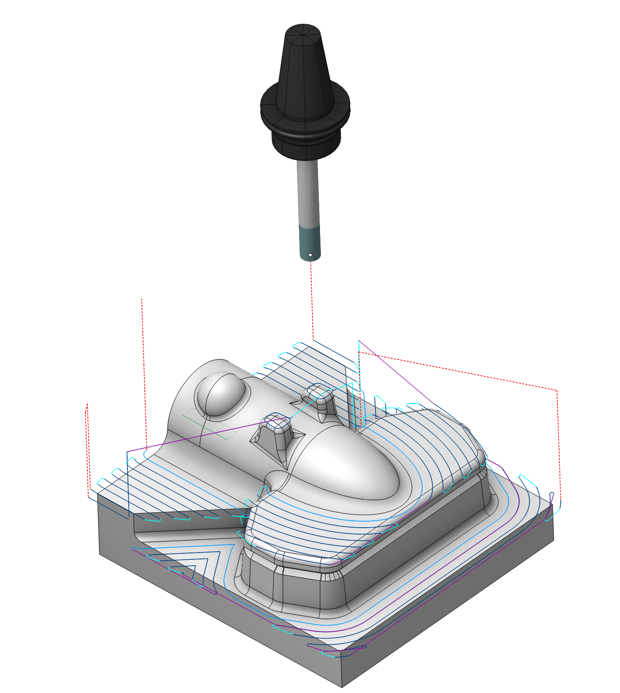
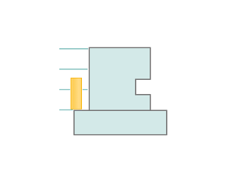
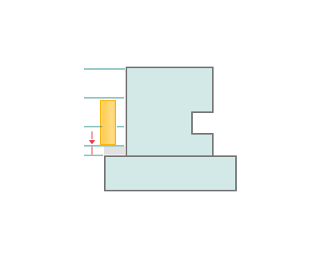

# 平坦面加工

## 適用分野：

このオペレーションは、水平な平面を持つモデルの加工に適しています。加工は、複数の高さにわたる一連の水平パスで構成されます。

### セットアップ：

<strong>セットアップ</strong> タブは、プロジェクトの主要なパラメータを設定するために使用します。これには、装置上の部品の位置決めや部品の座標系などが含まれます。[詳細を見る](1022.md)

### ジョブ割り当て：

<strong>フェイス</strong> 部品のさまざまな面を加工対象として選択します。システムは、選択された面に基づいて軌道を計算します。[詳細を見る](102121.md)

<strong>ポケット</strong> 一般的なプリズマティック部品や旋削フライス部品は、多くの単純な形状で構成されています。この作業を簡略化するために、3Dモデル内の部品要素を認識し、加工領域や加工高さなどの基本的なジョブ割り当て項目に自動変換できます。[詳細を見る](10154.md)

<strong>ジョブゾーン</strong>（加工領域） ジョブゾーンは、荒加工と仕上げ加工で加工される部品領域を定義するために使用します。[詳細を見る](10151.md)

<strong>制限領域</strong> <strong>ジョブゾーン</strong> に加えて、<strong>制限領域</strong>を使用すると、現在のオペレーションで加工しないワーク領域を指定できます。[詳細を見る](10152.md)

<strong>上部高さ</strong> モデル要素に基づいて上部高さを指定します。 [詳細を見る](10153.md)

<strong>底部高さ</strong> モデル要素に基づいて底部高さを指定します。 [詳細を見る](10153.md)

<strong>プロパティ</strong> 要素のプロパティを表示します。ストックを追加することも可能です。また、リスト内の項目をダブルクリックすることでも、このメニューを表示できます。

<strong>削除</strong> リストから項目を削除します。

<strong>制限</strong> 加工してはならない領域を制限できます。[詳細を見る](101231.md)

### 加工設定：

#### 加工ストラテジー：

このパラメータにより、ポケット加工を行う際に、平行、等距離などの工具軌跡を生成することができます。このパラメーターグループは<strong>ウォーターライン荒加工オペレーションと同様に動作します。</strong> [詳細を見る](736.md)

#### 加工高さ：

工具軸方向の加工範囲を定義します。このパラメーターグループは<strong>ウォーターライン荒加工オペレーション</strong><strong>と同様に動作します。</strong> [詳細を見る](736.md)

#### 加工送りでの平坦部加工

仕上げ送りでフラットなパスを出力します。このパラメーターグループは<strong>ウォーターライン荒加工オペレーション</strong><strong>と同様に動作します。</strong> [詳細を見る](736.md)

#### ミーリングタイプ

曲線加工オペレーションを除くほぼすべての加工で設定可能です。これにより、ツールパスの計算プロセス中に、必要なフライス加工タイプ（ダウンカットまたはアップカット）を設定することができます。このパラメーターグループは<strong>ウォーターライン荒加工オペレーション</strong><strong>と同様に動作します。</strong> [詳細を見る](736.md)

#### 多層加工

詳細を表示

<strong>工具軸方向のステップ</strong> 切込み深さにごとのステップを設定します。

<strong>プランジ高さ</strong>

<strong>前の高さから</strong> ワークの下側の平面高さから上側の高さまで、 光軸方向のステップで加工を行います。

<strong>高さから</strong> 平面高さでのみ加工を行います。

<strong>mm</strong> 平面面の高さから「プランジ高さ」で指定された値まで、<strong>工具軸方向のステップ</strong>ごとに加工を行います。

<strong>仕上げ高さ</strong> 底部高さの手前に、パラメータで指定した距離分の追加パスを加えます。

 

#### トリミング

加工対象外のサーフェスを除外したり、ツールパスを延長したりできます。このパラメータグループは、<strong>ウォータライン荒加工オペレーション。</strong>と同様に動作します。[詳細を見る](736.md)

### トリミング

このタブには、パーツ、ワーク、治具などを制御し、ツールパスを変更するための主要なパラメータが含まれています。[詳細](100112.md)

### リンク／リード：

リンク／リードタブでは、早送り動作のパラメータを設定します。これらの移動には、工具交換位置からのアプローチ、切削パス開始点までの位置決め、最終切削後の退避動作、各パス間の移動、および工具交換位置への復帰が含まれます。座標軸ごとの動作順序、各移動の軌跡、および移動量を設定できます。

詳細を表示

<strong>次の項目で構成されます。</strong>

<strong>アプローチ／リターン。</strong> このパラメータグループは、工具交換位置から進入動作の開始位置までの工具移動と、その復帰動作を管理します。[詳細](100116.md)。

<strong>安全動作</strong> 安全サーフェスのタイプとワークから安全サーフェスまでの距離を設定します。加工面またはツールパス間の移行を容易にし、アプローチまたはリターンの最初の段階は、この面に向かって行います。[詳細を見る](100117.md)

<strong>高度なリンク設定</strong> このパラメータグループは、回転軸の最適な動きを考慮し、主に5軸加工における軌道形成方法を設定します。[詳細を見る](100118.md)

<strong>リンク。</strong> 進入/退出リンクと、加工移動間のリンクの規則を定義します。[詳細を見る](100120.md)。

<strong>距離。</strong> 送りを切り替えるために必要な距離です。[詳細を見る](100139.md)。

<strong>切込みを許可。</strong> 切込みを有効にすると、閉じたポケットを加工できます。外側から加工できない閉じたポケットがある場合、CAMシステムは切込み移動を生成します。[詳細を見る](744.md)。

### 送り速度設定：

このダイアログを使用して、主軸回転速度、早送り速度、ツールパスの各領域の送り速度を設定できます。主軸回転速度は、毎分回転数または切削速度のいずれかで設定できます。設定値には下線が表示されます。もう一方の値は、工具径を考慮し、設定値に基づいて再計算されます。[詳細を見る](100142.md)

### 変換：

オペレーション内で計算された工具の軌跡に対して座標変換を行うためのパラメータグループです。[詳細を見る](10168.md)

### パーツ：

パーツは、干渉をチェックする空間を定義する幾何要素のグループです。[詳細を見る](330.md)

### ワーク：

加工のワークモデルは、加工する素材を定義します。[詳細を見る](738.md)

### 治具：

治具には通常、チャック、グリップ、クランプなどの固定補助具と、その他の種類の制限領域を指定します。[詳細を見る](10283.md)
