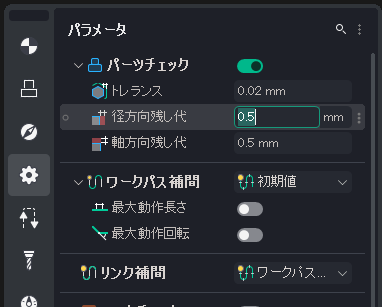

# ストック（残し代）

ストック（残し代）とは、次の取り残し加工のために、加工後に部品表面に残しておく必要がある材料層のことです。

正のストック値は残す材料の厚みを示し、負のストック値は部品表面から除去される材料を示します。

実際には、内側偏差（部品内部への偏差）がゼロの場合のみ、残りしろの最小厚さがストック値と正確に等しくなります。それ以外の場合、残りしろの最小厚さは、設定したストック値から内側偏差の分だけ小さくなります。

ストック（残し代）は、 `パラメータ` ページで設定できます。

