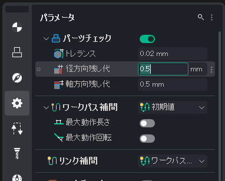

# Sovrametallo

Il sovrametallo (stock) è uno strato di materiale sulla superficie del pezzo, che deve essere lasciato dopo un'operazione per la successiva ripresa.

Un sovrametallo positivo definisce lo spessore in eccesso del materiale da lasciare, mentre uno negativo indica il materiale asportato dalla superficie del pezzo.

In realtà, lo spessore minimo del materiale rimanente è esattamente uguale al sovrametallo solo quando il valore dello scostamento interno è zero. Negli altri casi, lo spessore minimo dello strato è inferiore al sovrametallo definito della quantità dello scostamento interno.

Il sovrametallo può essere assegnato nella pagina **Parameters**.

