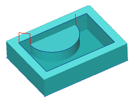
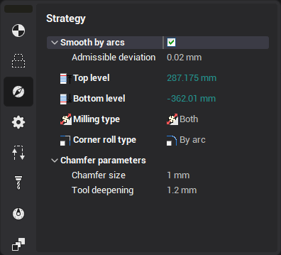

# 2.5D面取り加工オペレーション

このオペレーションは、モデルの水平エッジの面取りまたは丸め加工を行います。

このオペレーションのモデル作成方法は、他の2.5D加工オペレーションと同じです。

モデルを作成したら、オペレーションの**Parameters**ボタンを押し、面取りパラメータウィンドウを開きます。

既定では、モデルのすべての要素に面取りを生成しません。そのため、これらの曲線は面取り加工オペレーションで無視されます。面取りを加工するには、Chamfer typeダイアログで対象の曲線に面取り値を割り当てる必要があります。面取り寸法は、要素の上部から工具先端までの距離である面取り高さと、面取り幅の2つの値で指定します。

オペレーションで加工するすべての要素に対して、同じ操作を行います。面取りパラメータが同じ場合は、1本の曲線に対しても、曲線のグループに対しても、この一連の操作を実行できます。

また、ミーリングタイプ、コーナー回り込みの種類、曲線の近似、およびピックフィードの種類も指定できます。
