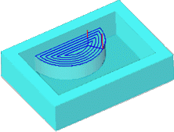

# 2,5D-Bearbeitung horizontaler Bereiche

Die Operation bearbeitet horizontale Modellbereiche, die als **Cover** bezeichnet werden.

Die Modelldefinition entspricht derjenigen der übrigen 2,5D-Operationen.

Entfernt wird Rohteilmaterial oberhalb der horizontalen Modellbereiche und außerhalb der Sperrbereiche. Rohteil, Bearbeitungs- und Sperrbereiche werden durch Projektionen geschlossener Kurven definiert.

Je nach Strategie erfolgt der Abtrag innerhalb einer Schicht spiralförmig von innen nach außen, von außen nach innen oder mit parallelen Bahnen. Fräsrichtung, Eckenumfahrung und Eckenglättung können ebenfalls festgelegt werden.
