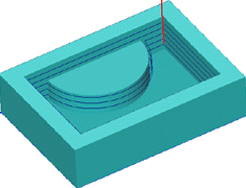

# Operazione di lavorazione di pareti 2.5D

Questa operazione è destinata alla lavorazione delle pareti verticali dei modelli.

Il metodo di creazione del modello da lavorare è descritto in dettaglio nei capitoli relativi all'operazione di svuotatura di tasche 2.5D.

L'operazione asporta il materiale del grezzo situato lungo le pareti del modello da lavorare e all'esterno di eventuali aree vietate. Il grezzo, le aree di lavorazione e le aree vietate sono assegnati tramite proiezioni di curve chiuse.

Il materiale viene asportato per strati, con il passo definito tra gli strati. Nella strategia dell'operazione l'utente può definire, se necessario, il tipo di fresatura, il tipo di raccordo degli spigoli e l'arrotondamento degli spigoli.
