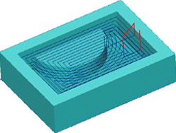

# 2.5Dポケット加工オペレーション

このオペレーションは、ポケットと島の加工、および予備的な材料除去に使用します。

加工対象モデルは、平面曲線と点の集合から作成した視覚的なモデルに基づいて形成されます。曲線または曲線のグループを順に追加してモデルを作成します。各曲線では、追加のストックによって、指定した厚さの隆起部または溝を定義できます。閉曲線は、段差またはくぼみとして追加できます。追加のストックは、曲線または曲線のグループごとに指定できます。

このオペレーションは、加工対象モデルと制限領域の外側にあるワーク素材をすべて除去します。ワーク、加工領域、および制限領域は、閉曲線の投影で定義します。

材料は、指定した層間ステップで層ごとに除去します。定義したストラテジーに応じて、各層の材料を、中心から外側または外側から内側へのらせん状の移動、あるいは平行パスで除去します。次の加工深さへの切込みには、切込み方法（軸方向、らせん、ジグザグ）のいずれか、または穴あけ点を使用します。

穴あけ点を使用する場合、システムは最初にオペレーションの穴リストから、次に加工工程の開口済み穴リストから、適切な直径と深さの穴を検索します。適切な穴が見つからない場合は、穴中心の座標を自動的に作成します。可能であれば、新しい穴の中心座標には整数を使用します。
