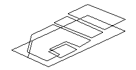
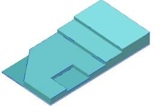

# 2.5D加工オペレーション

これらのオペレーションは、ポケット、段差、平坦面などを持つモデル向けのNCプログラム作成用に設計されています。このようなモデルでは、サーフェスモデルやソリッドモデルでツールパスを作成することが必ずしも効率的とは限りません。

視覚モデルは、異なる高さに配置され、間に壁を持つ閉じた輪郭で区切られた平坦面から形成されます。視覚モデルの作成には、開いた（閉じていない）輪郭や点も使用できます。

2.5Dオペレーションでは、平面プロファイルを使用してツールパスを作成することができます。輪郭のパラメータが変更されると表示されるツールパスは自動的に更新されます。このオペレーションでは、任意の数の輪郭や曲線投影から構成されるリストを処理します。各要素ごとに個別の加工方法が設定されます。

[ワーク](738.md)または[制限領域](10283.md)を指定した場合は、指定した輪郭のうち、ワーク内側にあり、かつ制限領域の外側にある部分のみが加工されます。ワークや制限領域が指定しない場合は、定義されたすべての輪郭が制限なく加工されます。

加工は、[工具](37.md)による一連の水平パスを連続して実行することで行われます。各パスは、配置されるZ深さだけが異なります。これらのパス数およびZ方向の深さは、加工深さと、`オペレーションパラメータ`ウィンドウの[パラメータ](https://confluence.encycam.com/display/SC1/.Assigning+Parameters+of+Mill+Operations+v20)ページで設定したステップ量によって決まります。

同じウィンドウで、[切削トレランス](https://confluence.encycam.com/display/SC1/.Tolerance+v20)や[ストック](76.md)も設定できます。

すべての2.5Dオペレーションは、モデルを定義するために2D曲線を使用します。モデルの作成は、[モデル](718.md) ウィンドウで行います。このウインドウでは、要素単位または要素グループ単位でパラメータを設定できます。

システムはグラフィックウィンドウに3Dモデルを動的に表示し、[モデル](718.md) ウィンドウで要素のパラメータが変更されると即座に表示を更新します。

|  |  |
|---|---|
| <strong>モデルを割り当てる曲線</strong> | <strong>作成されたモデル</strong> |
