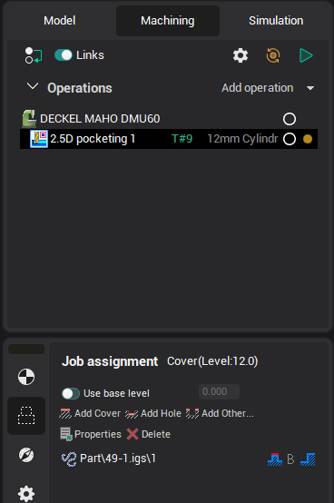
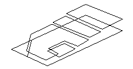
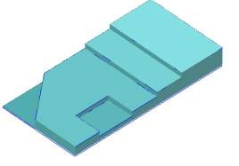

# 2.5D加工オペレーション

ポケット、段差、平坦面などを持つモデルのNCプログラムを作成するためのオペレーションです。このような形状では、サーフェスモデルやソリッドモデルを作成することが、必ずしも効率的とは限りません。

視覚モデルは、異なる高さに配置され、間に壁を持つ閉じた輪郭で区切られた平坦面から形成されます。視覚モデルの作成には、開いた（閉じていない）輪郭や点も使用できます。

2.5Dオペレーションでは、平面プロファイルを使用してモデルのジオメトリを視覚的に作成できます。プロファイルのパラメータを変更すると、表示モデルが自動的に更新されます。任意の数のプロファイルとカーブ投影からなるリストを処理し、各オブジェクトに個別の加工方法を設定します。

[ワーク](738.md)または[制限領域](10283.md)を指定した場合は、指定した輪郭のうち、ワーク内側にあり、かつ制限領域の外側にある部分のみが加工されます。ワークや制限領域を指定しない場合は、定義されたすべての輪郭が制限なく加工されます。

加工は、[工具](37.md)の一連の水平パスによって行います。各パスは、配置される深さだけが異なります。パス数とZ深さは、加工高さ、および**オペレーションパラメータ**ウィンドウのパラメータページで指定するステップによって決まります。

同じウィンドウで、[加工トレランス](100112.md)と残し代を設定できます。

すべての2.5Dオペレーションは、モデルを定義するために2D曲線を使用します。モデルの作成は、[モデル](718.md) ウィンドウで行います。このウインドウでは、要素単位または要素グループ単位でパラメータを設定できます。

システムはグラフィックウィンドウに3Dモデルを動的に表示し、[モデル](718.md) ウィンドウで要素のパラメータが変更されると即座に表示を更新します。

|  |  |
|---|---|
| <strong>モデルを割り当てる曲線</strong> | <strong>作成されたモデル</strong> |
