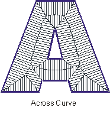
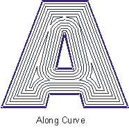
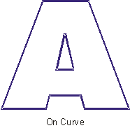
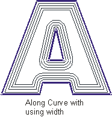
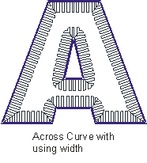

# Bearbeitungsverfahren bei Leitkurvenoperationen

Bei Leitkurvenoperationen wird der Verlauf der [Werkzeugbahn](37.md) in der Ebene durch den aus den Leitkurven gebildeten Bereich bestimmt. Die Z-Koordinate wird so berechnet, dass das [Werkzeug](37.md) die zu bearbeitende Oberfläche berührt.

Die Projektionen der Arbeitsbahnen auf die horizontale Ebene liegen stets innerhalb des Leitkurvenbereichs. Ihre Form wird mit einem der folgenden Verfahren festgelegt:

- **On curve (Auf der Kurve).** Erzeugt einen einzelnen Durchgang entlang der Bereichsgrenze. Die Werkzeugachse liegt dabei auf einer der begrenzenden Kurven.
- **Along curve (Entlang der Kurve).** Der erste Durchgang folgt der Bereichsgrenze. Weitere Bahnen verlaufen in der horizontalen Ebene äquidistant zur jeweils vorherigen Bahn. Der Abstand entspricht dem vorgegebenen Bahnabstand.
- **Across curve (Quer zur Kurve).** Die horizontale Projektion jedes Durchgangs ist eine Strecke, die an der Bereichsgrenze beginnt und dort senkrecht zu ihr verläuft. Ihre Länge wird so bestimmt, dass keine Bereiche doppelt bearbeitet werden. Für einen Punkt innerhalb des Bereichs ergibt sich die Bahnrichtung aus dem nächstgelegenen Grenzpunkt.

Die Anzahl äquidistanter Durchgänge bzw. die Länge quer verlaufender Bahnen wird grundsätzlich durch Form und Größe des Leitkurvenbereichs begrenzt. Die Bahnen werden erzeugt, bis das gesamte Modell innerhalb dieses Bereichs bearbeitet ist.

Bei aktiviertem Breitenmodus wird nur ein Streifen mit der angegebenen Breite entlang der Bereichsgrenzen bearbeitet, wahlweise längs oder quer. Die Bearbeitungsbreite begrenzt die Anzahl äquidistanter Bahnen zusätzlich.

Die folgenden Abbildungen zeigen Werkzeugbahnen für unterschiedliche Parameterkombinationen.

Das Bearbeitungsverfahren wird auf der Seite **Strategy** festgelegt.
