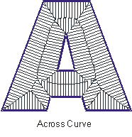
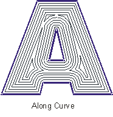
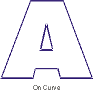
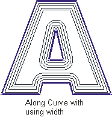
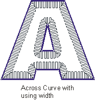

# ドライブオペレーションにおける加工方法

ドライブ加工では、平面上での[工具](37.md)ツールパスの表示は、定義されたドライブ曲線から形成されるドライブ領域によって決まります。Z座標は、 [工具](37.md)が加工対象の面に接触する条件に従って計算されます。

工具の[加工パス](https://confluence.encycam.com/display/SC1/.Working+Toolpath+v20)を水平面に投影した場合、その投影は常にドライブ領域内に収まります。これらの投影の形成を定義する方法は、以下のいずれかの方法で割り当てることができます。

- `カーブ上` – 領域の境界に沿って1回のみ加工パスを行います。すなわち、工具軸が常にドライブ領域を制限するいずれかの曲線上にあるように、加工対象部品を加工します。
- `カーブに沿って` – 最初の加工パスは領域の境界に沿って行い、以降のすべての加工パスは前のパスに対して水平面上で等間隔に配置されます。つまり、[加工パス](https://confluence.encycam.com/display/SC1/.Working+Toolpath+v20)を作成する際、工具軸は領域の境界から等距離にある曲線に沿って移動します。隣接する加工パス間のステップは、設定された加工ステップに等しくなります。
- `カーブに交差` – 各ストロークの水平投影は駆動領域の境界から開始され、該当点に対して垂直なセクションを表します。このセクションの長さは、同じ領域を二度加工しないように設定されます。また、境界上で最も近い点が、領域内のすべての点に対する加工方向を決定します。

カーブに沿った加工時の等間隔パスの本数、およびカーブ交差加工時のパスの長さは、一般にドライブ領域の形状と寸法によって制限されます。加工パスは、ドライブ領域内にあるモデル全体が加工されるまで組み立てられます。

ユーザーが「幅」モードを有効にした場合、選択された方法（カーブに沿ってまたはカーブに交差）を使用して、ドライブ領域の境界に沿った幅のみが加工されます。これは、等間隔パスの本数が、加工対象領域の幅によってさらに制限されることを意味します。

各パラメータの組み合わせに応じた軌跡の表示

<strong>カーブに交差</strong>

<strong>カーブに沿って</strong>

<strong>カーブ</strong>上

<strong>カーブに沿って（幅指定）</strong>

<strong>カーブに交差<strong>（幅指定）</strong>

ドライブ加工の加工方法は、 `加工設定` ページで設定できます。
