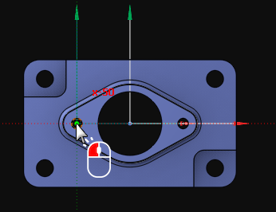
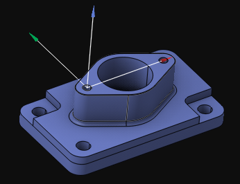

# Creazione del sistema di coordinate in base alla direzione della vista corrente

La creazione di un nuovo sistema di coordinate con questo metodo si attiva premendo la voce di menu  nel [pannello dei sistemi di coordinate](753.md).

Per creare il sistema di coordinate con questo metodo, occorre prima impostare la [vista](20.md) richiesta, oppure selezionare una delle [viste standard](728.md). Quindi si deve assegnare il punto di origine spostando il cursore sul punto desiderato nella [finestra grafica](169.md). Se si tratta di un punto valido, utilizzabile come origine del sistema di coordinate, esso viene evidenziato. La selezione si conferma facendo clic su di esso con il tasto sinistro del mouse:

Successivamente il sistema di coordinate appena creato diventa attivo:

In qualsiasi momento è possibile [modificare](403.md) il nome del sistema di coordinate, il suo colore e il suo punto di origine.
