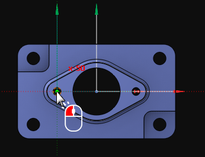
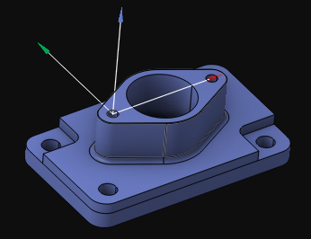

# 現在のビュー方向による座標系の作成

この方法で新しい座標系を作るには、  メニュー項目を押して、 [座標系パネル](753.md)を起動します。

この方法で座標系を作成する場合、最初に必要な [ビュー](20.md) を設定するか、 [標準ビュー](728.md) のいずれかを選択する必要があります。次に、 [グラフィックウィンドウ](169.md)の希望の点にカーソルを移動して、原点を割り当ててください。座標系の原点として使える有効な点であれば、ハイライトされます。左クリックで選択確定します。

その後、新しく作成された座標系がアクティブになります。

座標系の名前、色、原点はいつでも[変更](403.md)できます。
