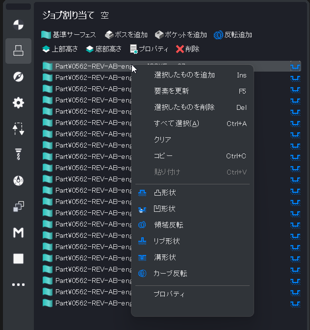
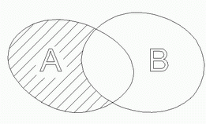
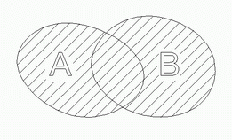
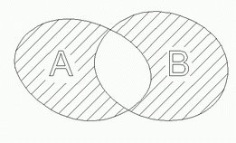
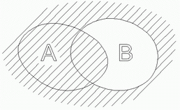
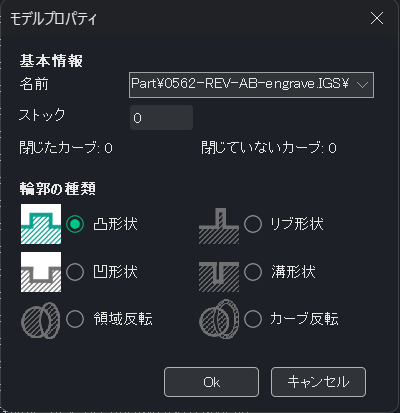

# 彫刻とポケット加工のジョブ割り当て

[彫刻加工](810.md)および[ポケット加工](256.md)では、モデルは2Dおよび3Dのカーブ加工と同様にカーブによって定義されます。ただし、カーブ加工とは異なり、システムは定義されたカーブから[加工用のモデル](294.md)を生成します。この加工モデルは平面領域を表し、加工対象となるカーブが存在する部分にのみ形成されます。ユーザーの役割は、利用可能なカーブから領域を作成することです。各カーブはモデルの「境界」となり、その選択されたタイプによって各境界の加工方法が決定されます。

- `段差` – 加工されない閉じた領域を示します。
- `キャビ` – 加工される閉領域を示します。
- `反転領域` – 加工ルールが反転する閉領域を示します。つまり、加工される領域が未加工になり、未加工の領域が加工されます。
- `リブ` –材料が除去されない曲線を示します。
- `溝` – 材料が除去される曲線を示します。
- `カーブ反転` –加工領域内に存在する場合、その曲線に沿って加工は行われず、逆も同様です。

`段差`、`キャビ`、`反転領域`は、閉じたカーブによってのみ定義することができます。開いたカーブを選択した場合、これらのタイプは使用できません。閉じた輪郭が複数の要素で構成されている場合は、それらを1つのカーブに結合する必要があります（「[カーブ結合](400.md)」を参照）。一方、`リブ`、`溝`、`カーブ反転`は、閉じているかどうかに関係なく、任意のカーブで定義することができます。これらの厚みを定義するには、追加ストックを使用します。

領域の生成は、選択されたカーブに対してブール演算を順次実行することで行われます。カーブがリストに表示される順序は重要です。リストの最初のオブジェクトは、境界で囲まれていない領域、すなわちいずれのカーブにも囲まれていないワーク領域の状態を決定します。最初のオブジェクトが`キャビ`または`溝`である場合、モデルはその無制限領域全体を占有していると見なされます。それ以外の場合、この領域で加工が可能となります。以降のオブジェクトは、それぞれの定義方法に従ってモデルの領域を変更します。オブジェクトが`段差`または`リブ`の場合は、モデルが占有する領域に追加されます。`キャビ`または`溝`の場合は、モデルが占有する領域から減算されます。オブジェクトが反転領域または反転カーブである場合は、その重なっている領域の状態を反転します。複数のカーブで構成されるグループがリストの要素となっている場合、そのグループ内の各カーブを逆加算することで領域が形成され、その結果得られた領域が定義されたタイプに従って全体結果に反映されます。なお、グループ内に含まれるサーフェス、フェース、ポイントは無視されます。

2本のカーブによる領域生成の結果は、下の画像に示されています。モデル（ソリッド）領域は陰影が付けられています。

| コンテンツ一覧 | 結果領域 |
|---|---|
| A - 段差 B - キャビ |  |
| A - 段差 B - 段差 |  |
| A - 段差 B - 反転領域 |  |
| B - キャビ A - 段差 |  |

最初と最後の例を見てください。いずれの場合も、カーブAは`段差`、カーブBは`キャビ`です。最初のケースでは、モデルのサイズはカーブAによって定義され、その領域からカーブBによって制限された範囲がさらに減算されます。最後のケースでは、カーブBが加工可能な領域を定義し、カーブAがそのBの領域内でさらに加工範囲を制限します。

リスト内の幾何オブジェクトの順序は、マウスのドラッグで変更することができます。生成されるモデルは、グラフィックウィンドウ上で動的に表示されます。

選択した項目のパラメータを設定するためのプロパティウィンドウがあります。このウィンドウは、項目をダブルクリックするか、ポップアップメニューから開くことができます。ウィンドウは以下に示されています。

<em>注意：<em>パラメータの動的表示は<em>`シェードモード`</em>でのみ可能です。有効にするには、メインパネル上の  ボタンを押してください。</em></em>
