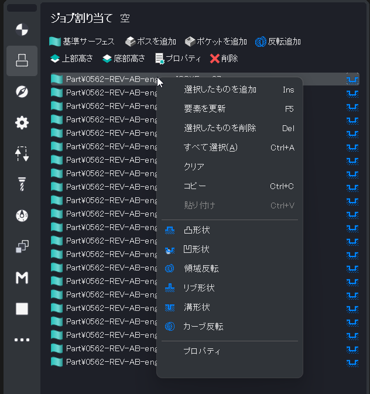
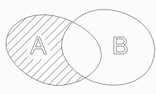
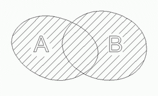
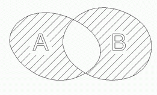
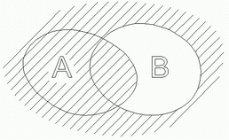
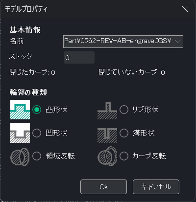

# Auftragszuweisung für Gravieren und Taschenfräsen

## Anwendungsbereich:

Beim [Gravieren](810.md) und [Taschenfräsen](256.md) wird das Modell wie bei der 2D- und 3D-Kurvenbearbeitung durch Kurven definiert. Das System bildet daraus jedoch ein [Bearbeitungsmodell](294.md) als ebenen Bereich. Aus den vorhandenen Kurven müssen die gewünschten Bereiche aufgebaut werden. Jede Kurve bildet eine Grenze; ihr Typ legt fest, wie diese Grenze bei der Bearbeitung berücksichtigt wird.

### Grenztypen

- **Ledge (Insel).** Geschlossener Bereich, der nicht bearbeitet wird.
- **Cavity (Tasche).** Geschlossener Bereich, der bearbeitet wird.
- **Inversion area (Umkehrbereich).** Geschlossener Bereich, in dem bearbeitete und ausgesparte Bereiche vertauscht werden.
- **Ridge (Steg).** Kurve, entlang der Material stehen bleibt.
- **Ditch (Nut).** Kurve, entlang der Material entfernt wird.
- **Inversion curve (Umkehrkurve).** Kehrt die Bearbeitungszuordnung entlang der Kurve um: Innerhalb eines Bearbeitungsbereichs wird Material ausgespart, außerhalb wird es entfernt.

**Ledge**, **Cavity** und **Inversion area** erfordern geschlossene Kurven und sind bei offenen Kurven nicht verfügbar. Besteht eine geschlossene Kontur aus mehreren Fragmenten, müssen diese zu einer Kurve [verbunden](400.md) werden; siehe [Kurven verbinden](400.md). **Ridge**, **Ditch** und **Inversion curve** können durch offene oder geschlossene Kurven definiert werden. Ihre Breite wird über das zusätzliche Aufmaß festgelegt.

### Bearbeitungsbereich aufbauen

Der Bereich entsteht durch aufeinanderfolgende boolesche Verknüpfungen der ausgewählten Kurven. Deshalb ist ihre Listenreihenfolge entscheidend. Das erste Element bestimmt den Zustand des unbegrenzten Außenbereichs, der von keiner Kurve eingeschlossen wird. Ist es **Cavity** oder **Ditch**, gilt dieser Außenbereich als Modellmaterial; andernfalls ist er bearbeitbar. Weitere Elemente verändern das Modell entsprechend ihrem Typ: **Ledge** und **Ridge** fügen Modellmaterial hinzu, **Cavity** und **Ditch** ziehen es ab. Umkehrbereiche und Umkehrkurven vertauschen den Zustand des überdeckten Bereichs. Enthält ein Listeneintrag eine Kurvengruppe, wird deren Bereich zunächst durch invertierende Verknüpfung der einzelnen Kurven gebildet. Dieser Bereich wird anschließend gemäß dem Gruppentyp angewendet. Flächen und Punkte innerhalb der Gruppe werden ignoriert.

Die folgenden Beispiele zeigen die Bereichsbildung aus zwei Kurven. Schraffiert sind die vom Modell belegten Bereiche.

| Listeninhalt | Ergebnis |
|---|---|
| A – Insel; B – Tasche |  |
| A – Insel; B – Insel |  |
| A – Insel; B – Umkehrbereich |  |
| B – Tasche; A – Insel |  |

Im ersten und letzten Beispiel ist A eine Insel und B eine Tasche. Im ersten Fall bestimmt A die Modellgröße; anschließend wird der durch B begrenzte Bereich abgezogen. Im letzten Fall definiert B zunächst den bearbeitbaren Bereich, den A anschließend weiter einschränkt.

Die Reihenfolge der Geometrieobjekte kann durch Ziehen mit der Maus geändert werden. Das entstehende Modell kann dabei dynamisch im Grafikfenster angezeigt werden.

### Elementeigenschaften

Öffnen Sie das Eigenschaftenfenster durch Doppelklick auf einen Eintrag oder über dessen Kontextmenü, um die Parameter des ausgewählten Elements zu bearbeiten.

*Hinweis: Die dynamische Darstellung der Parameter ist nur im schattierten Anzeigemodus verfügbar. Aktivieren Sie ihn mit  in der Hauptsymbolleiste.*
